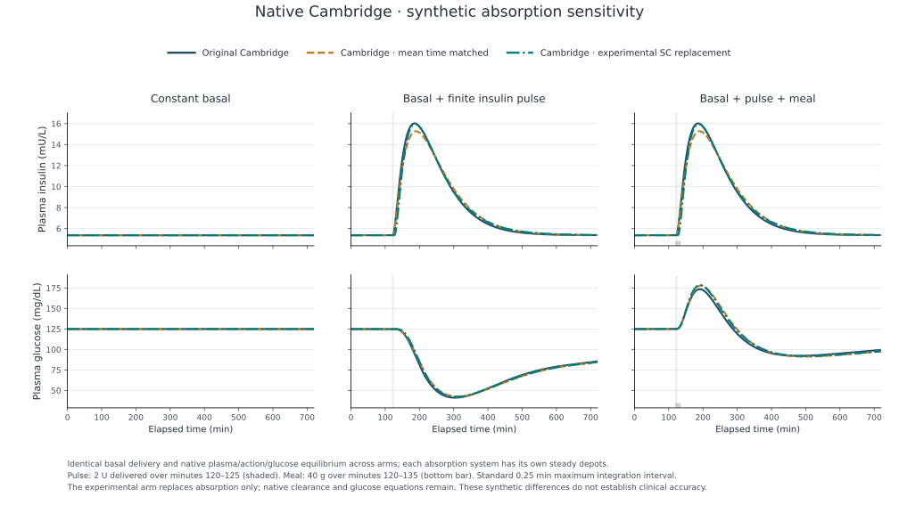
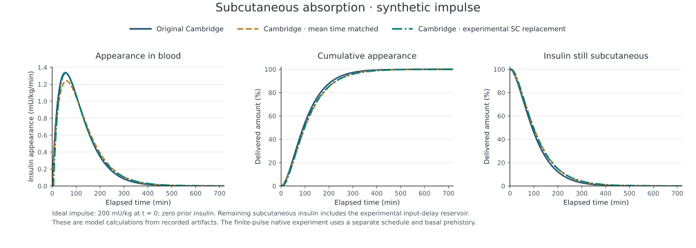

# LIT-002 — Run the experimental absorption comparison

**Current public scope:** this native research route is outside the initial
two-task public exercise. Its pinned environments retain advisories and are
excluded from automatic public installation. Read the
[current runtime and CI policy](publication-security.md) before using the
historical setup commands below.

LIT-002 turns the [LIT-001 source dossier](research/lit001-source-dossier.md) into a working component experiment. It compares three absorption assumptions inside the pinned native Cambridge patient under identical synthetic insulin delivery and meals. The [frozen protocol](research/lit002-protocol.md) defines the question, scenarios, inputs and numerical criteria; [decision 0009](decisions/0009-experimental-insulin-absorption.md) defines the integration boundary.

## What the code does

The baseline executes the original Cambridge absorption equations. A second variant retains those equations but matches the source-derived mean appearance time by setting `tmaxI` to approximately 59.273 minutes. The experimental variant replaces the two subcutaneous depot equations and their influx into plasma with the source-derived absorption equations and explicit delay.

The native systemic clearance, distribution volume, insulin action, glucose and meal equations remain in control. Each variant starts at its own absorption equilibrium with the same basal delivery and the same initial glucose and plasma insulin. This prevents a changed depot initialization from masquerading as a physiological effect. The experiment calls the actual upstream patient and native solver; no controller, sensor or pump participates in these prescribed-input runs.

Three scenarios cover basal equilibrium, a finite extra infusion, and the same infusion with a meal. Each runs at two integration resolutions, giving 18 planned native processes. An independent analytical calculation checks absorption amounts and appearance. A separate ideal-impulse illustration shows appearance, cumulative absorbed fraction and remaining insulin, including insulin still waiting in the delay.

## Install the existing locked environments

Use Python 3.12, uv 0.11.16 or newer, and Node 22.22.2. Run these commands from the repository root. The root environment remains tooling only; the existing LIT-001 runtime supplies plotting libraries separately.

```bash
uv sync --locked
npm --prefix experiments/m0/lt1 ci --ignore-scripts --no-audit --no-fund
node experiments/m0/lt1/setup.mjs
uv sync --locked --project experiments/literature/lit001/runtime
```

The setup fetches and checks the exact upstream revision. It refuses a modified upstream checkout. The experiment does not install a new physiological package into the root environment.

## Execute and inspect

```bash
uv run --locked python -m experiments.literature.lit002 run \
  --output results/lit002/study
```

Always choose a new output directory. The command copies the frozen protocol, snapshots experiment source and locks, creates every planned configuration, executes each native process and preserves traces, runtime details and any failure. It then seals the artifacts with SHA-256 hashes and writes a report. A failed process remains in the matrix; a failed numerical criterion makes the command exit unsuccessfully.

The principal outputs are:

| Artifact | Meaning |
| --- | --- |
| `manifest.json` | Complete 18-case inventory, statuses and artifact hashes |
| `protocol.json`, `source/` | Frozen specification and the exact local experiment code and locks |
| `cases/*/config.json` | Inputs passed to each native process |
| `cases/*/runtime.json` | Native source hashes, package versions, parameter values and process ownership |
| `cases/*/trace.jsonl` | Recorded states, glucose, plasma insulin, appearance, delivered inputs and delay inventory |
| `cases/*/verification.json` | Independent absorption agreement and accounting checks |
| `cases/*/native.log` | Native process diagnostics, including failures |
| `impulse.csv`, `impulse_metrics.json` | Separate ideal-impulse curves and model appearance quantiles |
| `report/report.json`, `report/report.md` | Checks, sampled outcomes, paired differences and numerical refinement |

Hashes detect changes relative to the saved manifest; they are not a digital signature or protection against someone replacing the manifest and evidence together. Native cumulative absorption inferred from depot balance is explicitly labeled as such. The independent analytic calculation and native agreement checks provide separate numerical evidence.

Generate figures using only the sealed artifacts:

```bash
uv run --locked --project experiments/literature/lit001/runtime python \
  experiments/literature/lit002/plot.py \
  --study results/lit002/study --output results/lit002/figures
```

The absorption figure separates entry into circulation, cumulative appearance and remaining insulin. The coupled figure shows plasma insulin and glucose across the three scenarios. Curve differences express sensitivity to model assumptions; lower glucose is not scored as a better model.

## Reconstruct without running a model

```bash
uv run --locked python -S -m experiments.literature.lit002 report \
  --study results/lit002/study --output results/lit002/reconstructed
cmp results/lit002/study/report/report.json \
  results/lit002/reconstructed/report.json
```

This route uses only the Python standard library and saved evidence. It checks artifact hashes and case membership, recomputes trajectory metrics and refinement comparisons, and reads the recorded independent verification evidence without rerunning its equations. Missing, altered or malformed required artifacts are refused. Recorded scientific failures remain visible in the reconstructed report.

## Verify the software

```bash
TS_NODE_PROJECT=experiments/m0/lt1/tsconfig.json node \
  --loader ./experiments/m0/lt1/node_modules/ts-node/esm.mjs \
  --test experiments/literature/lit002/native/test-native.mjs
uv run --locked python scripts/check.py
```

The native tests compare the baseline with direct upstream execution, check derivative ownership, initial equilibrium, event timing and delivered amounts. Standard-library tests check analytical limits, independent integration, conservation, verification and reconstruction failures. The separate LIT-002 CI job repeats the published-equation reference tests, native checks, full frozen matrix, reconstruction and rendering. The repository's prepared branch-protection configuration includes this job; this does not activate a remote policy.

## Recorded local result

On 20 September 2026 (Europe/Amsterdam), all 18 frozen cases completed and all 181 report checks passed. The six native tests and 132 repository tests passed, along with linting and the strict documentation build. Standard-library reconstruction produced a byte-identical JSON report. The [execution record](../experiments/literature/lit002/execution.json) retains the protocol, manifest and report hashes and the measured comparisons. Raw local artifacts remain under the ignored `results/lit002/study` directory; the added remote CI job has not been run in this task.

For the standard numerical resolution, the maximum sampled absolute glucose differences were:

| Scenario | Mean-matched versus original | Experimental SC versus original | Experimental SC versus mean-matched |
| --- | --- | --- | --- |
| Finite pulse | 3.954 mg/dL | 4.029 mg/dL | 1.631 mg/dL |
| Pulse and meal | 6.960 mg/dL | 5.084 mg/dL | 2.436 mg/dL |

Each entry is the largest absolute difference between two curves at the same time. These are not differences between independently timed glucose peaks. The signed values and times remain in the report. Matching mean transit time does not make the absorption shapes or coupled glucose curves identical; this is not a ranking of physiological accuracy.

The largest glucose change from halving the integration step was 0.000559 mg/dL for an individual curve and 0.000121 mg/dL for a between-arm contrast. Across the non-basal comparisons, the contrast refinement change was at most 0.00613% of the corresponding maximum glucose difference. The analogous insulin ratio was at most 0.0274%. Basal differences are effectively zero, so an effect ratio is not interpreted there. These are checks at two resolutions, not rigorous bounds on total numerical error.

The largest native-versus-analytic SC state discrepancy was 0.000267 mU/kg; the appearance discrepancy was 0.00000339 mU/kg/min. Both were below the prespecified limits. The independent oracle's relative mass residual was at most 2.13e-16. The native balance-derived absorbed quantity is not an independent mass measurement.



For the separate ideal impulse, times to 50% cumulative appearance were 92.31 minutes for original Cambridge, 99.48 minutes for mean-matched Cambridge and 97.32 minutes for the experimental SC equations. Times to 90% were 213.93, 230.56 and 230.83 minutes respectively. These describe the modeled absorption distribution, not clinical action duration.



## AZT1D and the next human-data test

Assessed before integration on 20 September 2026. Having AZT1D available does not turn this synthetic comparison into human absorption validation. The [original release](https://data.mendeley.com/datasets/gk9m674wcx/1) contains CGM and treatment records. The [authors' field descriptions and preprocessing account](https://arxiv.org/html/2506.14789v1), sections III-A and III-B, describe aligned event times, basal extraction from PDFs, repeated basal values and zero-filled absent carbohydrate/bolus records. They do not specify a plasma-insulin observation field. These are source-level descriptions, not a new audit of every released record.

Our assessment is that the existing CGM-only forecasting task cannot directly test the new absorption equations: it does not use their insulin appearance output or provide a physiological input/state mapping. LIT-002 emits native plasma glucose; a comparison with sensor glucose also requires an explicit observation model. Better CGM fit alone would not identify the absorption mechanism.

### Source-linked concentration-comparison boundary

The following is a specification for assessing feasibility, **not** a frozen human-data study or permission to use a dataset. The [Hovorka 2004 tables](https://www.stat.yale.edu/~jtc5/diabetes/NonlinearModelPredictiveControl_Hovorka_04.pdf), [Faggionato 2021 model](https://www.research.unipd.it/retrieve/e14fb26e-d89d-3de1-e053-1705fe0ac030/metabolites-11-00235.pdf), [pinned engine audit](research/lit001-engine-audit.md) and [LIT-002 protocol](research/lit002-protocol.md) support the software-side distinctions below. The cited earlier studies have been checked at the original abstract/article-record level; their full parameter derivations remain unverified.

| Boundary | Fixed in the current synthetic comparison | Required before a human concentration comparison |
| --- | --- | --- |
| Formulation and route | Hovorka's 2004 paper describes short-acting insulin Lispro; Faggionato analyzes lispro pharmacokinetics. The LT1 patient code exposes a generic delivered rate without a product identity. | Verify the actual formulation, concentration, route/site and delivered amount for every eligible administration. A code parameter labeled short-acting does not identify the delivered product. |
| Dose, body mass and clock | LT1 receives U/h and converts to whole-body mU/min. The experimental source uses body-mass-normalized amounts, with a 5.62-minute input delay; LIT-002 uses recorded body weight and explicit prehistory. | Confirm actual delivery rather than commands, mass, timestamps/time zone, infusion duration, prior basal and boluses, and the observation clock. Preserve the delay queue and pre-start exposure. |
| Absorption versus systemic kinetics | LIT-002 replaces only subcutaneous depots and their influx. Cambridge retains `VI=0.12 L/kg`, `ke=0.138/min` and its plasma/action equations. The source paper's volume, clearance and observation error are not imported. | Decide whether the question tests subcutaneous appearance under fixed systemic kinetics or the full published concentration model. Do not compare a hybrid prediction with the paper's fitted curve as if both used the same clearance and distribution assumptions. |
| Observable | The experimental arms emit modeled appearance and plasma insulin; the M3 forecast route observes CGM. | Obtain suitably timed measured insulin concentrations with assay type, units, quantification limits, endogenous-insulin context and baseline handling. CGM alone cannot directly score insulin appearance. |
| Comparator and evaluation | Native Cambridge, an analytical mean-transit match and the source-derived subcutaneous variant are known synthetic development arms. | Specify an unchanged baseline, a separately fitted parameter-only comparator if fitting is intended, and a structural candidate. Freeze fitting, exclusions, uncertainty, failure accounting and participant-disjoint assessment before reserved observations are scored. |

If product/delivery identity, a concentration observable or participant-level authorization cannot be established, the direct empirical absorption comparison stops at source/software feasibility. LIT-002's synthetic sensitivity result remains valid within its stated assumptions.

A later bounded human comparison should first:

1. Verify insulin amounts versus rates, actual delivery, time alignment, duplicate-event handling and missingness. Do not sum total bolus and its correction/food components as separate doses, or infer an absent meal from a filled zero.
2. Establish formulation, participant parameters, state initialization and the plasma-to-CGM mapping; disclose missing inputs and what can be identified.
3. Freeze original, parameter-only and structural comparators, development rules, numerical checks and failure accounting before assessment. The current mean-transit match is not a human-fitted calibration comparator.
4. Use appropriately reserved observations or a separate dataset. A period already used for the AZT1D forecast evaluation is known material; later reuse must be labeled exploratory. This integration does not open the reserve or rerun human evaluation.

This is a separate scientific evaluation requirement, not a blocker for merging the tested exploratory software.

## Interpretation and limits

This experiment can answer how much a specified absorption assumption changes a synthetic Cambridge trajectory, and whether that change survives tighter numerical resolution. The mean-matched variant helps separate overall transit timing from differences in curve shape.

It cannot establish which variant predicts people better, validate a commercial insulin formulation, infer personal absorption from CGM or recommend an insulin dose. The source population model, observed clinical curves, covariates, observation noise and random effects are outside this implementation. The original M0/M1/M2/M3 execution paths remain separate. Human evaluation and the roadmap's B1 evidence requirements remain open.
