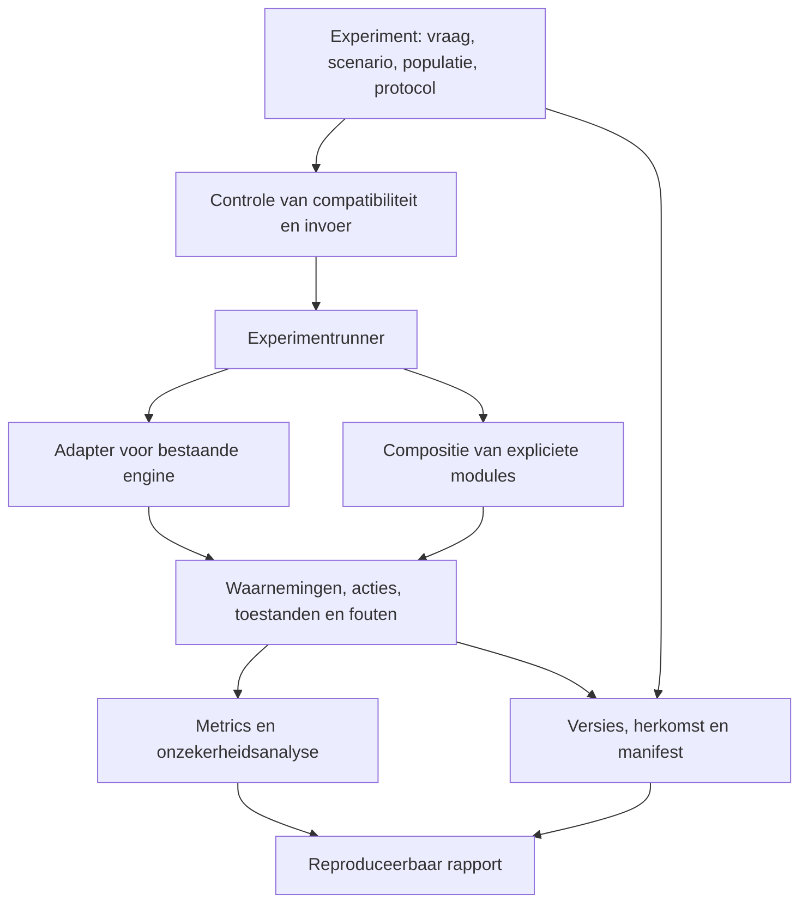

# OpenT1D: onderzoeksbasis en projectopzet

## 1. Advies

**Ontwikkel OpenT1D als een open, modulair virtueel laboratorium voor T1D-onderzoek: gedeelde infrastructuur én bruikbare bouwblokken, met hergebruik van modellen van anderen. Begin met een volledig reproduceerbaar glucose-/insuline-experiment en bewijs vroeg dat verschillende modelfamilies kunnen worden aangesloten. Bouw van daaruit naar personalisatie, bètacelfunctie en afgebakende therapievragen.**

De eerste wetenschappelijke opbrengst moet een controleerbare uitspraak zijn: onder welke omstandigheden blijft een conclusie over een behandeling of regelalgoritme overeind als het fysiologische model, de virtuele populatie of de meetonzekerheid verandert? Dat past bij de langetermijnambitie en levert bruikbare infrastructuur op voordat een multiscale digital twin beschikbaar is.

Er bestaan al open simulatoren, modulaire raamwerken, databewerkingspijplijnen en benchmarks. OpenT1D moet daarop aansluiten. De onderscheidende ambitie is een onderhouden verzameling experimentele protocollen, adapters, modelbeschrijvingen en bewijsmateriaal waarmee anderen daadwerkelijk samen kunnen werken. Dat onderscheid is een strategische hypothese die met externe gebruikers moet worden getoetst; het onderzoek onderbouwt geen claim dat niemand dit eerder heeft geprobeerd.

De prioriteiten zijn:

1. **Reproduceerbaarheid:** hetzelfde experiment opnieuw kunnen uitvoeren, inclusief versies, instellingen, invoer, toeval en analyse.
2. **Vergelijkbaarheid:** expliciete afspraken over waarnemingen, interventies, populaties, meeteenheden en uitkomstmaten.
3. **Wetenschappelijke geldigheid:** per onderzoeksvraag aangeven wat is getoetst en waar extrapolatie begint.
4. **Hergebruik:** bestaande modellen en analysetools aansluiten met zo weinig mogelijk wijzigingen.
5. **Uitbreidbaarheid:** nieuwe biologische processen toelaten zodra een meetbare vraag, bruikbaar model en passende validatiedata beschikbaar zijn.

De eerste bouwvolgorde is **upstreamreproductie → volledig experiment → betekenisvolle uitwisselbaarheid tussen modelfamilies**. Onderzoek naar geschikte echte data begint direct. Daarna kunnen externe toetsing, personalisatie, apparaten en biologische uitbreidingen volgens hun eigen afhankelijkheden verdergaan. Resterende endogene secretie is de eerste voorgestelde biologische uitbreiding; die hoeft niet te wachten tot alle personalisatie of apparaatfuncties af zijn. AI kan vanaf het begin de ontwikkeling versnellen en later experimentele zoekmethoden ondersteunen. De volgorde hangt af van bewijs en interfaces, niet van een veronderstelde ontwikkelsnelheid of teamomvang.

## 2. Reikwijdte en bewijskracht

Deze analyse betreft wetenschappelijke positionering, herbruikbare software, data, architectuur en een uitvoerbare roadmap. De peildatum voor de bronnen is 12 september 2026. Het rapport gebruikt oorspronkelijke onderzoekspublicaties, officiële projectdocumentatie, repositories, standaarden en voorwaarden van datahouders. Nieuwe preprints worden als zodanig onderscheiden van gepubliceerde studies.

De aanbevelingen zijn ontwerpkeuzes op basis van die bronnen. Er zijn voor dit rapport geen simulatoren geïnstalleerd, geen numerieke resultaten gereproduceerd en geen patiëntdatasets gedownload. Beschikbaarheid in een repository betekent daarom nog geen bewezen installeerbaarheid, onderhoudskwaliteit, modelgetrouwheid of recht op herdistributie van alle meegeleverde bestanden. Die controles zijn expliciete eerste mijlpalen.

Voor OpenT1D is het nuttig drie soorten uitspraken uit elkaar te houden: wat een publicatie heeft aangetoond, wat een softwareproject zegt te ondersteunen en wat OpenT1D zelf na reproductie kan bevestigen. Een toelichting in een README is voldoende om een kandidaat te selecteren, maar onvoldoende om een wetenschappelijke prestatieclaim over te nemen.

De actuele uitvoeringsroadmap staat in [ROADMAP.md](../../ROADMAP.md); de publieke [visie](../vision.md) en [architectuurrichting](../architecture.md) werken de modulaire laboratoriumopzet uit. De wetenschappelijke mijlpalen beschrijven nog te bouwen en te toetsen functionaliteit. De repositorybasis heeft inmiddels documentatie en controletooling; dat verandert de hier beschreven bewijskracht van de kandidaatmodellen niet.

## 3. Het bestaande landschap

### 3.1 Simulatoren en raamwerken

| Project | Aantoonbare basis | Mogelijke rol in OpenT1D | Aandachtspunt |
|---|---|---|---|
| UVA/Padova T1D Simulator | Gepubliceerde glucose-/insulinemodellen en toetsing aan klinische gegevens.[^1] | Wetenschappelijke referentie; eventueel optionele externe engine | Versie, populatie, toegangsvoorwaarden en toepassingsbereik afzonderlijk vaststellen |
| simglucose | Python-implementatie op basis van UVA/Padova 2008; 30 virtuele profielen; MIT-code.[^2] | Eerste adapter en eenvoudige referentie-experimenten | Geen onafhankelijke validatie of FDA-status veronderstellen voor deze implementatie |
| GluCoEnv | PyTorch-omgeving voor parallelle glucosecontrole en RL; bouwt voort op simglucose/UVA 2008; MIT volgens repository.[^3] | Latere versnelling en RL-experimenten | Een andere engine binnen grotendeels dezelfde modelfamilie |
| LoopInsighT1 / LT1 | Modulaire TypeScript-simulator met patiënt, controller, sensor en actuator; MIT.[^4][^5] | Eerste kandidaat voor een tweede modelfamilie en hergebruik van modules | Compatibiliteit en numerieke referenties van de geselecteerde versie toetsen |
| APS TestBed | Onderzoekstestbed dat twee simulatoren, controllers en foutinjectie combineert.[^6] | Bestaande protocollen en architectuur bestuderen; uitbreiding afwegen | Onderdelen en licenties controleren vóór overname |
| McGill Artificial Pancreas Simulator | MATLAB-raamwerk met onder meer een Hovorka-patiëntmodel; MIT.[^7] | Onafhankelijke referentie voor modelgedrag | MATLAB en eventuele aanvullende runtimevoorwaarden |
| py-mgipsim | Python-simulator voor maaltijden, activiteit en insulinetoediening; GPL-3.0.[^8] | Kandidaat voor activiteit en aanvullende fysiologie | Herkomst per modelvariant en distributie onder GPL vastleggen |
| ReplayBG / py_replay_bg | Identificatie van persoonlijke modellen en simulatie van gewijzigde insuline-/koolhydraatinvoer.[^9][^10] | Personalisatie en retrospectieve experimenten | Python-code heeft GPL-3.0; validatie van het oorspronkelijke artikel niet automatisch gelijkstellen aan elke port |

**Modeldiversiteit moet op herkomst worden beoordeeld.** simglucose en GluCoEnv vormen bijvoorbeeld een zinvolle vergelijking van implementaties en snelheid. Omdat beide naar dezelfde basis verwijzen, leveren zij samen geen sterke toets op onzekerheid over de fysiologische modelstructuur.[^2][^3] Een Hovorka/Cambridge-variant naast een UVA/Dalla Man-variant is daarvoor een geschiktere kandidaat. Gedeelde aannames blijven ook dan bestaan.

LT1 is een bijzonder relevante vergelijking: de publicatie beschrijft zowel uitvoering zonder gebruikersinterface als modulaire simulatie.[^5] De Cambridge-implementatie is bovendien concreet terug te vinden in de repository.[^39] Dit maakt een dunne adapter kansrijker dan een nieuwe implementatie van alle differentiaalvergelijkingen. Dat de combinatie met OpenT1D praktisch werkt, moet een uitvoerbare proef nog aantonen.

### 3.2 Data, analyse en benchmarks

Voor glucosevoorspelling bestaan onder meer GlucoBench, GluPredKit en het recente MetaboNet-Bench.[^11][^12][^14] Voor normalisatie van klinische gegevens bestaat BabelBetes; voor glucoseanalyse is er AGATA, inclusief een Python-port.[^15][^16] Een generieke voorspellingstool of nieuwe verzameling datasetparsers zou daardoor veel bestaand werk overlappen.

Deze projecten zijn ook niet allemaal hetzelfde. Voorspellen welke glucosewaarde volgt bij geobserveerde omstandigheden is een andere evaluatietaak dan onderzoeken wat een gewijzigde interventie zou veroorzaken. OpenT1D kan bestaande voorspellingstaken aansluiten, terwijl de eigen kern zich richt op expliciete interventies, modelkoppeling en de robuustheid van experimentele conclusies.

### 3.3 Welke ontwikkelroute heeft de voorkeur?

| Route | Sterkte | Zwakte | Advies |
|---|---|---|---|
| Nieuwe universele simulator | Volledige controle over implementatie | Grote verificatielast en duplicatie van biologie | Afwijzen als startpunt |
| Eén bestaand raamwerk uitbreiden | Veel onmiddellijk hergebruik | Kan begrensd worden door één runtime of modelstructuur | Serieus onderzoeken in de eerste mijlpaal |
| Gedeelde laboratoriuminfrastructuur met adapters en gerichte eigen modules | Behoud van bronmodellen; ondersteunt vergelijking en uitbreiding | Adaptersemantiek en versiebeheer vragen discipline | Voorkeursroute, beginnen bij een volledig experiment |
| Direct een multiscale QSP-platform bouwen | Sluit inhoudelijk aan op de eindvisie | Moeilijk te kalibreren en te valideren zonder specifieke data | Later, per onderzoeksvraag |

De eerste ontwikkelbeslissing moet daarom concreet zijn: voer hetzelfde kleine protocol rechtstreeks in simglucose en LT1 uit en leg vast welke functionaliteit ontbreekt. Onderzoek tegelijk of APS TestBed die leemte al grotendeels afdekt. De eerste integratie kan vooral configuratie, documentatie en adapters toevoegen; later kunnen ontbrekende modules en koppelingen volgen. Dat behoudt de ambitie van een gezamenlijk virtueel laboratorium en voorkomt onnodige duplicatie per onderdeel. Een eigen solver is geen voorwaarde voor waarde.

## 4. Eerste doelgroep en eerste onderzoeksvraag

De aanbevolen eerste gebruiker is een onderzoeker of ontwikkelaar die een glucosecontroller, fysiologisch model of apparaatmodel wil vergelijken met bestaande referenties. Deze gebruiker kan direct profiteren van een reproduceerbaar protocol en hoeft geen volledige digital twin te adopteren.

De eerste onderzoeksvraag luidt:

> Hoe verandert de relatieve prestatie van referentiecontrollers bij verschillen in maaltijdinformatie, sensormetingen en fysiologische modelkeuze?

Een tweede, infrastructuurgerichte vraag hoort daarbij: kan iemand buiten het project één controller of model aansluiten en dezelfde resultaten zelfstandig reconstrueren? Die gebruikstest is nodig om te bepalen of OpenT1D werkelijk gedeelde infrastructuur oplevert.

Een eerste demonstratie mag één simulator gebruiken. Een overtuigende eerste onderzoeksrelease vereist daarnaast vergelijking met ten minste één andere fysiologische modelfamilie, of een zeer expliciete beperking van de claim tot de gekozen engine. Het is niet nodig dat alle controllers in alle modellen dezelfde rangorde krijgen. Een verklaarde omkering kan juist het belangrijkste resultaat zijn.

De eerste scope omvat volwassen virtuele profielen, subcutane insulinetoediening, maaltijden en synthetische CGM-metingen. Kinderen, zwangerschap, inspanning, meerdere hormonen en nieuwe insulineformuleringen volgen afzonderlijk zodra de modelbasis en validatie daarvoor beschikbaar zijn. Dit is een keuze om onderzoeksclaims precies te kunnen formuleren, geen oordeel over het belang van die onderwerpen.

## 5. Het eerste complete experiment

### 5.1 Een kleine maar volledige keten

Het eerste product bestaat uit een Python-bibliotheek, een opdrachtregelinterface en een automatisch rapport. Een onderzoeker selecteert een versie van een protocol, een model, virtuele profielen en een controller. OpenT1D valideert de combinatie, voert alle gevallen uit en bewaart de resultaten met de informatie die nodig is om ze opnieuw te berekenen.

Voorgestelde gebruikershandeling:

```text
opent1d run experiments/reference-meals.yaml
opent1d report runs/<run-id>
opent1d reproduce runs/<run-id>/manifest.json
```

Dit is een ontwerpschets, geen bestaande CLI. De praktische belofte is dat het rapport volledig uit opgeslagen gegevens volgt, zonder handmatige notebookstappen of nabewerking van grafieken.

### 5.2 Referenties en scenario's

Gebruik eerst een gedocumenteerde basaal-bolusstrategie en een eenvoudige PID-controller. Ze dienen als functionele referenties; voeg vóór een inhoudelijke claim over geavanceerde controllers een passende sterkere referentie toe, bijvoorbeeld een gepubliceerde MPC-implementatie. Onderzoek hergebruik voordat een nieuwe controller wordt geschreven. Alle controllers krijgen per benchmarktrack dezelfde soorten informatie.

Begin met een gepubliceerd of upstream referentiescenario waarvan de invoer en uitkomsten voldoende gespecificeerd zijn. Voeg daarna afzonderlijke varianten toe: correcte maaltijdaankondiging, ontbrekende aankondiging, onnauwkeurige koolhydraatinformatie, sensorruis en sensoruitval. Een ontbrekende aankondiging verandert wat de controller weet; een andere werkelijke maaltijd verandert de patiëntinvoer. Die twee gebeurtenissen mogen niet ongemerkt samenvallen.

Een meerdaags scenario is pas een volgende stap nadat initialisatie, opwarmperiode en tijdsvariatie zijn onderzocht. De oorspronkelijke UVA/Padova-versies hadden een specifieker gevalideerd toepassingsbereik dan alle mogelijke meerdaagse simulaties; de publicatie over S2013 bespreekt die begrenzing expliciet.[^40] Een engine die een week kan doorrekenen heeft daarmee nog geen onderbouwde weekvoorspelling.

Dit is een versiegebonden beperking: de latere S2017-publicatie beschrijft juist uitbreiding naar dagsimulaties, met onder meer variërende insulinegevoeligheid en aangepaste insulinetoedieningsmodellen.[^41] OpenT1D moet zulke verschillen tussen modelgeneraties zichtbaar maken.

Voer storingen eerst afzonderlijk uit, daarna in combinaties. Kies ernst, duur en frequentie óf op basis van gegevens óf als expliciete stressproef. Een kunstmatig zware storing vertelt iets over robuustheid onder die aanname; zij levert geen schatting van de incidentie in de praktijk.

### 5.3 Uitkomsten en eerlijke vergelijking

De rapportage moet TIR van 70–180 mg/dL, TBR onder 70 en onder 54 mg/dL, en TAR boven 180 en boven 250 mg/dL bevatten. Deze indeling sluit aan op de internationale consensus voor CGM-rapportage.[^23] Bewaar de drempels en grensconventies in de benchmarkversie en ondersteun weergave in mmol/L. Klinische streefpercentages zijn niet automatisch de slaagcriteria voor een simulator.

Voeg glucosevariabiliteit, insulinetoediening, duur van lage-glucose-episoden, runtime, solverfouten, ontbrekende observaties en afgebroken runs toe. Bereken uitkomsten afzonderlijk op gesimuleerde bloedglucose en op synthetische CGM-metingen als beide beschikbaar zijn. Een goede sensorwaarde kan immers een modelmatige afwijking in de onderliggende toestand verbergen.

Presenteer uitkomsten per virtuele patiënt en per scenario, met gepaarde verschillen tussen controllers. Herhaalde toevalsseeds zijn geen nieuwe patiënten. Gebruik onzekerheidsintervallen met een passende groepering van herhaalde metingen en vermeld of zij alleen simulatievariatie of ook variatie tussen profielen beschrijven. Miljoenen gesimuleerde minuten uit enkele profielen onderbouwen geen brede klinische representativiteit.

Een ranglijst met één totaalscore is onvoldoende. Laat ten minste de verhouding tussen glucosecontrole, lage-glucoseblootstelling en storingsgedrag zien. Vooraf gekozen primaire uitkomsten en analyses voorkomen dat achteraf alleen de gunstigste resultaten worden gerapporteerd. Vermeld ook onbesliste vergelijkingen en verschillen die kleiner zijn dan de relevante onzekerheid.

Beperk eindpunten tot wat daadwerkelijk wordt gemodelleerd. Rapporteer geen gesimuleerde ketoacidose, klinisch ernstige hypoglykemie of duurzame HbA1c-verbetering wanneer het model alleen korte glucose-/insulinereeksen bevat. Een glucosegrensoverschrijding blijft in dat geval een glucose-uitkomst.

Gebruik een opzettelijk slechte of triviale referentie om te controleren of de benchmark duidelijke tekortkomingen detecteert. Zorg daarnaast dat gesimuleerde uitval en noodinterventies zichtbaar blijven. Een vroeg gestopte run mag niet een gunstige score krijgen doordat de rest van de simulatie uit de noemer verdwijnt.

## 6. Architectuur

### 6.1 Een kleine kern met twee niveaus van modulariteit

Er zijn twee verschillende integratieproblemen. Op korte termijn moet OpenT1D complete bestaande simulatoren kunnen aansturen. Later moet het biologische subsystemen kunnen koppelen. Probeer niet meteen elke bestaande simulator op te splitsen in dezelfde interne componenten: daarbij kunnen aannames en numerieke eigenschappen veranderen.

Begin daarom met een engine-adapter rond een bestaande simulator. Leg daarnaast een beperkt componentcontract vast voor nieuwe modules die daar werkelijk aan kunnen voldoen. Een engine kan intern een volledige glucose-/insulinecyclus beheren, terwijl OpenT1D het scenario, de controllerinformatie en de uitvoer standaardiseert.



Dit schema is een voorstel voor verantwoordelijkheden. Het impliceert geen microservices, cloudplatform of onafhankelijke solver voor ieder blok.

### 6.2 Contracten die vanaf het begin nodig zijn

| Contract | Minimaal vast te leggen |
|---|---|
| Modelbeschrijving | Identiteit, versie, bron, modelfamilie, soort, ziektefase, aannames en toepassingsbereik |
| Poort of variabele | Grootheid, eenheid, compartiment, concentratie of hoeveelheid, meetbaar of latent |
| Tijd | Relatieve tijd, invoerinterval, observatie-interval, eventvolgorde en interne integratiestap |
| Patiëntprofiel | Parameters, correlaties, initialisatie en herkomst; onderscheid synthetisch en persoonsgebonden |
| Scenario | Werkelijke gebeurtenissen en afzonderlijke informatie die aan de controller bekend is |
| Controller | Toegestane observaties, acties, limieten, intern geheugen en resetgedrag |
| Apparaat | Meet- of afgiftegedrag, vertraging, onzekerheid, storingen en kalibratiebasis |
| Resultaat | Tijdreeksen, eenheden, kwaliteitsmarkeringen, failures, manifest en metriekversie |
| Validatie | Onderzoeksvraag, toetsgegevens, vooraf bepaalde criteria, resultaten en beperkingen |

Een voorbeeld van een noodzakelijke semantische controle: een bolus in eenheden en een afgiftesnelheid in eenheden per uur zijn verschillende invoeren. Een ander voorbeeld is plasma-insuline versus subcutaan toegediende insuline. Alleen dezelfde variabelenaam of een converteerbare eenheid maakt deze grootheden nog niet uitwisselbaar.

Leg vast of een hoeveelheid geldt op een tijdstip of geïntegreerd is over een interval. Definieer of de controller op tijdstip t eerst de nieuwe meting ontvangt en daarna een actie kiest, en wanneer die actie de fysiologie beïnvloedt. Deze afspraken voorkomen dat verschillen in eventvolgorde voor verschillen in behandelingen worden aangezien.

Ondersteun capabilities: een adapter meldt bijvoorbeeld of hij toestanden kan herstellen, een controller kan laten ingrijpen, endogene secretie kan ontvangen of parameters tijdens een run kan wijzigen. Weiger een niet-ondersteund experiment vooraf. Stilzwijgend een invoer negeren maakt het resultaat onbruikbaar.

### 6.3 Numerieke verantwoordelijkheden

Laat aanvankelijk de oorspronkelijke engine zijn eigen vergelijkingen en solver uitvoeren. Controleer dat de adapter dezelfde referentietijdreeksen oplevert als rechtstreekse uitvoering. Bewaar solverkeuze, fouttoleranties en relevante runtime-informatie, naast de random seeds.

Voor toekomstige koppelingen moeten communicatie-intervallen, vertragingen, terugkoppelingen en gedeelde toestanden expliciet worden. Strak gekoppelde processen kunnen een gezamenlijke solver of iteratieve oplossing nodig hebben. Een trage immuunmodule eenmaal per dag bijwerken is een hypothese over tijdschalen, geen vanzelfsprekend correcte integratiemethode. Toets zo'n keuze met stapverkleining en een fijnere referentie.

Er mag één eigenaar zijn voor elk gemodelleerd proces. Als een nieuwe module insulineabsorptie overneemt, moet duidelijk zijn dat dezelfde absorptie niet ook in de bestaande engine wordt toegepast. Voor massabalansen geldt hetzelfde: de interne opslag van een hoeveelheid en de overdracht tussen compartimenten moeten gezamenlijk kloppen.

### 6.4 Technische keuzes

Advies: gebruik Python voor experimentdefinities, adapters, analyse en de opdrachtregelinterface. Houd modelengines in hun oorspronkelijke taal wanneer dat verificatie eenvoudiger maakt. Bewaar configuratie in versieerbare tekstbestanden, tijdreeksen in een tabel- of arrayformaat met expliciete metadata, en resultaten in een lokaal inspecteerbare directorystructuur.

Een passende eerste stack is Python met NumPy/SciPy, schema-validatie, Parquet voor tabulaire uitvoer en een eenvoudige rapportgenerator. Dit zijn architectuurvoorkeuren, geen al geteste dependencyset. De concrete ondersteunde versies volgen uit de adapterproeven. Houd zware ML-libraries, GPU-ondersteuning en externe runtimes optioneel.

Gebruik één repository zolang onderdelen samen veranderen. Scheid code logisch in contracts, adapters, experiments, validation, metrics en reporting; maak pas aparte packages wanneer onafhankelijk versiebeheer werkelijk nodig is. Begin met lokale parallelle uitvoering. Meet geheugen, rekentijd en I/O voordat een gedistribueerde runner wordt toegevoegd.

Een webinterface kan later configuratie en rapporten ontsluiten. De eerste wetenschappelijke functionaliteit moet ook volledig via bestanden en code beschikbaar zijn. Dat maakt CI, batchruns en gebruik door andere onderzoekers eenvoudiger.

## 7. Standaarden: aansluiten waar ze iets oplossen

| Standaard of infrastructuur | Geschikt voor | Aanbevolen moment |
|---|---|---|
| SBML | Uitwisseling van ondersteunde biologische modelstructuren.[^25] | Bij een concrete biochemische of QSP-module |
| CellML | Beschrijving van wiskundige fysiologische modellen.[^26] | Bij hergebruik van een passend bestaand model |
| SED-ML | Beschrijving van simulatie-experimenten, modellen, analyses en uitvoer.[^27] | Eerst een expliciete mapping van de ondersteunde experimenten |
| COMBINE/OMEX | Bundelen van model- en experimentbestanden.[^28] | Export van één aantoonbaar reproduceerbaar voorbeeld |
| FMI | Modeluitwisseling en co-simulatie tussen runtimes.[^29] | Als meerdere concrete adapters dezelfde behoefte hebben |
| BioSimulators/BioSimulations | Bestaande conventies, validatietools en uitvoering/publicatie van modelstudies.[^30] | Hergebruiken waar de gekozen modelvorm wordt ondersteund |
| PEtab | Reproduceerbare specificatie van parameterestimatieproblemen.[^31] | Bij kalibratie van daarvoor geschikte mechanistische modellen |

Geen van deze standaarden bewijst dat twee modellen biologisch bij elkaar passen. FMI specificeert bijvoorbeeld interfaces; de co-simulatiecoördinatie en wetenschappelijke koppeling blijven verantwoordelijkheden van de integrator.[^29] Ook ondersteunt niet iedere implementatie elk onderdeel van een standaard.

Definieer daarom een klein OpenT1D-profiel met versie, ondersteunde mogelijkheden en mapping naar bestaande begrippen. Exporteer alleen wat betekenisgetrouw kan worden weergegeven. Een gesloten regelkring met maatwerkcode mag niet als volledig SED-ML-reproduceerbaar worden gepresenteerd wanneer de gekozen toolchain die semantiek niet kan uitvoeren.

De juiste volgorde is een werkend experiment, een expliciete beschrijving van zijn betekenis en daarna toetsing van uitwisseling. Dat geeft een concrete basis voor standaardisatie zonder vooraf een universele beschrijvingstaal te ontwerpen.

## 8. Validatie als kernfunctionaliteit

### 8.1 Vier afzonderlijke vragen

De FDA beschrijft voor mechanistische modellen in medische-hulpmiddelendossiers een risicogestuurde beoordeling van geloofwaardigheid.[^22] OpenT1D kan de gedachte daarvan gebruiken: bepaal eerst de vraag en het beoogde gebruik, en verzamel vervolgens passend bewijs. Dit is een ontwerpbasis, geen claim dat het project daarmee aan alle indieningsvereisten voldoet.

| Vraag | Voorbeeld van bewijs | Wat dit nog niet bewijst |
|---|---|---|
| Voert de code het bedoelde model uit? | Referentievergelijking, eenhedencontrole, solverconvergentie | Dat het model de werkelijkheid voldoende beschrijft |
| Kan iemand het experiment reproduceren? | Schone installatie, vastgelegde inputs en manifest | Dat de aannames juist zijn |
| Beschrijft het model de bedoelde gegevens? | Toetsing op niet-gebruikte data, onzekerheidsdekking | Dat het effect van een andere behandeling klopt |
| Is de interventieconclusie geloofwaardig? | Passende experimentele of klinische interventiedata | Geldigheid voor andere populaties of therapieën |

De historische acceptatie van een UVA/Padova-simulator voor een bepaald preklinisch gebruik is geen overdraagbaar keurmerk voor afgeleide Python-code, nieuwe populaties of extra biologische modules.[^1][^40] Gebruik in documentatie daarom concrete bewoordingen over herkomst en eigen verificatie. Vermijd de aanduiding “FDA-goedgekeurde OpenT1D-simulator”.

### 8.2 Een bewijspakket per model en toepassing

Ieder model krijgt een beschrijving met de ondersteunde onderzoeksvragen, bronvergelijkingen, parameterherkomst, beperkingen en controles. Iedere samengestelde toepassing krijgt aanvullend een eigen dossier. Een versie van het model kan geschikt zijn voor een maaltijdrespons en tegelijk onvoldoende onderbouwd zijn voor inspanning of langdurige ziekteprogressie.

Een praktisch bewijspakket bevat: het protocol, de precieze model- en dataversies, de toetsgevallen, vooraf vastgelegde criteria, alle uitkomsten, de foutanalyse en een conclusie over de betreffende toepassing. Registreer bij elke claim of zij uit een bron komt, lokaal is gereproduceerd of onafhankelijk is gecontroleerd.

Gebruik geen universeel certificaat “gevalideerd”. Werk met expliciete aanduidingen als “upstreamreferentie gereproduceerd”, “getoetst op extern cohort voor deze uitkomst” of “exploratief buiten kalibratiebereik”. Zo kan OpenT1D nieuwe modules toelaten zonder hun wetenschappelijke volwassenheid te overschatten.

### 8.3 Identificeerbaarheid en onzekerheid

Een goede fit kan ontstaan doordat verschillende parametercombinaties hetzelfde meetpatroon produceren. Het protocol van Villaverde en collega's behandelt daarom identificeerbaarheid, parameterestimatie en onzekerheidsanalyse als samenhangende onderdelen van modelkalibratie.[^24]

Voor OpenT1D betekent dit: begin met weinig te schatten parameters, documenteer priors of grenzen en onderzoek of de beschikbare data juist die parameters kunnen onderscheiden. Controleer vervolgens de onzekerheid van de voorspelling die voor de onderzoeksvraag relevant is. Een parameter hoeft niet perfect bepaald te zijn om een bepaalde voorspelling bruikbaar te maken; die bruikbaarheid moet wel afzonderlijk worden getoetst.

Onderscheid meetonzekerheid, parameteronzekerheid, verschillen tussen modelstructuren en numerieke fouten. Veel toevalsseeds verkleinen alleen de Monte Carlo-onzekerheid binnen de gekozen aannames. Ze herstellen geen ontbrekend biologisch mechanisme.

### 8.4 Benchmarklekkage en controle van informatie

Houd trainings-, afstemmings- en toetsmateriaal gescheiden. Bij persoonsgebonden modellen zijn zowel een latere periode van dezelfde persoon als een andere persoon of studie nuttige, maar verschillende toetsen. Neem normalisatie, imputatie en selectie van features mee in die scheiding.

Een controller mag in een realistische track alleen de informatie ontvangen die in dat scenario beschikbaar is. Verberg werkelijke toekomstige maaltijden, latente fysiologische parameters en foutloze bloedglucose als de controller alleen CGM zou ontvangen. simglucose documenteert toegang tot patiënttoestanden via extra controllerinformatie; de adapter moet dus bewust de toegestane observaties begrenzen.[^2]

Volledig publieke benchmarks hebben onvermijdelijk een risico op afstemming op de testset. Begin met transparante, bevroren protocollen en expliciete registratie van tuning. Voeg later extern beheerde of prospectief gekozen evaluaties toe. Een verborgen seed alleen is geen sterke toets op generalisatie als dezelfde patiënten en scenarioverdelingen al bekend zijn.

## 9. Datastrategie

### 9.1 Geselecteerde bronnen

| Bron | Relevantie | Toegang en beperking | Gebruik in de roadmap |
|---|---|---|---|
| Synthetische upstreamreferenties | Adapter- en softwarecontrole | Rechten op bestanden en parameterprofielen vastleggen | Eerste release |
| JAEB Diabetes datasets | Klinische AID- en andere diabetesstudies; catalogus met protocollen.[^17] | Per studie gebruiksvoorwaarden en feitelijke variabelen controleren.[^18] | Externe vergelijking en geselecteerde reconstructies |
| MetaboNet | Geharmoniseerde CGM- en insulinegegevens uit meerdere bronnen.[^13] | Publieke en DUA-beperkte delen onderscheiden; bron- en bundelvoorwaarden controleren | Eerste kandidaat voor brede data-aansluiting |
| OhioT1DM | Kleine, rijk beschreven dataset voor voorspelling.[^19] | DUA; oorspronkelijke paper beschrijft institutionele ondertekening | Optioneel; geen afhankelijkheid voor de basisinstallatie |
| TrialNet TN10 via NIDDK | Teplizumab-preventiestudie met data beschikbaar op aanvraag.[^20] | Aanvraag en toegestane onderzoekstoepassing | Latere ziekteprogressie- en interventietoets |
| HPAP / PANC-DB | Moleculaire, cellulaire en functionele eilandjesgegevens.[^21] | Registratie; geraadpleegde overeenkomst verbiedt herdistributie | Latere toets van cellulaire modules |

MetaboNet rapporteert 3.135 deelnemers in de totale verzameling, waarvan 1.895 in het publieke deel. De gerapporteerde 1.228 patiëntjaren met overlappende CGM- en insulinegegevens horen bij de totale verzameling; het publieke deel bevat ongeveer 867 van zulke patiëntjaren.[^13] Deze aantallen zijn bronclaims, geen eigen audit. Ze maken duidelijk dat OhioT1DM niet de enige logische startbron is.

De MetaboNet-Bench-preprint van juni 2026 beschrijft voor de geconsolideerde dataset een beperking tot niet-commercieel onderzoek en onderwijs, naast oorspronkelijke bronvoorwaarden.[^14] De daadwerkelijke voorwaarden van een gedownloade versie blijven beslissend. Een openbare download is geen algemene toestemming om data opnieuw te verspreiden of ieder industrieel gebruik mogelijk te maken.

### 9.2 Concreet selectiebeleid

Start met een datainventaris die per onderzoeksvraag vaststelt welke variabelen noodzakelijk zijn. Voor glucosevoorspelling kan een bepaalde CGM-reeks voldoende zijn, terwijl identificatie van maaltijddynamiek ook bruikbare maaltijdregistraties vereist. Controleer intervalbetekenis, ontbrekende waarden, feitelijke insulineafgifte, apparaatwissels en eventuele tijdverschuivingen vóór modelkalibratie.

Gebruik voor het eerste externe experiment één geselecteerde dataset of een duidelijk gedefinieerde subset, met een vastgelegde bronversie en aparte toetsperiode. Breid vervolgens uit naar een tweede studie. Een grote verzameling slecht passende gegevens is minder nuttig dan een kleinere set die de gekozen vraag daadwerkelijk ondersteunt.

OpenT1D moet ruwe events kunnen bewaren naast geüniformeerde tijdreeksen. Anders kan bijvoorbeeld niet meer worden achterhaald of een waarde een totale insulinehoeveelheid per interval of een op dat moment geldende afgiftesnelheid was. Registreer de oorspronkelijke waarde, conversie en kwaliteitsmarkering waar dat voor reconstructie nodig is.

### 9.3 Datakwaliteit is onderdeel van het model

Maak onderscheid tussen nul, ontbrekend, onbekend en geïmputeerd. Een ontbrekende maaltijdregistratie is niet hetzelfde als bewijs dat er geen maaltijd was. Ook een nul in een insulinereeks kan verschillende betekenissen hebben, afhankelijk van het bronformaat.

Zoek naar overlap tussen studies voordat datasets over train en test worden verdeeld. Een deelnemer kan onder verschillende identifiers voorkomen. De MetaboNet-publicatie bespreekt dit probleem expliciet; overname van een harmonisatieformaat heft het risico voor nieuwe combinaties niet op.[^13]

Gebruik een versieerbare datakaart: populatie, inclusiecriteria, tijdsresolutie, ontbrekende modaliteiten, toestemming, variabelen en bekende beperkingen. Geef bij elk experiment de selectie en uitsluitingen weer. Rapporteer hoeveel deelnemers en welke delen van hun gegevens daadwerkelijk zijn gebruikt.

### 9.4 Open infrastructuur met gecontroleerde data

Lever publieke demo's en CI-controles met synthetische of aantoonbaar herdistribueerbare gegevens. Voor beperkt toegankelijke studies levert OpenT1D een converter en lokaal uitvoerbaar protocol; de gebruiker verkrijgt zelf passende toegang. Bewaar onderzoeksgegevens buiten de broncoderepository en leg vast welke afgeleide resultaten gepubliceerd mogen worden.

Voor onafhankelijk onderzoek zijn institutionele DUA's een mogelijke externe afhankelijkheid. Maak daarom geen dataset met zo'n overeenkomst noodzakelijk voor de eerste bruikbare release. Dit gaat om toegangsvoorwaarden, niet om hoeveel ontwikkelwerk iemand kan uitvoeren.

## 10. De route naar multiscale T1D

### 10.1 Apparaten, activiteit en nieuwe insulines

Na M2 kan de glucose-/insulineproductlijn zelfstandig worden uitgebreid, zonder eerst het immuunsysteem te modelleren. Prioriteer daarbij een vraag met een bestaande modelbasis: een sensorfoutmodel, een afgiftevertraging, een activiteitsscenario of een andere insulinekinetiek. py-mgipsim en de latere UVA/Padova-literatuur zijn concrete vertrekpunten voor respectievelijk activiteit en aangepaste toedieningsmodellen.[^8][^41]

Voor nieuwe insulines moet onderscheid worden gemaakt tussen farmacokinetiek, de concentratie in de tijd, en farmacodynamiek, het effect daarvan. Een andere formulering als louter “sneller werkende insuline” invoeren is alleen verantwoord als de gekozen parametrisatie die toepassing ondersteunt. Begin met een gepubliceerd referentieprofiel, toets de losse module en daarna de koppeling aan glucose-uitkomsten.

Voor apparaten geldt een vergelijkbare volgorde: eerst het relevante meet- of afgiftegedrag, daarna de gevolgen voor een controller. Een parameterset met een commerciële merknaam is geen bewijs dat het huidige product nauwkeurig wordt gesimuleerd. Apparatuurversie, modelbron en toepassingsgrenzen moeten zichtbaar zijn.

Deze uitbreidingen vormen een keuzetak op basis van de eerstvolgende onderzoeksvraag. Ze zijn geen verplichte omweg naar bètacel- of immuunonderzoek. Ook voor combinatietherapieën blijft gelden dat ieder geclaimd effect een passend mechanisme en toetsbasis vereist.

### 10.2 Personalisatie van glucose-/insulinedynamiek

ReplayBG biedt een concrete route: eerst parameters identificeren uit CGM, insuline en koolhydraten, daarna gewijzigde invoeren simuleren.[^9] De oorspronkelijke studie toetste de methodologie op 100 virtuele personen en presenteerde twee casussen met echte gegevens. Dat is bruikbaar uitgangsbewijs, maar geen algemene bevestiging van individuele behandelvoorspellingen in iedere klinische situatie.

Begin met reconstructie en voorspelling op apart gehouden gegevens. Voer daarna interventietesten uit waarvan de verwachte reactie onafhankelijk bekend is. Leg vast welke omstandigheden bij een replay gelijk worden verondersteld: gedrag, inspanning, voeding, ziekte en modelparameters kunnen in werkelijkheid mede door de behandeling veranderen.

Voor OpenT1D is een gepersonaliseerd model een versie van een model met persoonsgebonden gegevens, een kalibratieprocedure en onzekerheid. Reserveer een sterkere digital-twinclaim voor een toepassing met toetsbare persoonskoppeling, een updateprocedure en bewijs voor het bedoelde gebruik. De grens moet in de projectdocumentatie expliciet staan.

### 10.3 Bètacelfunctie als eerste biologische uitbreiding

De logische brug naar ziekteverandering is endogene insulinesecretie en functionele bètacelcapaciteit. C-peptide-gebaseerde minimal-modelmethoden laten zien hoe secretie en gevoeligheid uit dynamische metingen kunnen worden geschat.[^32] Die oorspronkelijke methodologie is geen automatische validatie voor T1D, transplantaties of ieder assayprotocol; een nieuwe toepassing vraagt passende gegevens.

Een eerste module moet daarom een beperkt aantal eigenschappen beschrijven, bijvoorbeeld secretierespons op glucose, functionele capaciteit en C-peptidekinetiek. Meetbare secretiefunctie en anatomische celmassa moeten afzonderlijke begrippen blijven. Als hun afzonderlijke waarden niet uit de gegevens zijn af te leiden, rapporteer dan een effectieve functionele capaciteit in plaats van een schijnbaar exacte celmassa.

De eerste onderzoeksvraag kan zijn: welke glucose- en insuline-uitkomsten voorspelt een model bij verschillende onderbouwde niveaus van resterende secretie? Toets de secretiekant aan dynamische metingen en de metabole kant aan gegevens die niet voor afstemming zijn gebruikt. Onderzoek bovendien of koppeling van die twee kanten de voorspelling verbetert boven een eenvoudiger model.

De technische koppeling vraagt aandacht voor de plaats waar insuline verschijnt. Endogene afgifte en subcutane toediening zijn niet identiek. Een graft heeft bovendien een implantatieplaats. Beschrijf toedieningsroute, compartiment en extractie in het contract en laat een domeinexpert de koppeling beoordelen.

### 10.4 Celtherapie als afgebakend volgend experiment

De fase 1–2-publicatie over zimislecel uit 2025 rapporteerde insulineonafhankelijkheid na een jaar bij 10 van de 12 deelnemers die de volledige dosis hadden gekregen en die follow-up hadden bereikt. Alle deelnemers kregen immuunsuppressie; het betrof een kleine studie met interimanalyses.[^36] Deze resultaten bieden aanknopingspunten voor uitkomsten en mechanistische vragen, geen volledige gegevensbasis voor een universele transplantatiesimulator.

Een eerste celtherapieonderzoek kan zich richten op de gevoeligheid van glucose-uitkomsten voor functionele graftcapaciteit en verlies van functie. Voeg zuurstoftransport, vascularisatie, encapsulatie of lokale immuunreacties alleen toe wanneer ze nodig zijn om een specifieke vraag te beantwoorden en meetgegevens beschikbaar zijn. Elke extra module moet een toetsbare verbetering leveren.

Definieer functionele genezing voor een experiment operationeel: welke mate van insulineonafhankelijkheid, welke glucoseregulatie, hoe lang behouden, en onder welke aanvullende behandeling? Een platform mag verschillende definities ondersteunen, maar mag kortdurende insulineonafhankelijkheid niet stilzwijgend gelijkstellen aan blijvende genezing zonder immuunsuppressie.

### 10.5 Immuunsysteem en ziekteprogressie

Het T1D PhysioLab-model laat zien dat uitgebreide koppeling van immuuncellen, eilandjes en ziekteverloop mogelijk is. Het gepubliceerde toepassingsgebied betreft echter de NOD-muis.[^33] Daarmee is het een architectuur- en hypothesebron, geen direct gevalideerde menselijke module. Beschikbaarheid van herbruikbare broncode en rechten zijn hier niet vastgesteld.

Begin voor menselijke ziekteprogressie met een beperkte vraag en de benodigde observabelen. Een mogelijke eerste toets is het reproduceren van een gepubliceerde interventie-uitkomst bij de juiste ziektefase. TN10 onderzocht vertraging van diagnose bij deelnemers met een hoog risico; PROTECT onderzocht behoud van bètacelfunctie kort na diagnose.[^34][^35] Deze populaties en eindpunten mogen niet tot één generieke “T1D-behandeling” worden samengevoegd.

Gebruik eerst een transparant, eenvoudig progressiemodel als referentie. Vergelijk vervolgens een mechanistische uitbreiding op extra voorspellend vermogen, identificeerbaarheid en interventiegedrag. Een model dat historische behandelarmen kan fitten moet een andere studie of vooraf apart gehouden interventie kunnen doorstaan voordat een bredere voorspellende claim gerechtvaardigd is.

Graftafstoting, auto-immuniteit en effecten van immuunsuppressie zijn afzonderlijke processen. Ze hoeven niet allemaal in de eerste module te zitten. Het model moet wel expliciet maken welke ervan zijn opgenomen en welke als externe randvoorwaarde worden behandeld.

### 10.6 Multiscale integratie als resultaat

Het einddoel is een familie van compatibele modellen voor verschillende vragen. Voor een AID-experiment kan een goed onderbouwd glucosemodel voldoende zijn. Voor een eilandjesimplantaat kan lokale transportdynamiek nodig zijn. Voor preventie kan langdurige immuun- en bètacelprogressie centraal staan.

Een multiscale compositie is pas geslaagd wanneer zij aantoonbaar iets toevoegt aan de voorspelling of verklaring, tegen acceptabele onzekerheid en rekenkosten. De onderzoeksvraag bepaalt dus welke schalen worden gekoppeld. Een zo groot mogelijk model is geen zelfstandig succescriterium.

## 11. Rol van AI

### 11.1 AI bij ontwikkeling

Gebruik AI intensief voor adapters, documentatie, bronverwijzingen, testgevallen, experimentconfiguraties en analysecode. De belangrijkste discipline is dat gegenereerde vergelijkingen, conversies en parameterwaarden herleidbaar blijven tot een gecontroleerde bron. Een plausibele toelichting is geen vervanging voor een numerieke referentie.

Organiseer werk in kleine controleerbare wijzigingen. Een adapter krijgt bijvoorbeeld een bekende invoer en een verwachte upstreamtijdreeks. Een metriek krijgt handmatig berekenbare grensgevallen. Een biologische uitbreiding krijgt expliciete aannames en een onafhankelijke toets. Deze controles kunnen geautomatiseerd worden zonder te veronderstellen dat de bouwsnelheid laag is.

### 11.2 AI als onderzoeksonderwerp

Voeg AI-methoden in oplopende afhankelijkheid toe: parameterzoeken en gevoeligheidsanalyse; selectie van informatieve experimenten; surrogaatmodellen voor dure berekeningen; daarna nieuwe controllers of behandelingsstrategieën. Deze volgorde is een aanbeveling om iedere methode tegen begrijpelijke referenties te kunnen toetsen.

Een RL-controller hoort een eigen afstemmingsprotocol en afgescheiden toetsgevallen te hebben. Test overdracht naar een andere fysiologische modelfamilie en rapporteer gevoeligheid voor observatie- en apparaatfouten. Een surrogate moet ook buiten zijn trainingspunten worden getoetst, inclusief een criterium wanneer de oorspronkelijke engine weer nodig is.

Gebruik een taalmodel aanvankelijk voor voorstellen en uitleg rond experimenten. Laat formele configuratievalidatie en de simulator bepalen wat werkelijk wordt uitgevoerd. Een automatisch gevonden strategie blijft een onderzoekshypothese totdat passend interventiebewijs beschikbaar is.

## 12. Open source, wetenschappelijke samenwerking en adoptie

### 12.1 Licenties en distributie

Advies voor zelfstandig geschreven kerncode: Apache-2.0, vanwege de brede hergebruiksmogelijkheden en expliciete patentlicentie voor bijdragen.[^38] Dit is een voorstel voor nieuwe code; het verandert geen rechten op code, modellen, datasets of parameterbestanden van anderen.

Maak per dependency zichtbaar welke licentie geldt. simglucose, GluCoEnv en LT1 publiceren MIT-code, terwijl onder meer py_replay_bg, py-mgipsim en py_agata GPL-3.0 aangeven.[^2][^3][^4][^8][^10][^16] Bepaal daarom per daadwerkelijk te verspreiden combinatie welke verplichtingen gelden. Een optionele plug-in of een apart proces is geen automatische oplossing voor licentiecompatibiliteit; de wijze én betekenis van de koppeling zijn relevant.[^37]

Begin met een helder distribueerbare basis en documenteer aanvullende engines afzonderlijk. Wanneer een GPL-engine essentieel wordt, kan verspreiding van de betreffende combinatie onder GPL een bewuste keuze zijn. Een publicatie, een dataset en de implementatie daarvan kunnen allemaal verschillende voorwaarden hebben.

### 12.2 Een bijdrage moet klein genoeg zijn om te beoordelen

De ideale eerste externe bijdrage is één controller, modeladapter of benchmarkscenario met een reproduceerbaar voorbeeld. Vraag bij een modelbijdrage om herkomst, ondersteunde toepassing, licentie, parameterbasis, referentie-uitvoer en beperkingen. Maak softwarebijdragen en wetenschappelijke claims afzonderlijk beoordeelbaar.

Gebruik eenvoudige besluitdocumenten voor wijzigingen aan eenheden, interfaces, metrics en benchmarkprotocollen. Versieer wetenschappelijke protocollen afzonderlijk van de software: een andere TIR-berekening of andere populatieselectie kan resultaten veranderen zonder dat de API verandert.

Bewaar citeerbare releases, een changelog, bijdragen van oorspronkelijke modelauteurs en een correctieprocedure voor fouten in eerdere resultaten. Het project heeft aanvankelijk geen omvangrijke bestuurlijke structuur nodig. Het heeft wel een herkenbare verantwoordelijke nodig voor releases en een manier om inhoudelijke kritiek in een herhaalbaar experiment om te zetten.

### 12.3 Externe samenwerking gericht op bewijs

Relevante gesprekspartners zijn de beheerders van de geselecteerde simulatoren, groepen die glucosecontrole onderzoeken, de betrokken datahouders en later onderzoekers naar eilandjesfunctie of immunotherapie. Een concreet samenwerkingsvoorstel is sterker dan een brede platformpitch: bijvoorbeeld een upstreamscenario reproduceren en laten beoordelen of de adapter het bedoelde gedrag behoudt.

De eerste vragen aan mogelijke gebruikers zijn welke vergelijking nu moeilijk te herhalen is, welke uitkomsten voor hen beslissend zijn en wat zij nodig hebben om een eigen model aan te sluiten. Het succescriterium is dat zij een onderzoekstaak kunnen uitvoeren, niet dat zij de visie interessant vinden.

Meet adoptie met zelfstandig gereproduceerde experimenten, externe adapters en gebruik in concrete analyses. Sterren, downloads en aantallen gesimuleerde jaren zijn aanvullende signalen. Ze vervangen geen bewijs dat anderen de infrastructuur betrouwbaar kunnen gebruiken.

## 13. Roadmap op basis van beslismomenten

| Mijlpaal | Op te leveren resultaat | Voorwaarde om door te gaan |
|---|---|---|
| M0 — Keuze en referenties | Onderbouwde keuze tussen uitbreiding en integratielaag; uitvoerbare upstreamreferenties | Modelherkomst, rechten en reproduceerbaarheid voldoende helder |
| M1 — Volledig basisexperiment | Eén engine, referentiecontrollers, versieerbaar scenario, metrics en herhaalbaar rapport | Adapter behoudt upstreamgedrag; invoer- en metriekcontroles slagen |
| M2 — Vergelijking tussen modellen | Ten minste twee fysiologische modelfamilies met compatibele tracks | Verschillen in conclusies worden zichtbaar en aannames zijn vergelijkbaar |
| M3 — Externe data en personalisatie | Eén gedocumenteerde datapijplijn, beperkte kalibratie en onafhankelijke toets | Geen datalek naar toetsmateriaal; onzekerheid en falende gevallen gerapporteerd |
| M4 — Bètacelfunctie | Secretie-/C-peptidemodule met passende gegevens en metabole koppeling | Meerwaarde en identificeerbaarheid onderzocht; koppeling inhoudelijk beoordeeld |
| M5 — Gerichte therapie | Eén celtherapie- óf immuuntherapievraag met een eigen bewijspakket | Resultaten houden stand op passend apart gehouden materiaal |
| M6 — Multiscale onderzoek | Geselecteerde gekoppelde modules, efficiënte uitvoering en experimentele zoekmethoden | Extra complexiteit levert meetbare winst boven eenvoudiger modellen |

Deze tabel vat de onderzoeksgebieden samen; de actuele afhankelijkheden en acceptatiecriteria staan uitsluitend in [de roadmap](../../ROADMAP.md). M0–M2 leveren de eerste werkende onderzoekstaak van het bredere laboratorium. Databeoordeling begint al in M0. M3, M4 en de apparaattak kunnen naast elkaar lopen zodra hun eigen modelkoppelingen en gegevens beschikbaar zijn. M4 vereist dus niet dat heel M3 is afgerond. M5–M6 bouwen op de mechanismen en het bewijs die hun gekozen vraag nodig heeft. Er staat geen beloofde datum voor een volledige digital twin.

Technische voorbereiding kan vooruitlopen op een wetenschappelijke mijlpaal. Terwijl toegang tot gegevens wordt verkregen, kunnen bijvoorbeeld een synthetische testset, interface en analyseprocedure gereed worden gemaakt. Die voorbereiding krijgt niet de status “gevalideerde module” zolang het vereiste bewijs ontbreekt.

## 14. Risico's en beslissingen

| Risico | Vroeg signaal | Gerichte reactie |
|---|---|---|
| Bestaande infrastructuur dupliceren | Het prototype herhaalt vooral LT1, APS TestBed of datatooling | Bestaande onderdelen hergebruiken; eigen werk richten op ontbrekende functies, koppelingen en bewijspakketten |
| Verwarring tussen engines en modelfamilies | Twee implementaties van dezelfde basis gelden als onafhankelijke validatie | Herkomst registreren en minimaal één andere modelstructuur toetsen |
| Onjuiste koppeling | Uitvoer lijkt plausibel, maar absorptie, extractie of tijdsvolgorde is dubbel gemodelleerd | Proceseigenaarschap, compartimenten en referentiebalansen expliciteren |
| Overfitting aan kleine virtuele populaties | Goede gemiddelden, zwakke prestaties op nieuwe scenario's | Afgescheiden afstemming, nieuwe modelstructuur en externe gegevens |
| Onbruikbare klinische data | Maaltijden, echte afgifte of tijdsinformatie ontbreken | Onderzoeksvraag aanpassen of geschiktere gegevens selecteren |
| Te veel niet-identificeerbare parameters | Veel verschillende fits geven uiteenlopende interventievoorspellingen | Model reduceren of informatievere metingen zoeken |
| Onvoldoende rechten | Open code bevat data of componenten met andere voorwaarden | Herkomst per asset; publieke kern met passende aparte datapaden |
| Groei zonder externe bruikbaarheid | Veel modules, niemand reproduceert een resultaat zelfstandig | Eerst één externe gebruikstaak afronden |
| Te sterke wetenschappelijke claim | Reconstructie wordt gepresenteerd als bewezen behandelvoorspelling | Claim beperken tot het werkelijk getoetste gebruik |

De belangrijkste directe beslissingen zijn de starttrack, de twee kandidaat-engines, de eerste upstreamreferentie, de betekenis van tijd en eenheden, en het rapportformaat. De exacte cloudarchitectuur, een algemene modelmarktplaats en een volledige immuunontologie kunnen wachten tot een concreet experiment ze vereist.

Een overtuigende eerste publieke demonstratie laat dezelfde controllervergelijking zien op twee modelfamilies, met identieke informatievoorwaarden, alle fouten en reproduceerbare uitvoer. De wetenschappelijke uitkomst hoeft geen spectaculaire verbetering te zijn. Een goed verklaard verschil tussen modellen, dat een ander zelfstandig kan bevestigen, bewijst precies de waarde die OpenT1D wil leveren.

## Bronnen

De genummerde voetnoten vormen het volledige bronnenregister. Repositoryverwijzingen betreffen de geraadpleegde toestand; voor een uitvoerbaar experiment moeten commit of release en bijbehorende licentiebestanden alsnog worden vastgezet. Jaartallen bij papers zijn publicatiejaren, niet noodzakelijk de leeftijd van de oorspronkelijke gegevens.

[^1]: Visentin et al. *The University of Virginia/Padova Type 1 Diabetes Simulator Matches the Glucose Traces of a Clinical Trial*. Diabetes Technology & Therapeutics, 2014. [Publicatie](https://pmc.ncbi.nlm.nih.gov/articles/PMC4074748/). Gebruikt voor klinische modeltoetsing en het specifieke historische preklinische toepassingsgebied.
[^2]: Jinyu Xie en bijdragers. *simglucose*. [Repository en documentatie](https://github.com/jxx123/simglucose), [MIT-licentie](https://github.com/jxx123/simglucose/blob/master/LICENSE). Geraadpleegd 12 september 2026. Gebruikt voor modelherkomst, profielen, interfaces en toegang tot latente toestanden.
[^3]: GluCoEnv-ontwikkelaars. *GluCoEnv*. [Repository](https://github.com/RL4H/GluCoEnv). Geraadpleegd 12 september 2026. Gebruikt voor PyTorch-uitvoering, herkomst van de fysiologie en repositorylicentie.
[^4]: Heiko Peuscher en bijdragers. *LoopInsighT1*. [Repository](https://github.com/hpeuscher/loopinsight1), [MIT-licentie](https://github.com/hpeuscher/loopinsight1/blob/master/LICENSE.md). Geraadpleegd 12 september 2026.
[^5]: Peuscher, Schrills, Eichenlaub en Jørgensen. *A Modular Open-Source Framework for In-Browser Diabetes Simulation*. IFAC-PapersOnLine 58(24), 309–314, 2024. [Artikel](https://doi.org/10.1016/j.ifacol.2024.11.055), [institutionele volledige tekst, vooral §2.2](https://backend.orbit.dtu.dk/ws/files/383717203/1-s2.0-S2405896324021827-main.pdf). Gebruikt voor architectuur en uitvoering zonder GUI.
[^6]: Zhou, Kouzel, Ren en Alemzadeh. *Design and Validation of an Open-Source Closed-Loop Testbed for Artificial Pancreas Systems*. CHASE, 2022. [Auteursversie](https://arxiv.org/abs/2208.06479), [APS TestBed-repository](https://github.com/UVA-DSA/APS_TestBed). Gebruikt om overlap met bestaande multi-enginebenchmarking en foutinjectie vast te stellen.
[^7]: McGill Diabetes Lab. *Artificial Pancreas Simulator*. [Repository](https://github.com/McGillDiabetesLab/artificial-pancreas-simulator). Geraadpleegd 12 september 2026. Gebruikt voor MATLAB-raamwerk, Hovorka-model en MIT-vermelding.
[^8]: Illinois Tech-ontwikkelaars. *py-mgipsim*. [Repository](https://github.com/illinoistech-itm/py-mgipsim), [GPL-3.0-licentie](https://github.com/illinoistech-itm/py-mgipsim/blob/main/LICENSE). Geraadpleegd 12 september 2026. De oorspronkelijke mGIPsim-methodiek is beschreven in [*Simulation Software for Assessment of Nonlinear and Adaptive Multivariable Control Algorithms: Glucose–Insulin Dynamics in Type 1 Diabetes*](https://pmc.ncbi.nlm.nih.gov/articles/PMC7449052/), 2019. De relatie met elke actuele Python-modelvariant moet bij integratie worden gecontroleerd.
[^9]: Cappon, Vettoretti, Sparacino, Del Favero en Facchinetti. *ReplayBG: A Digital Twin-Based Methodology to Identify a Personalized Model From Type 1 Diabetes Data and Simulate Glucose Concentrations to Assess Alternative Therapies*. IEEE Transactions on Biomedical Engineering 70(11), 3227–3238, 2023. [Publicatie en abstract](https://pubmed.ncbi.nlm.nih.gov/37368794/), DOI 10.1109/TBME.2023.3286856. Gebruikt voor de methode en omvang van de oorspronkelijke evaluatie.
[^10]: Giacomo Cappon en bijdragers. *py_replay_bg*. [Repository](https://github.com/gcappon/py_replay_bg), [documentatie](https://gcappon.github.io/py_replay_bg/). Geraadpleegd 12 september 2026. Gebruikt voor beschikbaarheid van de Python-port en GPL-3.0-vermelding.
[^11]: Sergazinov en collega's. *GlucoBench*. [Officiële repository](https://github.com/IrinaStatsLab/GlucoBench). Geraadpleegd 12 september 2026. Gebruikt voor bestaande voorspellingstaken; geen codehergebruik of licentievrijgave verondersteld.
[^12]: GluPredKit-ontwikkelaars / Replica Health. *GluPredKit*. [Repository](https://github.com/replicahealth/GluPredKit). Geraadpleegd 12 september 2026. Gebruikt voor bestaande voorbereiding, training en evaluatie van glucosevoorspelling.
[^13]: Wolff, Calhoun, Aiello, Qin en Royston. *MetaboNet: The Largest Publicly Available Consolidated Dataset for Type 1 Diabetes Management*. 2026. [Volledige auteursversie, tabel 1 en §2](https://arxiv.org/html/2601.11505v1), [tijdschriftpublicatie](https://doi.org/10.1177/19322968261441637). Gebruikt voor aantallen, publieke versus beperkte data en overlap tussen deelnemers. De cijfers volgen de geraadpleegde auteursversie; een downloadversie kan afwijken.
[^14]: Jeffries et al. *MetaboNet-Bench: A Multi-modal Benchmark for Glucose Forecasting in Type 1 Diabetes*. Preprint, 17 juni 2026. [Publicatie, inclusief appendix over datarechten](https://arxiv.org/html/2606.18640v1), [repository](https://github.com/njeffrie/MetaboNet-Bench). Gebruikt voor bestaande multimodale evaluatie en gerapporteerde voorwaarden van de dataverzameling. Publicatie als preprint impliceert geen afgeronde peerreview; code- en datalicentie zijn afzonderlijke vragen.
[^15]: BabelBetes-ontwikkelaars. *BabelBetes*. [Repository](https://github.com/nudgebg/babelbetes), [PyPI-release 0.3.1 van 2 juni 2026](https://pypi.org/project/babelbetes/0.3.1/). Gebruikt voor bestaande normalisatie van klinische diabetesgegevens.
[^16]: Cappon, Sparacino en Facchinetti. *AGATA: A toolbox for automated glucose data analysis*. 2023, DOI 10.1177/19322968221147570. [Python-repository](https://github.com/gcappon/py_agata). Geraadpleegd 12 september 2026. Gebruikt voor analysetooling en GPL-3.0-vermelding.
[^17]: Jaeb Center for Health Research. *Diabetes: Datasets & Documents*. [Studiecatalogus](https://public.jaeb.org/datasets/diabetes). Geraadpleegd 12 september 2026. Gebruikt voor bestaande studies en protocollen, niet als garantie over de inhoud van ieder databestand.
[^18]: Jaeb Center for Health Research. *DCLP3 Public Dataset: terms of use*. [Aanvraag- en voorwaardenpagina](https://public.jaeb.org/dataset/573). Geraadpleegd 12 september 2026. Gebruikt voor registratie, attributie en studiegebonden voorwaarden.
[^19]: Marling en Bunescu. *The OhioT1DM Dataset for Blood Glucose Level Prediction: Update 2020*. CEUR Workshop Proceedings, 2020. [Volledige tekst, met name §5](https://ceur-ws.org/Vol-2675/paper11.pdf). Gebruikt voor datasetomvang en de beschreven DUA-route; actuele individuele toegang is niet bevestigd.
[^20]: Krischer / NIDDK Central Repository. *Anti-CD3 Mab (Teplizumab) for Prevention of Diabetes in Relatives At-Risk for Type 1 Diabetes Mellitus (TN10)*. Dataset, versie 3, bijgewerkt 21 mei 2024. [Studiepagina](https://repository.niddk.nih.gov/study/113), DOI 10.58020/vwa2-e568. Geraadpleegd 12 september 2026. Data beschikbaar op aanvraag.
[^21]: Human Pancreas Analysis Program. PANC-DB [beschrijving](https://hpap.pmacs.upenn.edu/about-pancdb), [beschikbare assays en toegang](https://hpap.pmacs.upenn.edu/faq), [gebruiksovereenkomst](https://hpap.pmacs.upenn.edu/user-agreement). Geraadpleegd 12 september 2026. Gebruikt voor datatypes, registratie en herdistributiebeperking; de voorwaarden bij feitelijke toegang opnieuw vastleggen.
[^22]: U.S. Food and Drug Administration. *Assessing the Credibility of Computational Modeling and Simulation in Medical Device Submissions*. Definitieve guidance, november 2023. [Officiële publicatie](https://www.fda.gov/regulatory-information/search-fda-guidance-documents/assessing-credibility-computational-modeling-and-simulation-medical-device-submissions). Gebruikt als kader voor toepassingsgerichte geloofwaardigheid.
[^23]: Battelino et al. *Clinical Targets for Continuous Glucose Monitoring Data Interpretation: Recommendations From the International Consensus on Time in Range*. Diabetes Care 42(8), 1593–1603, 2019. [Publicatie](https://pubmed.ncbi.nlm.nih.gov/31177185/), [volledige tekst](https://pmc.ncbi.nlm.nih.gov/articles/PMC6973648/). Gebruikt voor de glucosebanden van TIR, TBR en TAR.
[^24]: Villaverde, Pathirana, Fröhlich, Hasenauer en Banga. *A protocol for dynamic model calibration*. Briefings in Bioinformatics 23(1), bbab387, 2022; online 2021. [Volledige tekst](https://pmc.ncbi.nlm.nih.gov/articles/PMC8769694/). Gebruikt voor samenhang tussen identificeerbaarheid, kalibratie en onzekerheid.
[^25]: SBML Editors. *SBML Level 3 Version 2 Core, Release 2*. 2019. [Officiële specificatiepagina](https://sbml.org/documents/specifications/level-3/version-2/core/).
[^26]: CellML Project. *CellML language specifications*. [Officiële specificaties](https://www.cellml.org/specifications). Geraadpleegd 12 september 2026.
[^27]: SED-ML Community. *Simulation Experiment Description Markup Language*. [Officiële beschrijving](https://sed-ml.org/). Geraadpleegd 12 september 2026. De te ondersteunen versie moet bij implementatie expliciet worden vastgelegd.
[^28]: COMBINE Community. *COMBINE Archive Specification / OMEX, version 1*. [Officiële specificatie](https://raw.githubusercontent.com/combine-org/combine-specifications/main/specifications/files/omex.version-1.pdf). Geraadpleegd 12 september 2026.
[^29]: Modelica Association, FMI Project. *Functional Mock-up Interface Specification 3.0.2*. [Officiële specificatie](https://fmi-standard.org/docs/3.0.2/). Geraadpleegd 12 september 2026. Gebruikt voor model exchange, co-simulatie en verantwoordelijkheden van de importer.
[^30]: BioSimulations/BioSimulators. [Platformdocumentatie](https://docs.biosimulations.org/), [test suite](https://docs.biosimulators.org/Biosimulators_test_suite/). Geraadpleegd 12 september 2026. Gebruikt voor herbruikbare uitvoeringsconventies en standaardvalidatie.
[^31]: PEtab-ontwikkelaars. [PEtab-documentatie](https://petab.readthedocs.io/en/latest/), [formaatspecificatie 2.0](https://petab.readthedocs.io/en/latest/v2/documentation_data_format.html). Geraadpleegd 12 september 2026. Gebruikt voor uitwisselbare parameterestimatieproblemen; daadwerkelijke engineondersteuning moet apart worden getoetst.
[^32]: Breda, Cavaghan, Toffolo, Polonsky en Cobelli. *Oral glucose tolerance test minimal model indexes of beta-cell function and insulin sensitivity*. Diabetes 50(1), 150–158, 2001. [Oorspronkelijke methodestudie](https://pubmed.ncbi.nlm.nih.gov/11147781/). Geen rechtstreekse validatie voor alle T1D-populaties of graftsituaties.
[^33]: Shoda et al. *The Type 1 Diabetes PhysioLab Platform: a validated physiologically based mathematical model of pathogenesis in the non-obese diabetic mouse*. Clinical & Experimental Immunology 161(2), 250–267, 2010. [Publicatie](https://pmc.ncbi.nlm.nih.gov/articles/PMC2909407/). Gebruikt als voorbeeld van immuun-/bètacelkoppeling in de NOD-muis.
[^34]: Herold et al. *An Anti-CD3 Antibody, Teplizumab, in Relatives at Risk for Type 1 Diabetes*. New England Journal of Medicine, 2019. [Oorspronkelijke trialpublicatie](https://www.nejm.org/doi/full/10.1056/NEJMoa1902226). Gebruikt voor onderzoeksvraag en populatie van preventieonderzoek.
[^35]: Ramos et al. *Teplizumab and β-Cell Function in Newly Diagnosed Type 1 Diabetes*. New England Journal of Medicine, 2023. [PROTECT-publicatie](https://www.nejm.org/doi/full/10.1056/NEJMoa2308743). Gebruikt voor behoud van bètacelfunctie na diagnose als afzonderlijke toepassing.
[^36]: Reichman et al. *Stem Cell–Derived, Fully Differentiated Islets for Type 1 Diabetes*. New England Journal of Medicine 393, 858–868, 2025; online 20 juni 2025. [Oorspronkelijke fase 1–2-publicatie](https://www.nejm.org/doi/10.1056/NEJMoa2506549). Gebruikt voor uitkomsten, omvang en beperkingen van de gerapporteerde celtherapiestudie.
[^37]: Free Software Foundation. *Frequently Asked Questions about the GNU Licenses*. [Uitleg over combinaties en aggregatie](https://www.gnu.org/licenses/gpl-faq.en.html#MereAggregation). Geraadpleegd 12 september 2026. Interpretatie van de licentiebeheerder; de beoordeling van een concrete distributie hangt van de feiten af.
[^38]: Apache Software Foundation. *Apache License, Version 2.0*. Januari 2004. [Officiële licentietekst](https://www.apache.org/licenses/LICENSE-2.0.html), met name §3 over de patentlicentie.
[^39]: LoopInsighT1-ontwikkelaars. *Cambridge.ts*. [Modelimplementatie met bronverwijzingen](https://github.com/hpeuscher/loopinsight1/blob/master/src/core/models/Cambridge.ts). Geraadpleegd 12 september 2026. Gebruikt om een concrete kandidaat uit de Hovorka/Cambridge-familie aan te wijzen.
[^40]: Dalla Man et al. *The UVA/PADOVA Type 1 Diabetes Simulator: New Features*. Journal of Diabetes Science and Technology, 2014. [Publicatie](https://pmc.ncbi.nlm.nih.gov/articles/PMC4454102/). Gebruikt voor versiegebonden modeluitbreidingen en de toen beschreven beperking tot een single-meal-validatie. Dit is geen beschrijving van alle latere simulatorversies.
[^41]: Visentin et al. *The UVA/Padova Type 1 Diabetes Simulator Goes From Single Meal to Single Day*. Journal of Diabetes Science and Technology 12(2), 273–281, 2018. [Publicatie en abstract](https://pubmed.ncbi.nlm.nih.gov/29451021/), DOI 10.1177/1932296818757747. Gebruikt voor het onderscheid tussen simulatorgeneraties, tijdsvariatie en uitgebreidere insulinekinetiek.
