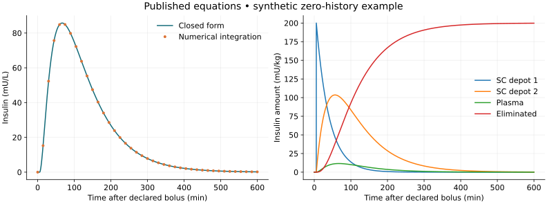

# LIT-001 execution and decision

20 September 2026. Execution of [OT-023 / LIT-001](literature-research-plan.md), an internally checked literature and model-preparation package. **The focused literature route is useful and should remain focused on conventional lispro kinetics.** It produced a source dossier, an audit of both existing engines and a numerically verified standalone implementation of published equations under declared synthetic conditions. It did not reproduce a published patient/cohort curve or establish clinical predictive validity.

The immediate recommendation is **clarify parameter ancestry and retain the existing physiology**. The inspected evidence does not justify replacing either engine's insulin pathway. A subsequent comparison should first establish compatible observables, initial conditions and process ownership, then reserve suitable human insulin-concentration observations for empirical assessment.

## Completed outputs

| Output | Location | What it establishes |
| --- | --- | --- |
| Five-topic landscape and priority decision | [Landscape](lit001-landscape.md) | A reasoned scope choice across insulin kinetics, meals, exercise, secretion and immune mechanisms |
| Search protocol, bibliography and decisions | [Search summary](../../experiments/literature/lit001/search-summary.json), [bibliography](../../experiments/literature/lit001/bibliography.json) | Actual query coverage, record identities, exclusions, access gaps and the final update |
| Original-source extraction and appraisal | [Source dossier](lit001-source-dossier.md) | Source locations, clinical lineage, 22 population/observation parameter estimates, units and source ambiguities |
| Pinned engine audit | [Engine audit](lit001-engine-audit.md) | Input conventions, equations, systemic handling, ownership and provenance differences |
| Frozen standalone case | [Protocol](../../experiments/literature/lit001/reference-protocol.json), [implementation](../../experiments/literature/lit001/runtime/model.py) | An explicitly synthetic case using published equations and fixed effects |
| Numerical result and artifact provenance | [Execution record](../../experiments/literature/lit001/execution.json) | Actual results, checks, artifact hashes and claim limits |

Machine records are ordinary versioned JSON. They are not a clinical knowledge base or a complete automatic evidence-quality scoring system. Full original papers, search abstracts and downloaded assessment material remain outside version control in ignored local result directories. No private health records, data-access agreements, author correspondence or engine physiology changes were introduced by LIT-001.

## Search, screening and coverage

The questions and four translated queries were frozen before the main export. The search covered PubMed and Europe PMC without a recent-year restriction, up to 20 September 2026. The initial pilot tested API access/query translation on one result; it was not an independent screening calibration exercise. Wilinska and Faggionato supplied the contrasting structural/population extraction cases. Their prior inspection is declared in the protocol, so the selected numerical source was already known development material.

| Query | Service | Records retrieved |
| --- | --- | ---: |
| P1: lispro/Humalog with kinetic, absorption or model terms | PubMed | 393 |
| P2: T1D, subcutaneous/continuous insulin and model/kinetic terms | PubMed | 617 |
| E1: translated first query | Europe PMC | 391 |
| E2: translated second query | Europe PMC | 578 |

These overlapping exports yielded **1,008 accession keys**. Two DOI-only records had the same verified DOI/title as PubMed records, leaving **1,006 publication records**. Preprints and later journal reports remain separate publications with potential lineage links; publications are not counted as independent studies or participants.

All 1,008 exported titles and 254 abstracts were inspected in three disjoint AI-assisted screening shards: [A](../../experiments/literature/lit001/screening-a.json), [B](../../experiments/literature/lit001/screening-b.json), [C](../../experiments/literature/lit001/screening-c.json). After the two identity aliases, first-pass decisions were:

| Decision | Publication records |
| --- | ---: |
| Potential primary evidence requiring follow-up | 39 |
| Unresolved eligibility requiring follow-up | 21 |
| Background/model ancestry | 216 |
| Excluded with reason | 730 |

The 60 candidate/unresolved records received documented original-source access and eligibility follow-up: [A](../../experiments/literature/lit001/fulltext-a.json), [B](../../experiments/literature/lit001/fulltext-b.json), [C](../../experiments/literature/lit001/fulltext-c.json). These files distinguish full articles, primary regulatory reports, abstracts, registry checks and failed access. A plausible study remains unresolved when an essential scope condition or original text is unavailable. A registry can clarify product or age eligibility without converting an unread journal paper into a full-text review. The focused numerical extraction concerns the selected model family; this package does not claim a full systematic risk-of-bias appraisal of every clinical paper.

The separate exclusion audit inspected 106 records and corrected five decisions: four became background and one became an unresolved diffusion-model source. After follow-up and these corrections, the [reconciled main-search register](../../experiments/literature/lit001/screening-final.json) contains **18 retained primary evidence records, 227 background, 726 excluded and 35 unresolved**. The primary count includes related modeling reports and separately usable conventional-lispro arms; it is not a count of independent studies, fully reviewed journal papers or verified U100 cohorts. Original first-pass decisions remain unchanged for auditability.

Two Europe PMC citation-index rounds retrieved 218 and 244 edges. The first used Wilinska, Schiavon and Faggionato; the second followed newly found transport/unified-model/diffusion families (PMIDs 25759184, 19885242, 16366223 and 8218870). They exposed 270 additional index keys, including unmatched references. Five verified identity aliases left 265 additional records: 186 background, 58 excluded and 21 unresolved. All available titles were inspected; missing titles remain explicit. The [tracing decisions](../../experiments/literature/lit001/tracing-screening.json) retain the stopping rationale and [citation bibliography](../../experiments/literature/lit001/tracing-bibliography.json). This is coverage of the declared index and rounds, not proof that every relevant publication was found.

The exclusion audit then recovered [Ramanathan and Krzyzanski's diffusion model](https://link.springer.com/article/10.1007/s10928-025-09973-8), whose title emphasizes antibodies but whose abstract includes lispro. A [targeted third round](../../experiments/literature/lit001/tracing-extension.json) retrieved 24 reference and two citation edges, adding 24 records: 11 methodological background and 13 exclusions. The publisher's full reference list was also inspected, including entries unmatched by the citation index. Its lispro source, Grant 2022, was already in the main follow-up. Public supplementary Fortran code was inspected without execution: its supplied example concerns olanzapine, so it is not a recovered lispro-specific reference. The main article and exact lispro parameter/scenario mapping remain unresolved.

Tracing recovered useful leads missed by the keyword queries, including [Hedman's lispro/aspart comparison](https://pubmed.ncbi.nlm.nih.gov/11375381/) and [Aiello's insulin immunosensor study](https://pubmed.ncbi.nlm.nih.gov/35118893/). Original-text excerpts support further consideration, but incomplete full-text retrieval, formulation details and study overlap prevent their promotion to a fully specified numerical reference. The sensor study also illustrates why the observation model and insulin antibodies matter when interpreting circulating insulin measurements.

The final fresh export used the same frozen queries and produced the same accession set: zero added or removed keys. DOI-specific correction/erratum/retraction checks were repeated for the three main model sources; no formal notice was located. This is a bounded search, not a guarantee of absence. The source dossier records the surviving internal notation issues.

### Amendments and review limits

The first export's parser missed three PubMed book records and reported an incomplete P2 parse. Its responses and failed manifest were retained in `results/lit001/search-01`. The corrected parser reprocessed those same archived bytes in `search-02`; the final fresh update is `search-03`. Queries and screening scope were not changed. The accession-to-publication aliases are recorded separately, preserving the original shard keys.

Some article endpoints returned HTTP 200 with a CAPTCHA page; those responses were not treated as recovered articles. Other routes returned 403, 500 or timeouts. Available primary-source rendering, preserved original files and unsuccessful archive attempts are distinguished in the records.

This was AI-assisted internal work. The agents divided screening records; they did not independently screen every record twice. A separate [screening audit](../../experiments/literature/lit001/screening-audit.json) checks potential model-family exclusions. The root checked the executable equations, values and units against rendered source pages, and a separate agent documented a [numerical implementation review](../../experiments/literature/lit001/numerical-review.json) and an independent dose/clearance AUC invariant check. None of these checks constitutes independent human scientific review.

## What the papers contributed

**Mechanisms and competing descriptions.** Wilinska examines alternative absorption/degradation structures under changing pump delivery. Faggionato specifies delayed absorption and population variability. The [Wong unified model](https://pmc.ncbi.nlm.nih.gov/articles/PMC2769764/) adds a broader aggregate-profile comparison: it fits 37 mean profiles across six insulin types, with a monomeric subgroup drawing on several clinical publications. Those aggregate fits are not new independent clinical cohorts. These sources support explicit model comparisons; they do not establish that every compartment corresponds to an independently measured biological process.

**Parameters with statistical meaning.** The extraction distinguishes fixed effects, estimation uncertainty, between-person random effects, their covariance, BMI dependence and assay error. This prevents using six point estimates as a virtual population or confusing a parameter's RSE with biological variability. Only fixed effects are used in the implemented case.

**Evidence dependencies.** The 2018 and 2021 modeling papers reuse the same reported 116-person database. Its component trial identifiers and analysis/enrollment counts are recorded in the [study register](../../experiments/literature/lit001/studies.json). Reuse is valuable for model development, but cannot provide independent confirmation. Participant uniqueness across trials was not independently verified.

**Concrete uncertainties.** The checked Faggionato material lacks the numeric cohort mean BMI, individual parameter vectors, complete input/baseline histories and censoring masks needed for exact cohort reconstruction. The Wilinska journal's selected-model numbering does not consistently match its parameter table; the thesis has a different candidate count. The selected article's `k_a1(t)` notation and a quartile-label inconsistency are preserved as issues, with explicit interpretations where needed.

**Useful future measurements.** A meaningful absorption comparison needs known formulation/concentration, administered dose and timing, body weight, delivery site/method, insulin-concentration samples, assay specificity/quantification limits, baseline and recent insulin history. Repeated administrations are needed to characterize within-person variability. CGM alone does not uniquely identify absorption independently of insulin action, meals and other processes. These are data requirements, not a claim that access has been obtained.

## Engine comparison and decision

The audit inspected the exact pinned source revisions without running or modifying the engines. It retained hashes for 19 relevant source files and 31 code-location references.

| Feature | simglucose lineage | LT1/Cambridge lineage |
| --- | --- | --- |
| Native external rate convention | U/min | U/h |
| Subcutaneous structure | Two depots with parallel appearance terms | Serial depots with appearance through the second depot |
| Systemic insulin handling | Plasma/liver exchange | One plasma compartment |
| Meaning of `ka1`, `ka2` | Subcutaneous absorption parameters | Insulin-action deactivation parameters in the Cambridge model |
| Formulation-specific lispro correspondence | Not established by the inspected module | Not established by the inspected module |

The shared symbols do not authorize parameter substitution. A standalone absorption module would have to specify whether it owns only subcutaneous appearance or also plasma distribution/elimination. Otherwise coupling risks counting a process twice. The [audit](lit001-engine-audit.md) records the exact mappings and remaining original-parameter provenance gaps.

## Executed numerical case

The selected source is [Faggionato et al., 2021](https://doi.org/10.3390/metabo11040235), Equation 3/Figure 3 and Table 2. The [source dossier](lit001-source-dossier.md) contains the full specification and source interpretations. No author implementation was located in the inspected material; this is an independent implementation.

A declared synthetic bolus of 0.2 U/kg equals 200 mU/kg and enters the first subcutaneous state after a 5.62-minute delay. All states and prior input are zero; random effects, BMI deviation and measurement noise are zero. The model uses body-mass-normalized amounts and the published volume to compute concentration. These assumptions do not describe a recovered original participant or the average participant.

The case covers 0–600 minutes on a 0.25-minute reporting grid, augmented with the exact delayed event, giving 2,402 time points. Adaptive RK45 and DOP853 integrations are compared with a closed-form solution; a matrix-exponential test provides an additional independent computational route. A coarser RK45 run reports numerical refinement without changing the prescribed input.



This original OpenT1D figure shows a declared synthetic example computed from attributed published equations. It is not a copied or reconstructed clinical figure.

| Quantity | Observed result | Prespecified criterion |
| --- | ---: | ---: |
| Maximum concentration error, tight RK45 | 3.27e-8 mU/L | At most 1e-5 mU/L |
| Maximum concentration error, tight DOP853 | 5.65e-8 mU/L | At most 1e-5 mU/L |
| Maximum mass-accounting discrepancy | 8.53e-14 mU/kg | At most 1e-7 mU/kg |
| Minimum numerical state | 0 mU/kg | At least -1e-9 mU/kg |
| Sampled synthetic peak | 85.7504 mU/L at 67 min | Descriptive only |
| Synthetic AUC, trapezoid rule over 0–600 min | 13097.17 mU min/L | Descriptive only |

The coarse RK45 maximum concentration error was 2.94e-5 mU/L; the prescribed tighter run reduced it to 3.27e-8. The pass limits measure numerical agreement, not empirical accuracy or source-parameter uncertainty. Neither the peak nor AUC is a clinical result from the paper.

Five isolated-runtime tests passed: closed form versus matrix exponential, exact delayed-event/mass accounting, zero-input and fixed-parameter linearity, solver agreement/positivity, and rejection of invalid inputs. Reconstruction with Python's standard library produced a byte-identical report from saved artifacts. Separate corruption checks rejected changed and missing traces. The implemented domain is this fixed-parameter single-bolus case; arbitrary pump schedules and clinical initial states are not covered.

Repository verification also passed: `uv sync --locked` and `uv run --locked python scripts/check.py`, including lint, 161 repository unit tests and the strict documentation build. Earlier failures from concurrently developed AZT1D test references and a redundant documentation blank line are preserved in the local check logs; they were resolved before the successful final run. These repository checks establish software/documentation consistency, not model validity.

## Re-run and reconstruct

Run from the repository root, using a fresh output directory. The standalone runtime keeps NumPy, SciPy and Matplotlib separate from repository tooling.

```bash
uv sync --locked --project experiments/literature/lit001/runtime
uv run --locked --project experiments/literature/lit001/runtime \
  python experiments/literature/lit001/runtime/test_model.py
uv run --locked --project experiments/literature/lit001/runtime \
  python experiments/literature/lit001/runtime/run.py \
  --output results/lit001/my-reference
```

Each run retains the frozen protocol, parameter record, source files and lockfile, CSV trace, figures, manifest and numerical report. Existing output directories are rejected rather than overwritten. The final inspected run is `results/lit001/reference-02`; `reference-01` remains as earlier execution history. Code archival was improved between them; equations, inputs, tolerances and numerical results were unchanged.

Reconstruct without loading scientific packages or rerunning the model:

```bash
python3 -S experiments/literature/lit001/runtime/report.py \
  results/lit001/my-reference \
  --output results/lit001/my-reference/reconstructed.json
```

To repeat the searches and citation export, use a Python 3.12 interpreter and new output directories:

```bash
.venv/bin/python experiments/literature/lit001/search.py \
  --output results/lit001/new-search
.venv/bin/python experiments/literature/lit001/trace.py \
  --ids 15651559 29989928 33921274 --round 1 \
  --output results/lit001/new-tracing-1
.venv/bin/python experiments/literature/lit001/trace.py \
  --ids 25759184 19885242 16366223 8218870 --round 2 \
  --output results/lit001/new-tracing-2
```

Public services and citation counts can change. These commands collect records; they do not automatically reproduce human or AI screening judgments. The historical accession keys, alias decisions and source hashes remain the reference for this execution.

Reconcile the checked-in review records without repeating the searches or altering earlier decisions:

```bash
.venv/bin/python experiments/literature/lit001/compile.py \
  --output results/lit001/reconciled-screening.json
```

This checks exact key coverage, alias consistency and all 60 follow-ups, applies the five recorded audit overrides, and records hashes for its inputs. Citation decisions remain in their separately documented registers.

## Acceptance and next decision

| Work item | Execution outcome |
| --- | --- |
| L1: frame and pilot | Frozen query/reference protocols and known-source disclosure; minimal API pilot and two contrasting extraction sources; no independent screening calibration claim |
| L2: landscape | Five themes compared; retain focused lispro priority |
| L3: search and screen | Declared queries, two tracing rounds plus a targeted third, final update and per-record decisions accounted for; unresolved access/identity remains explicit |
| L4: extract and appraise | Selected structural/population sources and executable values checked; complete clinical-paper extraction and independent scientific review remain outside the completed bounded dossier |
| L5: engine audit | Exact pinned source mappings recorded; provenance uncertainties explicit |
| L6: select reference | Published equations support a synthetic implementation case; exact original patient/cohort reconstruction is incomplete |
| L7: conditional execution | Synthetic numerical verification passed; published cohort reproduction and empirical validation not performed |
| L8: synthesis | Retain current physiology; prioritize parameter ancestry and a compatible-observable specification before a later extension |

The immediate follow-up is to resolve the engine parameters' original source definitions and write one comparison specification for conventional lispro: formulation, body-mass normalization, input/history, appearance versus plasma observable, and ownership of systemic clearance. Its completion criterion is a source-linked mapping with remaining gaps explicit, not an improved glucose forecast. Then assess whether the available published aggregate curves or an authorized independent insulin-concentration dataset can distinguish the competing structures. Further uncertainty simulation is exploratory until these conventions are settled.

A [27 September 2026 source follow-up](lit001-engine-audit.md#parameter-source-follow-up-27-september-2026) matches three pinned Cambridge defaults and the `VI*BW` convention to the primary Hovorka 2004 tables; Andersen's thesis repeats the numerals in an example. Original records identify Howey's plasma peak measurement and Rave's premixed activity study, but do not independently derive the 55-minute model setting. The [concentration-comparison boundary](../lit002-tutorial.md#source-linked-concentration-comparison-boundary) specifies the software-side mapping. Full experimental methods, a suitable measured-concentration dataset and its authorization remain unchecked.

M3 and OT-018/C1 retain their roadmap priority. LIT-001 does not satisfy B1/OT-020's human-evaluation requirement, authorize a new biological interpretation or establish a reason to replace a complete upstream engine. The strongest contribution here is a traceable way to turn papers into checked specifications and precise next experiments.
