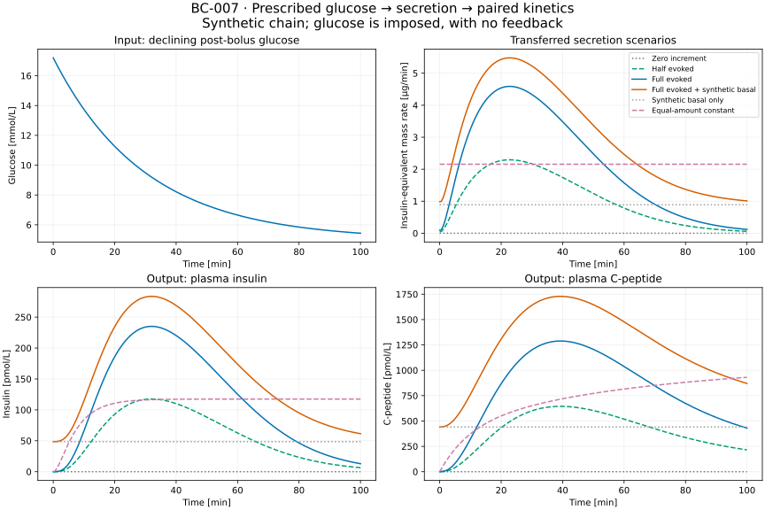

# BC-007: prescribed glucose to insulin and C-peptide

One command now runs the existing secretion reference and both kinetic branches as a reproducible synthetic chain. All six scenarios in each branch pass the [prespecified protocol](m4-chain-protocol.md). **Glucose is prescribed; the experiment does not predict glucose, external insulin requirements or treatment effects.** This advances OT-026 within M4 without closing its biological or full metabolic-coupling criteria.

Work took place in `/private/tmp/opent1d-beta-cell-reference`, branch `codex/beta-cell-reference`, from `f96fe29`. The original working directory, BC-001 through BC-006 and both scientific locks remain unchanged. [Decision 0022](../decisions/0022-glucose-secretion-kinetic-chain.md), the [machine protocol](../../experiments/m4/chain/protocol.json) and [execution record](../../experiments/m4/chain/execution.json) specify scope and provenance. The [runner](../../experiments/m4/chain/run.py) orchestrates existing numerical functions; the [boundary](../../experiments/m4/chain/common.py) and [report reconstruction](../../experiments/m4/chain/report.py) can be inspected without scientific packages.

## What was executed

`results/m4-chain/reference-02` contains a fresh complete BC-001 archive. Its synthetic post-bolus glucose falls from 17.2 toward 5 mmol/L over a 100-minute experiment. The unchanged literal initialization and reduced Pedersen–Cobelli equations generate evoked insulin mass per minute. Their source limitations remain as documented in the [model card](models/pedersen-cobelli2013.md) and [BC-006 audit](m4-source-audit-results.md).

BC-007 interprets that output as an uncalibrated whole-body rate, converts micrograms/min to pmol/(kg min) once, and supplies identical molar input to the insulin liver inlet and C-peptide central compartment. Distribution and clearance stay separate. A second set of cases adds the declared synthetic basal input of 153.48 pmol/min and separate steady initial inventories. No parameter is fitted, no observation multiplier is applied, and no secretion equation is changed.



The full evoked source interpolant delivers 215.549496 micrograms over 100 minutes, or 362.710286 pmol/kg at the declared 102.32 kg. A constant comparator delivers exactly the same interpolated amount. Its different time course produces different concentrations; this demonstrates sensitivity to delivery timing, not superiority against observations.

| Scenario | Sampled peak insulin (pmol/L) | Sampled peak C-peptide (pmol/L) |
| --- | --- | --- |
| Zero increment | 0 | 0 |
| Half evoked increment | 117.519939 | 644.323294 |
| Full evoked increment | 235.039878 | 1288.646589 |
| Full evoked plus synthetic basal | 283.601814 | 1729.045884 |
| Synthetic basal only | 48.561936 | 440.399295 |
| Equal-amount constant increment | 117.426075 | 930.448137 |

These are outputs from nominal profiles paired synthetically, not measurements from one person. Scaling evoked output leaves the independent basal term fixed. Functional gain is neither a cell count nor a calibrated measure of residual T1D function.

## Numerical evidence

| Maximum discrepancy across cases and recorded times | Insulin | C-peptide | Frozen limit |
| --- | --- | --- | --- |
| Independent matrix-exponential states (pmol/kg) | 1.5916e-12 | 2.2595e-12 | 1e-7 |
| Tight/reference solver concentration (pmol/L) | 3.0475e-8 | 8.4712e-10 | 1e-5 |
| Mass balance with initial inventories (pmol/kg) | 3.5811e-12 | 3.8085e-12 | 1e-7 |
| Delivered-input accounting (pmol/kg) | 3.6380e-12 | 3.6380e-12 | 1e-7 |
| Total = basal + increment, all states/ledgers (pmol/kg) | 1.0232e-12 | 1.8474e-13 | 1e-7 |
| Half/full gain, basal drift and repeated states | 0 | 0 | Per protocol |

No negative states were observed. The two branches receive exactly equal molar forcings. Conversion differs from independently integrated mass by at most 2.22e-16 relative. Zero-initial insulin outputs exactly match the historical BC-002 path. Independent propagation does not call the kinetic ODE derivatives. This verifies the implemented equations and accounting, not the biological appropriateness of their composition.

Source sampling is a separate error source. The same unchanged secretion equations are sampled more finely and their piecewise-linear outputs transferred with fixed tight kinetic settings:

| Source sample spacing (min), compared with 0.0625 min | Insulin discrepancy (pmol/L) | C-peptide discrepancy (pmol/L) |
| --- | --- | --- |
| 0.25, primary experiment | 0.0114759 | 0.0479661 |
| 0.125 | 0.0022964 | 0.0095950 |

Both finest-pair differences meet 0.01 pmol/L; middle/coarse ratios are 0.20011 and 0.20004, below 0.35. Source samples match exactly at common times. The finest two interpolated source amounts differ by 2.30e-7 relative. Sampling error exceeds kinetic solver error here. The 0.01 limit applies to the finest pair, **not** to the primary 0.25-minute trace. The finest sampled input is a numerical comparison reference, not an exact continuous-input solution or a physiological accuracy target.

## Reproduce and reconstruct

From the worktree root, use fresh output paths:

```bash
uv sync --locked
uv sync --locked --project experiments/m0/simglucose
uv sync --locked --project experiments/m4/beta_cell/runtime
uv run --locked python -m experiments.m4.chain.run \
  --output results/m4-chain/my-reference
```

The parent launches a fresh BC-001 run, finer source sampling and both kinetic workers in their existing locked environments. It saves protocols, parameters, source snapshots, locks, runtime/native identities, all source and kinetic states, independent reference states, forcings, initial inventories, logs, report and figure. Existing directories are refused; failed or interrupted attempts retain failure status and available evidence.

```bash
uv run --locked python -S -m experiments.m4.chain.report \
  results/m4-chain/my-reference --output results/m4-chain/my-reconstructed.json
cmp results/m4-chain/my-reference/report.json results/m4-chain/my-reconstructed.json
uv run --locked --project experiments/m4/beta_cell/runtime \
  python -m experiments.m4.chain.plot results/m4-chain/my-reference \
  --output results/m4-chain/my-reconstructed.svg
cmp results/m4-chain/my-reference/figure.svg results/m4-chain/my-reconstructed.svg
```

Reconstruction verifies hashes and completeness, recomputes the summaries and does not execute archived code or numerical solvers. It reassesses saved independent reference states; recomputing those requires the full experiment. Hashes detect changed artifacts but do not authenticate a deliberately rewritten archive.

## Checks performed

Root and both scientific `uv sync --locked` commands passed. Thirteen new root tests check hand-calculated conversion/triangular area, single body-mass normalization, gain/basal separation, frozen settings, lost inventory, spurious input, repeated/initial state changes, incomplete/nonfinite output and failure/interruption preservation. Seven existing insulin and three existing C-peptide numerical tests passed in their separate runtimes. Each chain execution also reruns BC-001's numerical verification. Commands:

```bash
uv run --locked python -m unittest tests.test_m4_chain -v
uv run --locked --project experiments/m0/simglucose \
  python -m unittest experiments.m4.paired_kinetics.test_insulin -v
uv run --locked --project experiments/m4/beta_cell/runtime \
  python -m unittest experiments.m4.paired_kinetics.test_cpeptide -v
uv run --locked python scripts/check.py
```

The repository check passed 305 tests, Ruff, Markdown/YAML/citation checks, navigation and the strict Sphinx build. Standard-library report and artifact-only SVG reconstruction are byte-identical; the figure was visually inspected. A fresh whole-chain execution reproduced 62 archived files byte-identically, including all branch trajectories and source CSVs. Two additional JSON artifacts have equal contents after removing only the source-manifest hash: every fresh BC-001 run legitimately has different manifest timestamps, so its hash and downstream provenance references differ. No numerical values are excluded from comparison.

Saved code and lock snapshots match the live implementation. All three full-chain attempts passed, without criterion amendments. The first completed run is retained as development evidence; it predates a reconstruction error-message fix for missing finer source states. The final implementation was executed as `reference-02` and repeated as `repeat-01`. The new CI step runs and reconstructs the chain and preserves failures; remote CI was not run. Historical standalone studies were not rerun wholesale.

## Roadmap and remaining evidence

OT-024 and the relevant OT-015 specification remain delivered, with actual external domain review open. OT-025 retains its completed equation/stimulus references and unresolved exact dynamic cohort reproduction. **OT-026 is partial:** BC-007 completes the synthetic prescribed-glucose source-to-kinetics chain. Full glucose feedback, coupled human identifiability, biological interpretation and independent observation assessment remain open. M4 and OT-027 are not complete.

BC-006's pre-bolus pool explanation is not an author-confirmed correction. Basal and whole-body secretion scale are uncalibrated; neither the nominal insulin profile nor the C-peptide group parameters makes this a jointly validated T1D or transplant model. We performed amplitude, timing, solver and sampling comparisons; no human parameter-identifiability result follows. The separate [BC-003 synthetic identifiability limits](m4-cpeptide-results.md) still apply.

The next bounded OT-026 step is a protocol for glucose feedback in one existing metabolic route: determine whether the selected secretion equations support the glucose trajectories that route will generate, specify basal replacement and process ownership, and freeze zero-extension, simpler-baseline and numerical checks before implementation. The current declining-IVGTT reference cannot silently become an arbitrary meal-response model. Synthetic engineering preparation can continue while source clarification, [domain review](m4-collaboration-brief.md) and [authorized paired observations](m4-cpeptide-measurements.md) remain open. Later cell-therapy research additionally needs a specified graft site and an independently supported intervention/function mechanism. No outreach, data-access request or patient-data download occurred.
