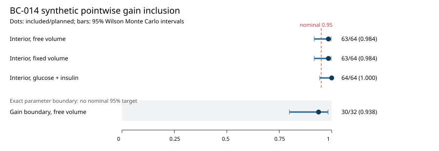

# BC-014 — Independent synthetic gain-profile coverage

This report assesses the [prespecified BC-014/1 protocol](m4-coverage-protocol.md)
under the unchanged BC-013 inference rules and BC-012 forward model. The
question is how often the nominal pointwise evoked-gain profile includes the
generating gain on fresh synthetic Gaussian observation errors. The
[decision record](../decisions/0029-independent-synthetic-coverage.md) explains
the separation from BC-013's development cases.

## Execution and reconstruction

The experiment uses 64 new interior noise draws paired across free-volume
GIC, fixed-volume GIC and GI designs, plus 32 separate exact gain-boundary
draws in free-volume GIC. Each analysis reoptimizes the unrestricted objective
and then fixes only gain at its generating value while reoptimizing the
declared nuisance parameters. The nominal interior reference is
`DeltaQ <= 3.841458820694124`. The exact parameter boundary is reported
separately without a nominal 95% expectation.

The local archive is `results/m4-coverage/reference-01`, ignored by Git. It
contains the complete seed roster, generated observations, all optimizer
starts, reference-solver checks, native identity and a fresh-process repeat.
The [runner](../../experiments/m4/coverage/run.py) and
[standard-library reader](../../experiments/m4/coverage/report.py) reconstruct
the result, with [usage instructions](../../experiments/m4/coverage/README.md).
The campaign ran from 24 September 2026 21:56 UTC to 22:56 UTC on local
commit `e67be20`, with a clean source worktree at execution start. The
manifest finished as `completed`; all inherited numerical oracles, 224 case
completion checks and exact fresh-process repetition passed. All 322
numerical files matched byte for byte between processes. The report and
figure were independently reconstructed from the archived inputs and matched
the saved output exactly. See the [execution record](../../experiments/m4/coverage/execution.json)
for archive hashes and the exact validation commands.

## Results

All 224 planned analyses in both executions completed; there were no
failed replicates. The 64 interior draws were shared across the three designs.
The primary denominator remains the number planned even when all runs
complete. Wilson intervals below describe uncertainty in each synthetic
inclusion fraction, not uncertainty about a biological population.

| Generating case and observations | Included / planned | Rate | 95% Wilson interval | Unrestricted fits at a bound |
| --- | ---: | ---: | ---: | ---: |
| Interior, GIC with estimated Cp volume | 63 / 64 | 98.4% | 91.7–99.7% | 0 |
| Interior, GIC with correctly fixed Cp volume | 63 / 64 | 98.4% | 91.7–99.7% | 0 |
| Interior, glucose and insulin only | 64 / 64 | 100% | 94.3–100% | 47 |
| Exact gain boundary, GIC with estimated Cp volume | 30 / 32 | 93.8% | 79.9–98.3% | 24 |

The two interior GIC noninclusions occur on different paired draws: seed
140034 for free volume (`DeltaQ=4.840372`) and 140017 for fixed volume
(`DeltaQ=7.546637`). GI includes the true gain for every draw, but 47 of its
unrestricted fits place the peripheral insulin removal multiplier at an
engineering bound. Thus 64/64 cannot be read as evidence that GI separates
gain and clearance well. At the exact gain boundary, 19 of the 24 bound-hit
fits put gain itself at its lower bound. The two boundary noninclusions are
seeds 240001 and 240008. No reference-solver reoptimization was triggered:
no fitted `DeltaQ` lay within 0.01 of the cutoff and no solver-side inclusion
decision differed. The largest selected-fit reference discrepancy in
`DeltaQ` was `8.1e-6`, below the frozen `0.001` limit. The smallest raw
`DeltaQ` was `-6.95e-7` in the boundary arm, within the prespecified
`-0.0001` unresolved-minimum limit; it was not clipped.



## Checks and rerun

Run the exact frozen campaign from the repository root with:

```sh
uv run --locked python -m experiments.m4.coverage.run \
  --output results/m4-coverage/reference-02
```

The output path must be new for a rerun; `reference-01` already exists
locally. Root `uv sync --locked` and separate native
`uv sync --locked --project experiments/m0/simglucose` passed. The three
native BC-014 numerical regression tests passed, including the independent
preassessment seed-117 objective benchmark and invalid-observation failure.
The final `uv run --locked python scripts/check.py` passed 627 repository
tests, lint and the strict documentation build. A standard-library-only
reader reconstructed `report.json` byte for byte, and a separate SVG
reconstruction matched `figure.svg`; XML parsing confirmed that the SVG is
well formed. These are software/numerical checks, not a human validity test.

## Interpretation and limitations

The reported Wilson intervals quantify Monte Carlo uncertainty in the
conditional synthetic inclusion fractions for this single fixed model and
noise generator. They are not confidence intervals for a human T1D
population or proof of exact 95% calibration. Pairing makes the interior
designs comparable on the same draws, but the three marginal intervals are
not independent between-design tests. The boundary arm tests a nonregular
case; [Self and Liang 1987](https://doi.org/10.1080/01621459.1987.10478472)
shows why standard likelihood-ratio references need care at parameter
boundaries. The weighted Gaussian objective and pointwise profile follow
[Raue et al. 2009](https://doi.org/10.1093/bioinformatics/btp358).

Known exact basal glucose/insulin, known subcutaneous input, fixed noise SDs
and fixed unvaried physiology make this a favorable synthetic experiment.
The three fixed starts cannot certify global optima. An estimated functional
gain is neither a beta-cell count nor a treatment effect. [BC-015-P1](m4-measurement-readiness.md) and [BC-015-P2](m4-cit07-public-crosswalk.md) now inventory the paired-measurement
metadata gap. OT-026 still needs authorized paired glucose/insulin/C-peptide
observations, independent domain review, measured nuisance kinetics and a
freshly frozen assessment before any human predictive claim.
