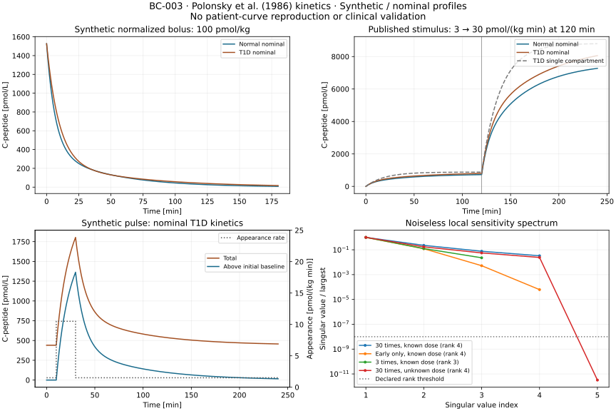

# BC-003 execution: forward C-peptide observation reference

BC-003 implements and verifies a standalone forward C-peptide calculation using [Polonsky et al. (1986)](https://doi.org/10.1172/JCI112308). Eight nominal-profile/case combinations pass the [frozen protocol](m4-cpeptide-protocol.md). Published equations, tabulated coefficients and an infusion schedule are reproduced computationally. **No participant or cohort concentration curve is reproduced or empirically validated.**

The code maps a supplied C-peptide appearance rate to plasma concentration, demonstrates an explicitly synthetic basal-plus-pulse scenario, compares a simpler one-compartment response, and examines noiseless known-input identifiability. It does not reconstruct arbitrary secretion from measured C-peptide or implement glucose feedback. [Run and reconstruction commands](../../experiments/m4/c_peptide/README.md), [model card](models/polonsky1986-cpeptide.md), [measurement/review specification](m4-cpeptide-measurements.md) and [execution record](../../experiments/m4/c_peptide/execution.json) supply the reproducible evidence.

## Numerical results

Executed on 20 September 2026 in worktree `/private/tmp/opent1d-beta-cell-reference`, branch `codex/beta-cell-reference`, from `751e701` with the new source archived by hash. The existing BC-001 runtime lock is reused unchanged: Python 3.12.13, NumPy 2.2.6, SciPy 1.15.3 and Matplotlib 3.9.4. Final archive: `results/m4-cpeptide/reference-02`. All maxima below are over declared cases and reporting times, not continuous-time or biological guarantees.

| Check | Observed maximum | Frozen limit | Outcome |
| --- | --- | --- | --- |
| Tight/reference integration versus published analytical kernel | 1.7721e-8 pmol/L | 1e-5 pmol/L | Pass |
| Tight RK45 versus DOP853 concentration | 1.7721e-8 pmol/L | 1e-5 pmol/L | Pass |
| Mass conservation | 3.1833e-12 pmol/kg | 1e-7 pmol/kg | Pass |
| Cumulative input accounting | 1.1369e-13 pmol/kg | 1e-7 pmol/kg | Pass |
| Negative amount violation | 0 | 1e-9 pmol/kg | Pass |
| Repeated integration; zero-input output | 0; 0 | Exactly zero | Pass |
| Constant equilibrium inventory drift | 0 | 1e-8 pmol/kg | Pass |
| One-compartment exponential limit | 7.9581e-13 pmol/L | 1e-5 pmol/L | Pass |
| Unit conversion relative error | 0 | 1e-12 | Pass |
| Noiseless synthetic parameter recovery, two starts | 3.5750e-14 relative | 1e-4 | Pass |
| Synthetic fit residual | 5.9686e-12 pmol/L | 1e-6 pmol/L | Pass |
| Sensitivity finite-difference refinement | 1.6466e-9 relative | 1e-5 | Pass |
| Joint dose/volume rescaling difference | 0 pmol/L | 1e-8 pmol/L | Pass |

The normal/T1D nominal bolus begins at 1526.72 pmol/L for the synthetic 100 pmol/kg dose. The synthetic basal T1D case begins at 440.40 pmol/L and peaks at 1804.05 pmol/L on the reporting grid. These concentrations follow declared inputs, not observed human measurements. In the published-schedule replay, the largest T1D difference from the one-compartment comparator is 1642.81 pmol/L. That demonstrates a material transient effect of peripheral exchange; it does not establish superior human prediction.

## What the synthetic identification experiment establishes

Analytical bolus concentrations at the paper's 30 sampling times are fitted with an independent matrix-exponential prediction. Both frozen starts recover the known four parameters within tolerance. The derivative matrix is with respect to log parameters, in concentration units, without an empirical noise weighting.

| Observation/input design | Rank at relative threshold 1e-8 | Local condition number | Meaning |
| --- | --- | --- | --- |
| Known bolus, 30 times from 2–180 min | 4 of 4 | 30.28 | Recoverable in this ideal numerical experiment |
| Known bolus, six early times through 10 min | 4 of 4 | 16164.37 | Much poorer conditioning despite unchanged rank |
| Known bolus, three times | 3 of 4 | Undefined for full parameter recovery | Four parameters cannot be distinguished |
| Unknown bolus amplitude, full schedule | 4 of 5 | Undefined for full parameter recovery | Dose/volume ambiguity remains |

Scaling dose and distribution volume together by 0.5 or 2 leaves the concentrations unchanged. Thus a successful four-parameter fit with **known dose** does not establish that endogenous secretion and kinetics can jointly be recovered from human C-peptide. No assay noise, censoring, confidence interval, participant variability or independent human test set is assessed. At equilibrium, concentration supplies only the combination `q/(K3 Vp)`.

## Verification, provenance and failures

Executed checks: `uv sync --locked`, `uv run --locked python scripts/check.py`, isolated locked sync and native test discovery all passed. The repository suite ran 246 tests (including 13 new artifact tests); the separate scientific environment ran 15 native tests. Ruff, Markdown/YAML/citation checks, documentation navigation and the strict Sphinx build passed. The CI workflow now includes the same C-peptide run/reconstruction; remote CI was not executed.

The isolated tests cover the published bolus against an independent matrix exponential, off-grid discontinuities and conservation, a linearly increasing input with a one-compartment closed form, equilibrium/zero limits, repeated decay rates, unit and invalid-input handling, synthetic recovery, incomplete solver output, interrupted execution and refusal to overwrite results. Artifact tests separately check hashes, missing/truncated traces, wrong units, false pass flags, inconsistent initial inventories, mass loss, altered fitted parameters, unsafe paths and standard-library reconstruction.

The initial repeated-rate unit test exposed cancellation in the analytical peripheral-return expression. Equivalent nonnegative discriminant and `expm1` expressions fixed it; the test is retained. Run `reference-01` passed numerical criteria but failed report reconstruction because the shared linear interpolator can round a constant rate by one floating-point unit. The report now allows only 1e-14 relative/absolute roundoff when checking recorded forcing; no scientific acceptance criterion changed. Its failed manifest, sources and outputs remain in the ignored result directory. Run `reference-02` completes; the numerical results themselves were unchanged by the reporting correction.

Standard-library report reconstruction and artifact-only SVG reconstruction are byte-identical to the completed archive. A fresh-process repeat records separate execution timestamps and reproduces all deterministic artifacts. The public SVG is generated from those results, not copied from the publication. The execution record contains the actual test/check outcomes and artifact hashes. Archived verification is not a cryptographic attestation or an independent human review.

## Roadmap status and next work

OT-024 and the relevant OT-015 specification remain delivered within their bounded evidence/route scope, now extended with a C-peptide model card and concrete measurement needs. Domain review and usable human observations remain outstanding. OT-025 gains a completed forward C-peptide equation/stimulus reference; its broader exact published dynamic reproduction remains partial. BC-001's missing cohort glucose series, paper/code initialization difference and basal/whole-body scale are not resolved by BC-003.

OT-026 remains partial: BC-002 verifies incremental insulin kinetics, and BC-003 provides a separate observation reference. Their end-to-end biological adapter, full glucose feedback and independent observation assessment remain open. The next concrete step is to review and freeze the [paired insulin/C-peptide observation contract and measurement plan](m4-cpeptide-measurements.md#concrete-review-request-and-next-interface), including baseline, scale and equimolar-processing assumptions. No outreach, data-access application or restricted download was made. OT-027 still requires a defined therapy/population/endpoint and evidence for its intervention mechanisms; functional capacity is not cell count or a treatment model.
