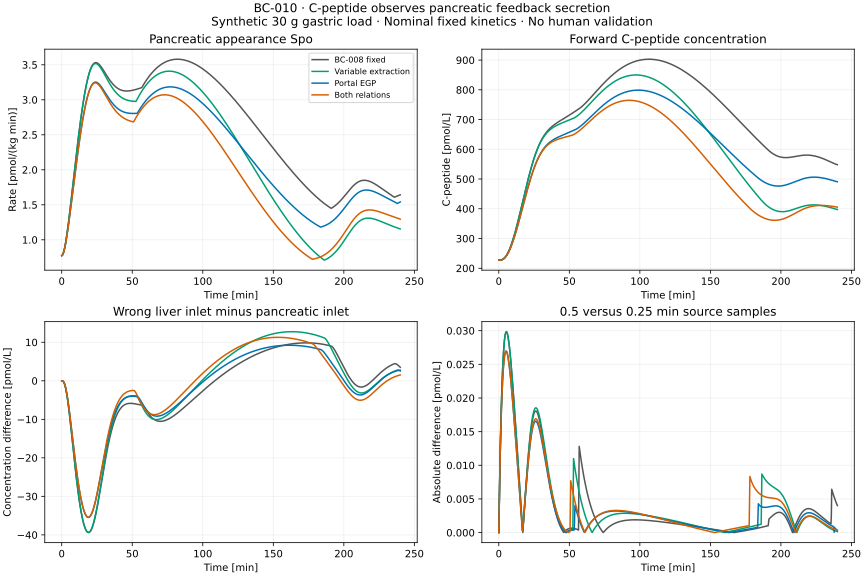

# BC-010: C-peptide observes the pancreatic feedback source

BC-010 adds a working forward C-peptide observation branch to the verified feedback experiment. All 24 parent cases pass the frozen observation criteria and repeat exactly in a fresh process. The observer preserves the parent glucose/insulin results and uses the already verified C-peptide model in its separate locked environment. This is a **synthetic observation capability**, not a calibrated human model, deconvolution algorithm or biological validation. OT-026 and M4 remain partial.

Work continues from `9393fb1` in `/private/tmp/opent1d-beta-cell-reference`, branch `codex/beta-cell-reference`. The [protocol and boundary specification](m4-feedback-observation-protocol.md), [decision 0025](../decisions/0025-feedback-cpeptide-observation.md) and [execution record](../../experiments/m4/feedback_observation/execution.json) define this contribution. The original checkout, previous references, native physiology and both numerical locks are unchanged.

## What the code does

The [adapter](../../experiments/m4/feedback_observation/adapter.py) takes **pancreatic appearance Spo**, already in pmol/(kg min), from every completed BC-009 case. It defines a piecewise-linear input at the recorded 0.25-minute grid, initializes C-peptide inventories from the explicit basal release, and runs the unchanged [Polonsky forward kinetics](../../experiments/m4/c_peptide/model.py). It never adds SC insulin, repeats body-mass conversion, adds basal twice or applies the insulin hepatic-extraction fraction.

The published basis is [Polonsky et al. 1986](https://doi.org/10.1172/JCI112308), with its nominal T1D mean kinetic parameters, and the [Dalla Man 2007 secretion model](https://doi.org/10.1109/TBME.2007.893506) used by BC-008/009. Equimolar processing and appearance at the C-peptide central boundary are declared composition assumptions. No insulin-specific portal delay is applied to C-peptide. This does not establish instantaneous anatomical transport or graft-specific processing. The [existing model card](models/polonsky1986-cpeptide.md) preserves the original population, equation and parameter evidence.

Glucose and insulin are retained as paired synthetic parent outputs. C-peptide adds four separately owned states: central amount, peripheral amount, eliminated amount and delivered amount. Only the central amount divided by its own volume becomes plasma concentration. Insulin and C-peptide concentrations are never equated.

## Reproduce and inspect

The complete chain can start from a new feedback reference:

```bash
uv sync --locked
uv sync --locked --project experiments/m0/simglucose
uv sync --locked --project experiments/m4/beta_cell/runtime
uv run --locked python -m experiments.m4.feedback_observation.run \
  --output results/m4-feedback-observation/my-reference
```

To reuse an already completed BC-009 archive, explicitly supply it:

```bash
uv run --locked python -m experiments.m4.feedback_observation.run \
  --source results/m4-hepatic/reference-01 \
  --output results/m4-feedback-observation/my-observer
uv run --locked python -S -m experiments.m4.feedback_observation.report \
  results/m4-feedback-observation/my-observer \
  --output results/m4-feedback-observation/reconstructed.json
cmp results/m4-feedback-observation/my-observer/report.json \
  results/m4-feedback-observation/reconstructed.json
uv run --locked --project experiments/m4/beta_cell/runtime \
  python -m experiments.m4.feedback_observation.plot \
  results/m4-feedback-observation/my-observer \
  --output results/m4-feedback-observation/reconstructed.svg
cmp results/m4-feedback-observation/my-observer/figure.svg \
  results/m4-feedback-observation/reconstructed.svg
uv run --locked --project experiments/m4/beta_cell/runtime \
  python -m unittest experiments.m4.feedback_observation.test_numerical -v
uv run --locked python scripts/check.py
```

The [runner](../../experiments/m4/feedback_observation/run.py) verifies the full parent archive and includes its hash-checked files in the new attempt. Unlisted files are not imported. It archives the frozen protocol, code/runtime snapshots, finite inputs, initial states, all kinetic/reference/diagnostic arrays, logs, failures and a new-process repeat. It refuses to overwrite existing directories. The [report builder](../../experiments/m4/feedback_observation/report.py) verifies hashes, parent acceptance, units/boundaries, complete grids, inventories, flux accounting and numerical comparisons using only the standard library. `--allow-failed` reconstructs failed-attempt evidence without treating incomplete cases as accepted observations.

The completed archive `results/m4-feedback-observation/reference-01` uses the existing BC-009 reference. The separate `results/m4-feedback-observation/reference-fresh-01` also completes the command that creates a new BC-009 parent. Its 82 parent numerical files and 25 observation files match the reused-parent run exactly, as do the report and figure. Raw arrays and logs remain under ignored `results/`; compact evidence and the original figure are versioned. There are no participant data or new author-software assets.

## Numerical evidence

Every primary case is calculated with two kinetic solvers and an independent matrix exponential. Each also includes parent-solver, two source-coarsening, wrong-boundary and two scale diagnostics. The 24 case files plus worker metadata are **byte-identical** in the new-process observation repeat. Parent provenance and trajectories are preserved; no glucose/insulin re-estimation occurs in the observer.

| Check | Maximum discrepancy | Frozen limit |
| --- | ---: | ---: |
| ODE versus matrix exponential, pmol/L | 2.59e-10 | 1e-5 |
| Tight/reference kinetic solver, pmol/L | 2.59e-10 | 1e-5 |
| C-peptide mass conservation, pmol/kg | 5.96e-12 | 1e-7 |
| Delivered-input accounting, pmol/kg | 4.55e-12 | 1e-7 |
| Basal/fasting concentration drift, pmol/L | 2.20e-9 | 1e-7 |
| Native-zero C-peptide state | 0 | 0 |
| Parent tight/reference source, pmol/L | 3.30e-6 | 0.01 |
| 0.5 versus 0.25 min source samples, pmol/L | 0.029852 | 0.05 |
| Fine/coarse discrepancy ratio | 0.199409 | 0.6 |
| Input versus pancreatic ledger, relative | 1.82e-7 | 1e-4 |
| Appearance/volume scale ambiguity, pmol/L | 0 | 1e-7 |
| Repeat artifact differences | 0 | 0 |

Source coarsening is substantially larger than kinetic solver error. The 1-minute coarsening difference reaches 0.149703 pmol/L. The comparison is against the declared 0.25-minute interpolant: it does not prove continuous-source accuracy below that grid. The very small total-dose discrepancy is a separate integral check and cannot bound all transient shape errors. No numerical limit is a clinical accuracy threshold.

Three numerical tests compare constant/step inputs with the published analytical kernel, affine inputs with a matrix exponential, equilibrium/zero limits, conservation and scale symmetry. Eleven root tests challenge incorrect normalization, double basal input, pharmaceutical input, wrong source boundary, source mutation, malformed/nonfinite input, inventory and ledger faults, altered references/protocols, missing diagnostics and failed-run preservation. Full repository checks, standalone report/figure reconstruction and source-snapshot comparisons are recorded in the execution record. Remote CI is configured but was not executed here.

## Synthetic findings and interpretation



For full responsivity with a 30 g gastric load, all variants start at the assumed 227.287 pmol/L C-peptide baseline:

| Hepatic variant | C-peptide peak, pmol/L | Peak time, min | C-peptide at 240 min, pmol/L | Maximum error using liver arrival instead of pancreatic appearance, pmol/L |
| --- | ---: | ---: | ---: | ---: |
| Fixed BC-008 | 902.928 | 106.50 | 548.187 | 39.410 |
| Variable extraction | 849.980 | 97.25 | 397.371 | 39.344 |
| Direct portal EGP | 798.904 | 99.00 | 490.788 | 35.467 |
| Both relations | 764.743 | 92.50 | 405.425 | 35.414 |

The incorrect liver inlet shifts the sampled C-peptide peak by two minutes in all four load/full-response cases. Its maximum discrepancy is much larger than the measured numerical sensitivities, even though its peak height is quite close to the correct peak. Looking only at the peak would miss much of the timing error. Signed errors and AUCs remain in the machine report; the incorrect inlet is an implementation diagnostic, not a rival validated physiological model.

Different C-peptide curves across hepatic variants arise because hepatic changes alter glucose and hence pancreatic secretion in the parent feedback loop. The observation branch itself contains no hepatic insulin coefficient. Lower C-peptide under variable extraction does not directly measure hepatic extraction or establish poorer beta-cell function.

Multiplying C-peptide appearance, initial amounts and its distribution volume by the same factor leaves this forward concentration unchanged. Thus interpretation depends on the declared appearance ratio and volume/kinetics. This branch-level symmetry is conditional on the saved glucose/insulin and is not an alternative common insulin-secretory capacity, a fitted human ambiguity or proof that every hepatic parameter is unidentifiable with joint observations.

## Roadmap and next step

OT-024 and the relevant OT-015 conventions remain delivered within their declared scope; BC-010 adds the specific pancreatic-to-observation boundary. OT-025 retains equation-level numerical references without reproducing an original patient/cohort. OT-026 now includes paired glucose/insulin/C-peptide synthetic outputs from the feedback source, checked ownership and a reproducible observation experiment. Human parameter identifiability, suitable independent observations, external domain review and biological applicability remain open. M4 is not complete.

The next bounded step is to freeze and execute a **synthetic joint sensitivity/identifiability study**: specify which secretion and clearance parameters vary, compare glucose alone with glucose+insulin and glucose+insulin+C-peptide, and distinguish externally known kinetics from estimated kinetics. Resolve exact scaling symmetries before attempting recovery; preserve weakly distinguishable combinations and include sampling/noise assumptions. This can identify which measurements or independent kinetic information are needed, while human identifiability still requires actual authorized observations and an empirical protocol.

This planned synthetic follow-up is now implemented in [BC-011](m4-joint-identifiability-results.md), preserving BC-010 and its original evidence. BC-011 conditions on exact basal G/I and fixed nuisance physiology; global/human identifiability remains open.

The existing [measurement/access requirements](m4-cpeptide-measurements.md) and unsent review brief remain applicable. No contact, data-access application or restricted-data download occurred. M5/OT-027 still needs a defined intervention, population and supported intervention-to-function mechanism; these synthetic observation curves do not count cells or establish a treatment effect.
