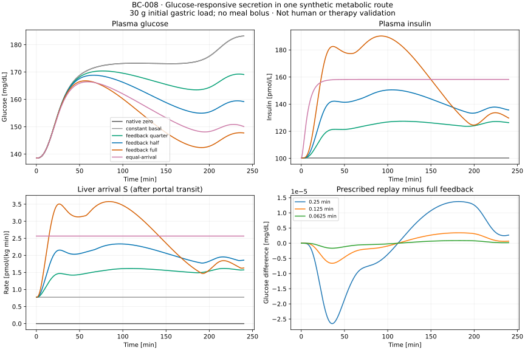

# BC-008: bounded glucose-responsive secretion and metabolic feedback

BC-008 implements and verifies a small glucose → secretion → portal transit → liver/plasma insulin → glucose loop in one pinned virtual profile. The source and coupling pass the frozen numerical criteria. This is an **exploratory synthetic model**, not a reproduced human meal, an estimate of residual beta-cell mass or a cell-therapy result. OT-026 and M4 remain partial for biological assessment and appropriate independent observations.

Work continued from commit `663e137` in `/private/tmp/opent1d-beta-cell-reference`, branch `codex/beta-cell-reference`. The original checkout, upstream physiology, numerical locks and BC-001 through BC-007 were preserved. The [frozen BC-008/2 protocol](m4-feedback-protocol.md), [model card](models/dallaman2007-secretion.md), [source register](../../experiments/m4/feedback/sources.json) and [execution record](../../experiments/m4/feedback/execution-feedback.json) define the scope and evidence.

## What is implemented

The original OpenT1D implementation follows Dalla Man, Rizza and Cobelli (2007), *Meal Simulation Model of the Glucose–Insulin System*, [DOI 10.1109/TBME.2007.893506](https://doi.org/10.1109/TBME.2007.893506), equations 23–26 on p. 1745, with normal-column alpha, beta, K and gamma from Table I on p. 1743. The model card records primary-source inspection, selection and rights limitations. No author program or participant data is used.

The standalone [source solver](../../experiments/m4/feedback/secretion.py) accepts continuous glucose clamps/ramps in mg/dL. A separate [analytic calculation](../../experiments/m4/feedback/source_oracle.py) verifies the rate state Z and portal amount P, including equal rate constants, basal equilibrium, floor crossing, washout and zero gain. The seven [source fixtures](../../experiments/m4/feedback/source-cases.json) were frozen before source execution. Negative signed Y below basal is allowed through Z=Y+Sb. Z is never counted as physical insulin inventory.

The [coupled solver](../../experiments/m4/feedback/coupled.py) evaluates native plasma glucose and its derivative at the same integration stage. Pancreatic appearance enters P; only S=gamma*P enters the guarded native liver derivative. It retains all 13 native states, two source states and five separate insulin-flux ledgers. Glucose production, appearance, utilization and renal-loss integrals are checked by independent adaptive quadrature of the dense trajectory. There is no duplicate first-pass factor, pharmaceutical depot transit or molar/body-weight conversion for the endogenous source.

The experiment fixes the initial plasma glucose and insulin, replaces a prescribed 25% of SC basal appearance in the source cases and applies either fasting or one 30 g **initial gastric solid load**. Five primary cases use three solver settings; each scenario also has three replay sampling levels, a constant equal-arrival control under all three solvers, a padded native reference and the original native patient class. The entire numerical worker runs again in a fresh process. Parameter gains 0.25, 0.5 and 1 scale beta and K together; they are not fractions of cells or inferred treatment doses.

## Reproduce and inspect

Run from the worktree root with a new output directory:

```bash
uv sync --locked
uv sync --locked --project experiments/m0/simglucose
uv run --locked --project experiments/m0/simglucose \
  python -m unittest experiments.m4.feedback.test_numerical -v
uv run --locked python -m experiments.m4.feedback.run \
  --output results/m4-feedback/my-reference
uv run --locked python -S -m experiments.m4.feedback.report \
  results/m4-feedback/my-reference --output results/m4-feedback/reconstructed.json
cmp results/m4-feedback/my-reference/report.json results/m4-feedback/reconstructed.json
uv run --locked --project experiments/m0/simglucose \
  python -m experiments.m4.feedback.plot results/m4-feedback/my-reference \
  --output results/m4-feedback/reconstructed.svg
cmp results/m4-feedback/my-reference/figure.svg results/m4-feedback/reconstructed.svg
uv run --locked python scripts/check.py
```

The [runner](../../experiments/m4/feedback/run.py) refuses to overwrite results. It archives the protocol, input fixtures, full selected virtual parameters, source/runtime identities, code and lock snapshots, all solver states and ledgers, transition times, quadrature error estimates, replay forcings, logs, fresh-process repeat and a hash manifest. Source verification and the native preflight must pass before any feedback solve. The [report builder](../../experiments/m4/feedback/report.py) uses only the standard library, checks file hashes and full grids, reconstructs analytic references and recomputes acceptance metrics from saved numbers. It does not execute saved source files.

Terminal glucose-envelope or negative-amount events retain stop time and last state and prevent a shortened trajectory being accepted as a full case. A failed parent cannot generate derived controls. Failed attempts stay on disk; reconstruct their failure evidence with the report command's `--allow-failed` flag. Such reports never infer missing scenario contrasts. Unexpected worker failures retain a failed manifest and log. The runtime emits upstream packaging deprecation warnings; no dependency versions were changed to suppress them.

## Numerical evidence

The completed run `results/m4-feedback/reference-02` is the final source-snapshot execution. Its first complete predecessor `reference-01` is retained; subsequent changes strengthened artifact assessment and tests, without changing numerical equations, scenarios, parameters or limits. The earlier standalone source check is retained at `results/m4-bc008-source-first`. There were no failed scientific scenarios or post-result parameter/tolerance changes.

| Check | Maximum observed discrepancy | Frozen limit |
| --- | ---: | ---: |
| Source analytic Z, pmol/(kg min) | 1.78e-14 | 1e-7 |
| Source analytic P, pmol/kg | 1.02e-9 | 1e-7 |
| Same-solver zero extension, all states | 0 | 0 |
| Native patient-class glucose, mg/dL | 7.55e-8 | 0.05 |
| Tight/reference glucose, mg/dL | 4.14e-8 | 0.01 |
| Tight/reference insulin, pmol/L | 1.38e-6 | 0.01 |
| Tight/reference source rates, pmol/(kg min) | 2.37e-7 | 1e-5 |
| Insulin inventory/portal balance, pmol/kg | 3.35e-11 | 1e-6 |
| Independent systemic glucose balance, mg/kg | 3.67e-8 | 1e-5 |
| Constant-basal/native glucose, mg/dL | 2.88e-11 | 0.01 |
| Finest replay glucose, mg/dL | 1.66e-6 | 0.01 |
| Finest replay insulin, pmol/L | 1.41e-4 | 0.01 |
| Equal delivered amount, relative | 6.41e-14 | 1e-10 |
| Fresh-process numerical artifact differences | 0 | 0 |

All cases finish at 240 minutes. No physical negative amounts or glucose-envelope exits occur. Fasting glucose and plasma insulin drift stay below 4.1e-10 in their concentration units. Replay glucose errors decrease from 2.65e-5 to 6.62e-6 to 1.66e-6 mg/dL as the transfer interval halves; the transferred amount and its difference from the integrated parent ledger are both reported. These checks establish numerical behavior within this runtime and scope. They do not establish biological validity.

The root tests challenge double-counted liver input, wrong portal ledgers, glucose-flux corruption, rate-versus-amount accounting, source-boundary mismatch, nonfinite/incomplete output, changed fixtures and failed-run preservation. Numerical tests independently check the published signed-Y branches, analytic washout/equal-rate limits, native derivative locality, both instantaneous balances and an intentionally forced terminal event. Exact commands, local test counts and reconstruction hashes are recorded in the execution record. Remote CI is configured but was not run here.

## Synthetic effect and its interpretation



For the 30 g initial load, all trajectories start at 138.56 mg/dL:

| Scenario | Sampled peak glucose, mg/dL | Glucose at 240 min, mg/dL | Signed glucose AUC difference versus constant basal, mg min/dL |
| --- | ---: | ---: | ---: |
| Constant basal | 183.201 | 183.201 | 0 |
| Quarter responsivity gain | 170.411 | 169.114 | -1367.049 |
| Half responsivity gain | 168.854 | 159.207 | -2490.009 |
| Full responsivity gain | 166.819 | 147.747 | -4200.363 |

The nonzero load-case contrasts exceed ten times their measured numerical uncertainty; the nadir contrast is zero. Tiny fasting differences are reported with their numerical classification rather than interpreted as physiology. Increasing the assumed responsivity changes the simulated response, but common gain/beta/K scaling is structurally confounded and no human parameter is fitted or recovered.

Delivery timing also matters within this composition. Relative to a constant delivering the same total liver-arrival amount, full feedback gives a **0.379 mg/dL higher sampled peak**, a **2.331 mg/dL lower final glucose**, and a **641.984 mg min/dL lower signed AUC**. Thus this diagnostic does not support a blanket superiority claim. Its constant input is calculated from the completed feedback trajectory and retains that trajectory's initial states; it is not a prospective treatment or an independently calibrated basal condition.

## Roadmap position and next evidence

- **OT-024:** the bounded evidence/measurement dossier remains delivered; access, external review and collaboration are not claimed.
- **OT-015:** the secretion/coupling conventions are implemented for this declared hybrid, including ownership, units and baseline construction.
- **OT-025:** source equations now have an additional independent analytical synthetic reference. Exact published dynamic cohort reproduction remains unresolved; these glucose inputs are constructed, not measured.
- **OT-026:** bounded metabolic feedback, native controls, conservation, numerical refinement, simpler comparators and reproducible artifacts are implemented. Biological plausibility, population-specific calibration and independent observation assessment remain open; M4 is not complete.

The subsequent [BC-009 assessment and comparison](m4-hepatic-results.md) now execute the following scoped internal step; external domain review and biological validation remain open.

The next concrete OT-026 step recorded at BC-008 completion was a scoped biological assessment of this hybrid's fixed hepatic extraction and absent direct portal-insulin effect on endogenous glucose production. First specify which published full-model comparison and measurements could distinguish those assumptions, before adding either mechanism. Review basal replacement, source parameter ancestry and functional gain with secretion/kinetics and T1D expertise. An observation extension also needs an explicit C-peptide boundary: pancreatic appearance Spo and post-transit arrival S are different signals.

The existing [measurement requirements](m4-cpeptide-measurements.md) and [unsent collaboration brief](m4-collaboration-brief.md) identify glucose/C-peptide/insulin assays, stimulus and exogenous-insulin timing, renal information, suitable kinetics, access conditions and review needs. No new contact or restricted-data download occurred. M5/OT-027 additionally needs a specified intervention, implantation site and supported intervention-to-function mechanism. Changing a responsivity gain does not supply that mechanism, establish insulin independence or count beta cells.
