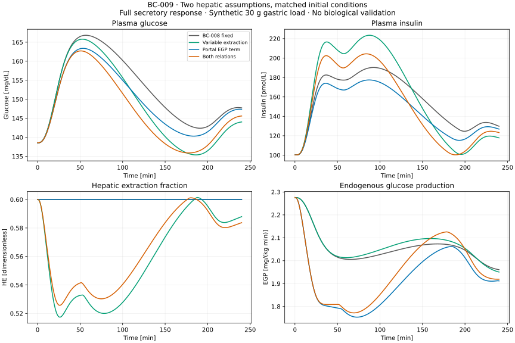

# BC-009: hepatic structure assessment and synthetic comparison

BC-009 quantifies how two explicit hepatic assumptions change the earlier glucose-feedback result. **All 24 cases pass the frozen numerical criteria**, under three solver settings and an exact fresh-process repeat. The extraction and portal-EGP relations materially change the synthetic contrast, with nonadditive effects. This establishes structural sensitivity, not improved biological accuracy, residual-T1D prediction or therapy efficacy. OT-026 and M4 remain partial.

Work started from `c6cb206` in `/private/tmp/opent1d-beta-cell-reference`, branch `codex/beta-cell-reference`. The original checkout, upstream package, numerical locks and earlier reference implementations were preserved. The [assessment and model specification](m4-hepatic-assessment.md), [decision 0024](../decisions/0024-hepatic-structure-sensitivity.md), [frozen protocol](../../experiments/m4/hepatic/protocol.json), [source register](../../experiments/m4/hepatic/sources.json) and [execution record](../../experiments/m4/hepatic/execution.json) define this contribution.

## Scientific assessment

Dalla Man, Rizza and Cobelli's [2007 primary paper](https://doi.org/10.1109/TBME.2007.893506), equations 4–7 and 10–12, supplies an S-dependent hepatic extraction relation and a direct portal-state term in endogenous glucose production (EGP). Table I's normal-column m5 and kp4 are used as fixed hypothetical coefficients. Basal intercepts are explicitly reanchored using the paper's equilibrium constraints. This preserves the BC-008 initial conditions and distinguishes a dynamic change from an unbalanced starting state.

Literal substitution would give HE=0.623566 instead of 0.6 at the full-source baseline, changing the liver derivative by -0.126006 pmol/(kg min). Subtracting absolute kp4*P without adjusting the EGP intercept changes the initial glucose derivative by -0.049960 mg/(dL min). These diagnostics explain why a direct coefficient substitution would be an unsuitable matched comparator. They are not simulated treatment responses.

The primary-source review supports investigating the mechanisms but does not establish these coefficients in T1D. The cited healthy-human pulsatility study does not independently establish a universal negative linear relation between smooth secretion and extraction. Animal portal-delivery evidence does not calibrate human kp4. A native delayed-insulin coefficient may already represent some omitted biological effects; keeping it fixed isolates a mathematical change but does not prove the new action is biologically separable. The assessment documents these limits and the required paired kinetic and tracer measurements.

## Reproduce

From the worktree root, using a new output directory:

```bash
uv sync --locked
uv sync --locked --project experiments/m0/simglucose
uv run --locked --project experiments/m0/simglucose \
  python -m unittest experiments.m4.hepatic.test_numerical -v
uv run --locked python -m experiments.m4.hepatic.run \
  --output results/m4-hepatic/my-reference
uv run --locked python -S -m experiments.m4.hepatic.report \
  results/m4-hepatic/my-reference --output results/m4-hepatic/reconstructed.json
cmp results/m4-hepatic/my-reference/report.json results/m4-hepatic/reconstructed.json
uv run --locked --project experiments/m0/simglucose \
  python -m experiments.m4.hepatic.plot results/m4-hepatic/my-reference \
  --output results/m4-hepatic/reconstructed.svg
cmp results/m4-hepatic/my-reference/figure.svg results/m4-hepatic/reconstructed.svg
uv run --locked python scripts/check.py
```

The [runner](../../experiments/m4/hepatic/run.py) executes four hepatic variants × three source cases × two stimuli, each under coarse, tight and reference settings. It also calculates six unchanged BC-008 trajectories for exact comparison and reruns the complete numerical worker in a fresh process. Analytic source verification and the hepatic preflight precede trajectories. The [wrapper](../../experiments/m4/hepatic/numerical.py) replaces only the specified loss/EGP terms, their ledgers and the glucose derivative seen by secretion at the same solver stage.

The archive contains input protocols, source fixtures, full virtual parameters and identities, runtime locks, code snapshots, all states/flux ledgers, independent glucose-flux quadrature, transition roots, settings, logs, failures, a hash manifest and a reconstructible figure/report. No human measurements or fitted parameters enter. The [report builder](../../experiments/m4/hepatic/report.py) needs only Python's standard library and verifies the full inventory, source analytic reference, conservation and contrast arithmetic. It does not execute archived code. A failed case retains its available state and reason, stays in the denominator and prevents accepting the contrast matrix. An interrupted worker retains its failed manifest and log; use `--allow-failed` to reconstruct that evidence. Existing output directories are never overwritten.

## Numerical evidence

The completed local archive is `results/m4-hepatic/reference-01`. All 72 variant/case/solver trajectories and six BC-008 comparisons complete at 240 minutes. The fresh process reproduces all **82 numerical artifacts byte for byte**, including source checks and preflight. No scientific scenario failed and no protocol, parameter or tolerance changed after inspecting results. A subsequent lint-only report edit removes import spacing and renames a local loop variable; rebuilding the report and SVG with the final code gives identical bytes. Numerical implementation snapshots remain identical to the executed versions.

| Check | Maximum discrepancy | Frozen limit |
| --- | ---: | ---: |
| Disabled versus unchanged BC-008, all states | 0 | 0 |
| Native-zero variants, all states | 0 | 0 |
| Basal derivative change, native units/min | 0 | 1e-8 |
| Independent literal hepatic/source equations | 3.55e-15 | 1e-12 |
| Same-stage source derivative check | 8.88e-16 | 1e-12 |
| Insulin/portal inventory balance, pmol/kg | 2.24e-11 | 1e-6 |
| Independent glucose balance, mg/kg | 3.67e-8 | 1e-5 |
| Tight/reference glucose, mg/dL | 1.51e-7 | 0.01 |
| Tight/reference plasma insulin, pmol/L | 4.60e-6 | 0.01 |
| Tight/reference source rates, pmol/(kg min) | 5.09e-7 | 1e-5 |
| Constant-basal variant glucose, mg/dL | 0 | 0.01 |
| Fresh-process artifact differences | 0 | 0 |

Fasting glucose and insulin drift remain below 1.8e-10 mg/dL and 4.1e-10 pmol/L. Source analytic errors are 1.78e-14 pmol/(kg min) for Z and 1.02e-9 pmol/kg for P. No physical negative amounts or computational-domain exits occur in the frozen matrix. Extraction-only HE spans 0.517366–0.601418; with both relations it spans 0.525700–0.601222. These are outputs of the assumed law, not an empirical physiological range.

Eight numerical tests include an independent matrix-exponential kinetic transient, instantaneous mass conservation, corrected same-stage Gdot, and a deliberately forced HE termination with retained time/state. Nine root artifact tests detect corrupted balances, wrong source/extraction values, changed protocols, damaged analytic references, invalid/incomplete calculations and lost failure evidence. The full root suite and strict documentation build, archived BC-008 reconstruction, simulator-free report and SVG reconstruction are recorded in the execution record. Remote CI has been extended but was not run locally.

## Synthetic effects



All cases start at 138.56 mg/dL with identical plasma insulin and SC schedule. For the full-responsivity source and 30 g initial gastric load:

| Hepatic variant | Peak glucose, mg/dL | Glucose at 240 min, mg/dL | Glucose AUC contrast versus its constant-basal control, mg min/dL | EGP integral contrast, mg/kg |
| --- | ---: | ---: | ---: | ---: |
| Fixed BC-008 | 166.819 | 147.747 | -4200.363 | +15.284 |
| Variable extraction | 165.794 | 144.043 | -5221.486 | +18.077 |
| Direct portal EGP term | 163.383 | 147.371 | -4921.113 | -17.986 |
| Both relations | 162.705 | 145.610 | -5586.709 | -9.454 |

All nonzero load-case contrasts exceed the frozen numerical-resolution criterion; zero nadir contrasts and tiny fasting results remain in the report with their classifications. There is no clinical improvement threshold. The glucose AUC is the signed integral above initial glucose; table entries subtract the corresponding constant-basal AUC. Peaks and nadirs are sampled at the fixed 0.25-minute grid.

The combined change relative to fixed is -1386.347 mg min/dL in the AUC contrast and -4.114 mg/dL in peak glucose. The factorial AUC interaction is **+355.527 mg min/dL** (largest solver-dependent change 0.001510), so the joint change is smaller in magnitude than the sum of the separate changes. Combined final glucose is also higher than extraction-only final glucose. These are coupled effects across secretion, clearance and glucose action, not additive treatment benefits.

The EGP contrast changes sign when the portal term is enabled. It measures the integrated response of the complete feedback system, including glucose and delayed systemic action, rather than the isolated direct coefficient. Similar glucose curves therefore cannot establish which hepatic mechanism is correct. Concentration and flux observations are needed.

## Roadmap and next evidence

- **OT-024:** bounded evidence/measurement work remains delivered; the source dossier now includes the hepatic evidence and its applicability gaps. No external review, authorized cohort access or collaboration is claimed.
- **OT-015:** this additional coupling specification records units, baseline intercepts, process ownership and same-stage feedback. It is limited to the declared synthetic hybrid.
- **OT-025:** equation-level references remain numerically verified. No full published healthy/T2D trajectory or patient/cohort has been reproduced here; original dynamic inputs and appropriate observations remain missing.
- **OT-026:** bounded feedback and this hepatic structural assessment are implemented. Population-specific calibration, human identifiability, external domain review and independent observation assessment remain open. M4 is not complete.

The subsequent [BC-010 observation experiment](m4-feedback-observation-results.md) now implements the following bounded next step; joint/human identifiability remains open.

The next bounded implementation recorded at BC-009 completion was to specify and verify an observation adapter from the feedback source's **pancreatic appearance Spo** into the existing forward C-peptide reference, keeping the insulin-only portal transit distinct from the C-peptide kinetics. A synthetic observation experiment can then assess which secretion/clearance ambiguities persist with glucose, insulin and C-peptide, and which require independently justified kinetics or EGP tracer observations. Synthetic recoverability would still not establish human identifiability. The [measurement/access assessment](m4-cpeptide-measurements.md) and the concrete unsent review question in the [hepatic assessment](m4-hepatic-assessment.md) define the external evidence needed next.

M5/OT-027 remains preparation for a specified treatment, population and endpoint. This study supplies neither graft anatomy nor an intervention-to-function relationship. Changing functional gain or selecting a liver equation cannot establish cell count, engraftment, immune protection or clinical insulin independence. No outreach, access application, restricted-data download or remote publication occurred.
