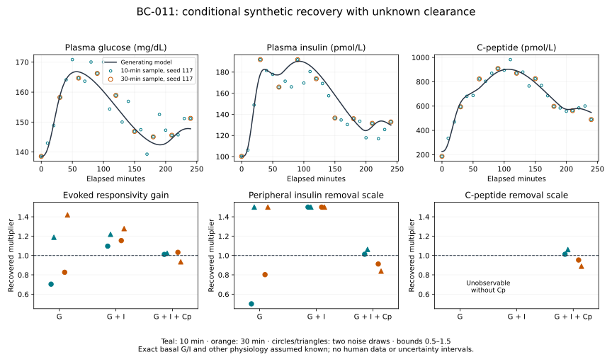

# BC-011 — What the three synthetic observation channels constrain

BC-011 implements a conditional parameter-recovery experiment for the existing glucose–secretion–insulin loop and its passive C-peptide observation. It compares dynamic G, G+I and G+I+C-peptide at 10- and 30-minute intervals, with known versus unknown clearance, one noiseless input and two shared noise realizations. This is a favorable same-model synthetic study, not calibration to a person, a global identifiability proof or a validated clinical sampling recommendation.

The [frozen protocol](m4-joint-identifiability-protocol.md) and [decision 0026](../decisions/0026-joint-synthetic-identifiability.md) define scope and the pre-fit derivative amendment. The experiment starts from `b0bd514` in `/private/tmp/opent1d-beta-cell-reference`, branch `codex/beta-cell-reference`; original worktree changes and historical experiments are preserved.

## What is implemented

The [forward model](../../experiments/m4/joint_identifiability/model.py) reuses the unchanged BC-008 derivative and adds passive C-peptide amounts. Candidate removal rates receive consistent fasting inventories while preserving the assumed exact basal glucose/insulin and known SC input. Thus the comparison asks about **dynamic measurements with this baseline knowledge**. Basal secretion is derived from the equilibrium condition, not recovered independently. The three candidate multipliers describe common evoked responsivity, peripheral insulin removal m4 and central C-peptide removal k3. They do not count cells or identify hepatic clearance.

The [inference code](../../experiments/m4/joint_identifiability/inference.py) uses fixed absolute log-parameter differences, weighted residuals and two off-truth starts per analysis. It explicitly marks k3 unobservable without Cp. Sensitivity decomposition, forward verification and result reconstruction have separate implementations. The [report reader](../../experiments/m4/joint_identifiability/report.py) checks the full matrix, shared observations, residual arithmetic, bound hits, recovery, derivative refinement, SVD factors and their source matrices without importing a numerical package. Every start is checkpointed, and failed computations remain in the archive.

Dalla Man et al. ([2007](https://doi.org/10.1109/TBME.2007.893506)) and Polonsky et al. ([1986](https://doi.org/10.1172/JCI112308)) retain the model ancestry documented in the [secretion](models/dallaman2007-secretion.md) and [C-peptide](models/polonsky1986-cpeptide.md) cards. The local-sensitivity and recovery scope follows the distinction from global/data-limited identifiability discussed by [Raue et al. 2009](https://doi.org/10.1093/bioinformatics/btp358). No author assets or human records were imported.

## Reproduce

From this worktree:

```bash
uv sync --locked
uv sync --locked --project experiments/m0/simglucose
uv run --locked python -m experiments.m4.joint_identifiability.run \
  --output results/m4-joint-identifiability/my-reference
```

The command starts two complete numerical processes, each with 36 analyses and 72 fitted starts, then reconstructs the report and figure. It refuses to overwrite an existing directory. Source files, native identities, locks, protocol, observations/noise, sensitivity matrices, estimates, predictions, residuals, verification and logs are archived. The source generator uses tighter numerical settings than the fitting solver. The separate root environment remains tooling only.

```bash
uv run --locked python -S -m experiments.m4.joint_identifiability.report \
  results/m4-joint-identifiability/my-reference \
  --output results/m4-joint-identifiability/reconstructed.json
cmp results/m4-joint-identifiability/my-reference/report.json \
  results/m4-joint-identifiability/reconstructed.json
uv run --locked --project experiments/m0/simglucose \
  python -m experiments.m4.joint_identifiability.plot \
  results/m4-joint-identifiability/my-reference \
  --output results/m4-joint-identifiability/reconstructed.svg
cmp results/m4-joint-identifiability/my-reference/figure.svg \
  results/m4-joint-identifiability/reconstructed.svg
uv run --locked --project experiments/m0/simglucose \
  python -m unittest experiments.m4.joint_identifiability.test_numerical -v
uv run --locked python scripts/check.py
```

## Execution and interpretation

The first complete execution contains all **36 analyses and 72 starts**, with no failed optimizer or model solves. All noiseless active parameters recover within the prespecified 1% criterion: the worst relative error across both starts is **1.105e-7**. The complete fresh-process repeat produces **40 byte-identical numerical files**, including all datasets, fits, sensitivities and forward checks. The [execution record](../../experiments/m4/joint_identifiability/execution.json) retains hashes and compact results; raw arrays/logs remain under ignored `results/`. Standard-library report reconstruction and figure reconstruction are byte-identical.

With unknown clearance, both G and GI have local rank 2 out of the three declared parameters: k3 is exactly unobservable. Their two nonzero directions are numerically resolved under the checked refinements. Adding Cp gives local rank 3 for this restricted parameter set. At 10 minutes, the smallest nonzero weighted singular values are 0.2393 for G and 1.2223 for GI; the smallest GIC singular value is 11.8405. These depend on the frozen noise weights and log coordinates and are not universal identifiability scores. Each is compared with its own derivative-refinement discrepancy; the largest GIC discrepancy is 0.00110.

**Local rank does not imply stable recovery from noisy measurements.** The table shows maximum absolute relative parameter errors of the best completed start, over the four specified schedule/noise combinations. A boundary count describes these four cases, not a population failure rate.

| Unknown-clearance observations | Evoked gain error | m4 error | k3 error | Cases with a bound hit |
| --- | ---: | ---: | ---: | ---: |
| G | 41.91% | 50.00% | Unobservable | 3 / 4 |
| G + I | 27.75% | 50.00% | Unobservable | 4 / 4 |
| G + I + Cp | 6.61% | 16.18% | 11.13% | 0 / 4 |

Seven of the eight noisy G/GI cases put peripheral insulin clearance at an imposed 0.5 or 1.5 bound. Good optimization and a recovered noiseless truth therefore do not make that clearance a precise measurement. More fitting iterations or reporting the bound as a confident estimate would not address the information limitation.

For GIC, the largest individual parameter error over the two fixed noise realizations is 6.25% at 10-minute sampling and 16.18% at 30-minute sampling. These examples favor retaining joint information and sufficient sampling in this scenario; two realizations cannot establish a reliable clinical sampling interval. With kinetics assumed known, the maximum gain errors across the same four combinations are 18.18% for G, 8.55% for GI and 4.46% for GIC. Fixing nuisance parameters makes the recovery task easier and must remain visible in any comparison.

The largest disagreement between the two fitted starts is 3.54e-5 in multiplier units. This checks these starts only; it does not exclude distant alternative solutions.

## Numerical and software verification

The forward stage passes all 46 gates. The largest fit/reference difference is 9.62e-7 in SD-scaled output units against a 0.001 limit. Mass-balance discrepancies are at most 4.32e-12 pmol/kg. Original BC-008 glucose/insulin agreement is 5.11e-10 in scaled units. The independent Cp matrix-exponential comparison converges from 0.009949 to 0.000622 pmol/L as pancreatic-input sampling is refined from 0.25 to 0.0625 minutes; its frozen final limit is 0.01 pmol/L.

The full weighted Jacobian discrepancy is 5.88e-7 relative under difference-step refinement and 8.13e-6 under solver refinement, both below 0.01. Every reported nonzero local direction also exceeds its own checked numerical discrepancy. Algebraically absent k3 sensitivities in G/GI are explicitly zeroed after preserving the small adaptive-solver leakage as a diagnostic.

Six native numerical tests exercise the forward gates, units/equilibrium, invalid and incomplete output, corrupted conservation accounting and independent analytic derivatives at/near bounds. Twenty-one standard-library artifact tests use hand-calculated objectives and synthetic orthogonal matrices; they reject changed observation subsets, missing starts, false gate statuses, wrong SVD bindings and altered archives. The required `uv sync --locked` and `uv run --locked python scripts/check.py` complete successfully: 370 repository tests, linting and the strict documentation build pass. Both locks are unchanged. The added CI job is configured but was not executed remotely during this task. No scientific failure required a protocol or tolerance change.



## What to measure next

This experiment supports testing **paired glucose, plasma insulin and C-peptide** as a candidate observation set for the declared question. It does not justify a clinical protocol by itself. The subsequent [BC-012 volume experiment](m4-volume-sensitivity-results.md) now tests C-peptide distribution-volume knowledge with prespecified fixed-correct, fixed-wrong and unknown-volume arms while preserving the remaining BC-011 settings. It isolates one nuisance assumption and documents biased low-residual fits and reduced noisy precision when volume is free. Unknown exchange rates and uncertain basal insulin remain further extensions; properly nuisance-reoptimized likelihood profiles could characterize uncertainty within the chosen model. Preserve the fixed-hepatic variant as a named assumption; earlier BC-009 results show why it cannot silently become population truth.

For eventual human assessment, obtain source-appropriate assay/noise characteristics, repeated basal observations, documented stimulus/SC delivery and relevant kinetic covariates, alongside an independent evaluation plan and domain review. More patient data with the same uninformative channels need not resolve an unobservable parameter. No human data were read and no collaboration was initiated.

## Remaining evidence boundary

Full local numerical rank and agreement of two optimization starts do not prove global uniqueness. Two noise realizations do not establish confidence coverage or a recovery probability. The engineering noise levels and hard parameter bounds are not empirical uncertainty estimates. G is modeled plasma glucose; there is no sensor-lag or CGM observation model. Fixed hepatic structure, insulin action, meal kinetics, Cp exchange/volume and exact baseline conditioning make this substantially easier than human inference.

OT-024 and the relevant OT-015 specification remain delivered. OT-025 still lacks exact published dynamic cohort reproduction; OT-026 remains partial for population-specific calibration, independent observations, external biological review and human identifiability. The [measurement requirements](m4-cpeptide-measurements.md) remain conditional; no data-access request, collaboration or therapy effect is claimed.
