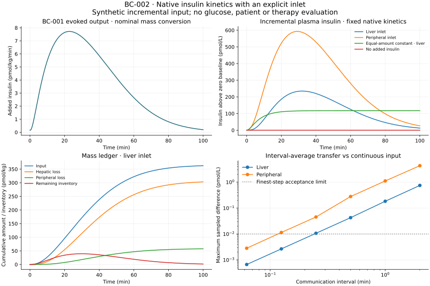

# BC-002 kinetic inlet: execution and limits

Executed on 20 September 2026. The bounded extension reuses the pinned simglucose insulin derivatives and compares explicit liver/peripheral inputs with an independent matrix-exponential solution. **The refined BC-002/2 numerical execution passes all fifteen checks at the frozen reporting times.** The original BC-002/1 communication criterion fails at 0.125 minutes for peripheral delivery; that negative result is retained. Neither outcome establishes physiological validity.

The [protocol](m4-kinetic-protocol.md) and [boundary assessment](m4-kinetic-boundary.md) describe the scientific contract. [Run and reconstruction commands](../../experiments/m4/kinetic_inlet/README.md) reproduce the experiment in the existing M0 environment; the [execution record](../../experiments/m4/kinetic_inlet/execution.json) identifies attempts and archived evidence. This is a new bounded OT-026 contribution after [BC-001](m4-results.md), based on `615bed7` in the same isolated `codex/beta-cell-reference` worktree. No later changes from the original working directory were imported.

## What the code establishes

The [native wrapper](../../experiments/m4/kinetic_inlet/native.py) calls the original 13-state derivative and adds a named liver influx at index 9 or peripheral influx at index 5 under the native nonnegative-state guard. Nonzero execution integrates only Ip, Il and cumulative input/loss ledgers; the other carrier entries are not interpreted as a glucose trajectory. An [independent oracle](../../experiments/m4/kinetic_inlet/oracle.py) directly assembles the kinetic matrix with auxiliary linear-input states; it never calls the native derivative. [Verification](../../experiments/m4/kinetic_inlet/verify.py) compares both numerical methods, conservative transfer intervals, baselines and input gains.

The source/parameter-file hashes and installed revision match simglucose `a6f6777586c860457a2a1e6cce6d0bd3fd33d1cc`. All original upstream files remain unchanged. The sole full-patient regression uses zero added secretion: 61 samples of all 13 states over 60 minutes agree exactly with the original native patient, including fresh instances and reset. Thirty derivative probes cover both routes and guarded zero/negative states. This is software preservation, not a new test of native physiological accuracy.

The incremental mass identity is `Ip + Il + hepatic_loss + peripheral_loss = cumulative_input`. Native m1/m2 exchange is not counted as disappearance; m30 and m4 retain sole ownership of hepatic/peripheral loss. Zero SC inventories and zero exogenous input prevent adding pharmaceutical absorption to secretion. Added basal secretion remains zero by experimental definition, not by a claim about fasting physiology.

## Original frozen result: BC-002/1

Four engineering inputs (zero, constant, finite pulse, ramp) were tested by both routes. The pulse has explicit boundaries at 5.3 and 15.7 minutes. Independently calculable total inputs are 0, 100, 20.8 and 100 pmol/kg respectively. Reporting uses 403 points: the regular 0.25-minute grid plus both off-grid boundaries. **All reported trajectory/transfer maxima are sampled on that grid; they are not continuous-time bounds.** Splitting the input at each segment boundary preserves its definition but does not establish an error bound between output samples.

The BC-001 source is its completed printed-initialization reference. Its 401 sampled evoked-release values define a piecewise-linear input, converted to pmol/(kg min) using the declared 5808 g/mol and native virtual weight 102.32 kg. Integrated converted input is **362.710286 pmol/kg**. This is the exact integral of the declared source interpolant, not a dose recommendation or recovered participant secretion.

| Check | Observed result | Frozen criterion |
| --- | --- | --- |
| Native zero-extension derivatives, trajectories, fresh/reset | All discrepancies zero | Exact equality |
| Primary tight/reference versus independent oracle | Maximum insulin-state error 2.05e-9 pmol/kg; plasma error 2.70e-8 pmol/L | At most 1e-7 and 1e-6 respectively |
| Source replay tight/reference versus oracle | Maximum insulin-state error 2.45e-9 pmol/kg; plasma error 3.06e-8 pmol/L | Same criteria |
| Primary and source mass/input ledgers | Maximum discrepancy 7.96e-13 pmol/kg | At most 1e-8 |
| Scalar mass/mole anchor | 5.808 micrograms = 1000 pmol; zero relative error | At most 1e-12; importer separately checks every converted row |
| Repeatability and gain 0/0.5/1/2 linearity | Zero state discrepancy; zero input/gain exactly zero | Exact repeat/zero; scaling error at most 1e-7 |
| Minimum numerical state | Zero | At least −1e-9 pmol/kg |
| Interval-average transfer amounts | Maximum error 2.50e-12 pmol/kg | At most 1e-8 |
| Finest liver transfer, 0.125 min | Concentration error 0.00267223 pmol/L; fine/coarse ratio 0.00356608 | At most 0.01 pmol/L and ratio 0.35; passed |
| Finest peripheral transfer, 0.125 min | Concentration error **0.0114951 pmol/L**; fine/coarse ratio 0.00266039 | Absolute criterion **failed**; ratio passed |

Fourteen of the fifteen verification groups pass. The communication group requires both routes; it correctly reports failure despite strong convergence and conserved input. The result must not be relabeled complete by considering only its favorable liver route or by raising the threshold after inspecting the error.

The largest sampled difference between liver and peripheral plasma concentrations under identical dynamic input is approximately **361.811 pmol/L**. This is a structural consequence of the fixed coefficients and route, not evidence that one route is a superior therapy. The numerical-resolution comparison includes both solver/oracle disagreement and the finest communication discrepancy. The 0.125-minute discrepancy remains far smaller than 1% of that route contrast even though it misses its separate absolute tolerance.

The equal-area constant-input baseline preserves the same integrated amount. It provides a comparator for timing effects; it is not a calibration of endogenous basal secretion. The zero-input comparator remains exactly zero. Functional/source gain is an input amplitude experiment, not anatomical cell mass or a mechanistic model of graft survival.

| Route and input, each nonzero case totaling 362.710286 pmol/kg | Sampled peak incremental plasma insulin (pmol/L) | Insulin remaining at 100 min (pmol/kg) |
| --- | --- | --- |
| Liver, time-varying source | 235.040 | 1.84036 |
| Liver, equal-area constant | 117.426 | 19.5976 |
| Peripheral, time-varying source | 592.772 | 2.49089 |
| Peripheral, equal-area constant | 293.565 | 25.5115 |

Equal input totals need not imply equal finite-horizon concentration curves or remaining inventories. These numerical comparisons use identical fixed kinetic coefficients and an uncalibrated synthetic source scale.

## Separate numerical refinement

A separate [BC-002/2 protocol](../../experiments/m4/kinetic_inlet/refined-protocol.json) adds a 0.0625-minute communication interval after the BC-002/1 negative result. It retains the original thresholds, original five resolutions, source trace, routes, parameters and scientific exclusions. This is disclosed numerical follow-up rather than a prespecified result of BC-002/1. The original protocol and failed `results/m4-inlet/reference-01` attempt remain historical evidence.

The refined numerical execution passes all fifteen groups. At 0.0625 minutes the sampled concentration discrepancy is **0.000668132 pmol/L for liver delivery** and **0.00283503 pmol/L for peripheral delivery**, both below 0.01. Their finest/coarsest sampled-error ratios are 0.000891617 and 0.000656130, below 0.35. Maximum communication amount error remains 2.50e-12 pmol/kg. The maximum of solver/oracle disagreement and the finest sampled communication discrepancy is 7.84e-6 of the sampled route contrast, below the prespecified 0.01 fraction.

These are measured finite-grid results; they do not certify continuous-time communication error or every possible input. A later consumer with different query times requires a corresponding error assessment. The unchanged earlier resolutions remain in the refined report, including the failed peripheral 0.125-minute setting. The unmodified continuous piecewise-linear source and its conservative interval-average approximation are different numerical input representations; their difference is kept separate from ODE solver refinement.

## Failure handling and reproducibility

During implementation, the existing SciPy version's automatic initial-step estimate attempted to evaluate the right-hand side outside short source-input segments. The finite-domain forcing correctly rejected that probe. The driver now supplies a first step bounded by segment duration and maximum step, while preserving adaptive error control and exact segment splitting. This prevents extrapolation without relaxing a scientific acceptance threshold; a regression exercises the short source grid.

The runner archives source/configuration identities, used BC-001 files, native coefficients, exact inputs, output traces, verification and errors. Existing directories are refused; final report/figure artifacts are required for completion. A failed verification preserves the attempted case traces and measured checks. Public reconstruction does not accept a started, failed or calculated-only attempt as a completed experiment. The mathematical oracle, native derivatives, input interpolation and reporting have separate files for review.

The native environment passed 26 tests, including exact route ownership, finite jumps, short source segments, mass accounting, guarded states, rejection of malformed or incomplete solves and durable runner failures. The root environment passed 32 artifact tests with hand-calculable fixtures and no scientific imports. The repository-wide check passed all 233 repository tests, lint and documentation checks; native model tests run separately. The [execution record](../../experiments/m4/kinetic_inlet/execution.json) identifies the commands and artifacts.

The final archive is `results/m4-inlet/reference-04`; `reference-02` preserves the earlier successful refined run before report-label clarification. JSON reconstruction used `python -S`, without scientific packages or archived-code execution, and was byte-identical to the saved report. Artifact-only SVG reconstruction was also byte-identical. A new-process repetition in `results/m4-inlet/repeat-01` produced all nine numerical/report artifacts byte-identically. These are observed local reproducibility results, not a promise of bitwise equality across hardware or library versions. The public figure was visually checked for layout, units, the sampled-error definition and the frozen tolerance line. Internal AI-assisted checking is not independent human scientific review.

## Remaining OT-026 and cell-therapy gates

This extension establishes an executable kinetic inlet and quantifies a specific transfer limitation. **OT-026 and M4 remain incomplete.** It does not integrate secretion feedback with glucose, infer a physiological basal rate, reduce exogenous delivery or evaluate a transplant. The native fixed m30 and missing direct portal-insulin term in glucose production prevent reading the route contrast as a complete portal-versus-peripheral metabolic comparison.

BC-001's pool scale remains illustrative. Its paper/code initialization discrepancy, unavailable cohort glucose input and omitted term in the published reduction remain unresolved; accurate downstream kinetics cannot repair them. The selected secretion reduction also does not cover arbitrary rising/meal glucose. Its output is evoked release, not total endogenous secretion, and it contains no C-peptide measurement model.

The next scientific step is a domain-reviewed secretion/observation question for the intended glucose regime, with explicit basal and scale assumptions, appropriate dynamic glucose/C-peptide/insulin measurements and an identifiable parameter subset. Use independent or reserved observations for assessment. Later cell-therapy work additionally needs a defined site, intervention, population, longitudinal outcome and treatment information; a capacity sweep alone supplies none of those mechanisms or evidence. No person was contacted, restricted patient data downloaded or access application submitted by this kinetic experiment.
