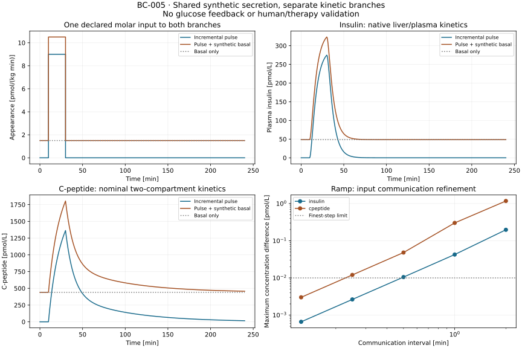

# BC-005: executed paired insulin and C-peptide kinetics

The [frozen BC-005 protocol](m4-paired-kinetics-protocol.md) now executes both kinetic branches from one explicit synthetic molar input, including basal inventories and unforced washout. All six cases in each branch pass the prespecified criteria. **These are synthetic kinetic trajectories, without glucose feedback or human validation.** Equal molar input gives different concentrations because each branch owns different distribution and removal processes.

Work continues in `/private/tmp/opent1d-beta-cell-reference`, branch `codex/beta-cell-reference`, from `c9008d8`. BC-001/002/003/004 code and both scientific runtime locks are unchanged. [Decision 0021](../decisions/0021-paired-kinetic-execution.md) and the [machine execution record](../../experiments/m4/paired_kinetics/execution.json) record scope, sources, runtime identities, hashes and actual checks. Saved source snapshots identify the precommit implementation. The original working directory was not modified.

## Executed results

Run `results/m4-paired-kinetics/reference-01` consumes the completed BC-004 archive `results/m4-paired/reference-01`. It executes zero increment, an incremental pulse, pulse plus synthetic basal, a mass-rate ramp, basal only, and nonstationary washout. Initial inventories and input amounts come from the archived boundary and protocol; no parameters are estimated. The new [insulin wrapper](../../experiments/m4/paired_kinetics/insulin.py) supports nonzero inventories while calling the unchanged pinned native derivative. The C-peptide branch reuses its existing forward solver.



The pulse is 9 pmol/(kg min) from 10 to 30 min; the synthetic basal is 1.5 pmol/(kg min). Initial basal concentrations are 48.5619364 pmol/L insulin and 440.3992954 pmol/L C-peptide. Sampled incremental peaks are 274.7341889 and 1363.6481056 pmol/L, respectively. Adding basal changes these to 323.2961253 and 1804.0474010 pmol/L. These values describe the declared nominal profiles, not observed people or a jointly calibrated patient.

| Maximum discrepancy across declared cases and reporting times | Insulin | C-peptide | Frozen limit |
| --- | --- | --- | --- |
| Independent state calculation (pmol/kg) | 1.4041e-11 | 6.8213e-12 | 1e-7 |
| Tight/reference or analytical concentration (pmol/L) | 9.4695e-8 | 2.9991e-9 | 1e-5 |
| Mass balance including initial inventory (pmol/kg) | 1.5039e-11 | 5.3291e-12 | 1e-7 |
| Delivered-input accounting, including communication runs (pmol/kg) | 1.0232e-12 | 1.0232e-12 | 1e-7 |
| Basal equilibrium drift (pmol/kg) | 0 | 0 | 1e-8 |
| Total = basal + increment, all states/ledgers (pmol/kg) | 1.2677e-11 | 2.5012e-12 | 1e-7 |
| Repeated reference trajectory | 0 | 0 | Exactly zero |

No negative inventory was observed. The zero-initial insulin runs exactly match the unchanged BC-002 implementation. Nonstationary washout preserves the initial inventory at time zero and accounts for its subsequent elimination. Independent matrix-exponential references do not call the numerical ODE derivative; constant-input C-peptide also agrees with the published analytical kernel. Test fixtures additionally compare an affine stimulus with a one-compartment closed form and exercise equal decay rates and peripheral initial inventory.

| Interval-average input communication (min) | Insulin error (pmol/L) | C-peptide error (pmol/L) |
| --- | --- | --- |
| 2 | 0.1971108 | 1.1723834 |
| 1 | 0.0425609 | 0.3018061 |
| 0.5 | 0.0105301 | 0.0481349 |
| 0.25 | 0.0026369 | 0.0120341 |
| 0.125 | 0.0006595 | 0.0030085 |

Both finest-step errors meet 0.01 pmol/L. Finest/coarsest ratios are 0.003346 and 0.002566, below 0.35. Interval averaging preserves delivered amount; these differences isolate input discretization from the tightly integrated reference. The result does not specify a biological transit delay or continuous-time error bound.

## Reproduce and reconstruct

Run from the worktree root, using fresh output paths:

```bash
uv sync --locked
uv sync --locked --project experiments/m0/simglucose
uv sync --locked --project experiments/m4/beta_cell/runtime
uv run --locked python -m experiments.m4.paired_observation.run \
  --output results/m4-paired/my-boundary
uv run --locked python -m experiments.m4.paired_kinetics.run \
  --boundary-run results/m4-paired/my-boundary \
  --protocol experiments/m4/paired_kinetics/protocol.json \
  --output results/m4-paired-kinetics/my-reference
```

The standard-library parent starts each worker in its existing locked runtime. The output contains protocol and boundary archive, code snapshots, locks, runtime/native identities, initial states, inputs, all three solver trajectories, independent reference states, communication trajectories, worker status/logs, report and SVG. Existing output directories are refused. Failed or interrupted runs retain their artifacts and cannot be reconstructed as completed results.

```bash
uv run --locked python -S -m experiments.m4.paired_kinetics.report \
  results/m4-paired-kinetics/my-reference \
  --output results/m4-paired-kinetics/my-reconstructed.json
cmp results/m4-paired-kinetics/my-reference/report.json \
  results/m4-paired-kinetics/my-reconstructed.json
uv run --locked --project experiments/m4/beta_cell/runtime \
  python -m experiments.m4.paired_kinetics.plot \
  results/m4-paired-kinetics/my-reference \
  --output results/m4-paired-kinetics/my-reconstructed.svg
cmp results/m4-paired-kinetics/my-reference/figure.svg \
  results/m4-paired-kinetics/my-reconstructed.svg
```

Reconstruction verifies file hashes, required states and branch completeness, then recomputes summaries without integrating, fitting or executing archived code. It uses saved oracle states; rerunning the experiment is required to recompute those independent references. Hashes detect changes but do not authenticate an intentionally rewritten archive. The public SVG is generated from our synthetic experiment; no published figure or participant record is redistributed.

## Verification performed

Root and both scientific `uv sync --locked` commands passed. Seven new native insulin tests and three new C-peptide numerical tests passed in their respective runtimes. The full repository check passed 283 tests, including 16 new artifact/accounting/failure tests, plus Ruff, Markdown/YAML/citation checks, navigation and the strict Sphinx build. Commands:

```bash
uv run --locked --project experiments/m0/simglucose \
  python -m unittest experiments.m4.paired_kinetics.test_insulin -v
uv run --locked --project experiments/m4/beta_cell/runtime \
  python -m unittest experiments.m4.paired_kinetics.test_cpeptide -v
uv run --locked python scripts/check.py
```

A fresh-process repeat produces all 52 deterministic archived files byte-identically; the top-level manifest retains run-specific times and command paths. Standard-library report reconstruction and artifact-only SVG reconstruction are byte-identical. The figure was visually inspected. Saved source and lock snapshots match the live implementation. Tests reject changed units/volumes, nonfinite/boolean states, missing solvers or output rows, invalid initial ledgers, incorrect mass accounting, incomplete numerical solves, changed repeat evidence, traversal/symlink archives and incomplete status. They also verify durable worker-failure/interruption records and overwrite refusal.

Both complete experiment attempts passed; no failed scientific attempt or post-result threshold amendment was needed. Existing standalone studies were not rerun wholesale because their code and locks are unchanged; the new insulin path is checked directly against BC-002. The CI workflow now includes the paired tests, execution and reconstruction. Remote CI was not run.

## Evidence boundary and next step

BC-005 closes the paired kinetic execution dependency identified by BC-004, including the missing nonzero insulin initialization. It does not resolve BC-001's source-initialization and whole-body/basal scale gaps, pair the nominal profiles biologically, or identify secretion and kinetics from unknown-input human curves. No new parameter recovery, joint identifiability or sensitivity-to-physiology claim is made; BC-003's synthetic identifiability limits remain applicable. Solver and input-discretization sensitivity are numerical evidence only.

OT-024 and the relevant OT-015 specification remain delivered; actual domain review and authorized observations remain open. OT-025 retains the completed equation/stimulus references and unresolved exact dynamic cohort reproduction. OT-026 advances to two verified forward kinetic outputs with synthetic basal handling, while full glucose feedback, biological interpretation and independent observation assessment remain incomplete. No M4 completion or OT-027 therapy result is claimed.

The next scientific step is to resolve the secretion scale/basal and initialization discrepancies against the original source or authors' clarification, and obtain review of the [paired-boundary packet](m4-collaboration-brief.md#paired-boundary-review-packet). The [measurement assessment](m4-cpeptide-measurements.md) identifies the required stimulus, sampling, assays, renal information and separate administered-insulin record. No ready authorized paired dataset is established. Only after a suitable question, baseline and observations are justified should a new protocol permit glucose feedback or human assessment. A later cell-therapy study additionally needs a specified graft site, survival/function mechanism and independently supported intervention effect. No outreach or access request was sent.
