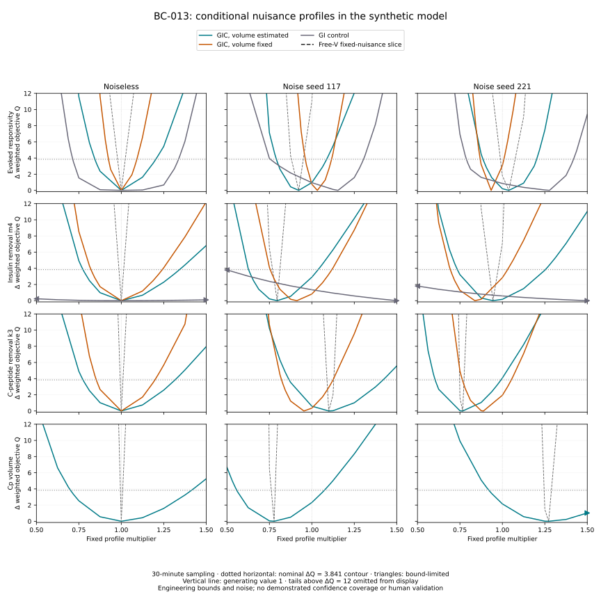

# BC-013 — Conditional nuisance profiles for beta-cell inference

BC-013 examines the uncertainty left by the BC-012 point estimates. For each fixed gain, removal rate or volume value, it reoptimizes every remaining unknown within the same parameter bounds. It compares these profiles with fixed-nuisance slices, with correctly fixed volume and with observations that omit C-peptide. This is a conditional synthetic investigation of objective geometry, not human parameter identification or a demonstrated confidence procedure.

The [protocol](m4-profile-likelihood-protocol.md), [machine specification](../../experiments/m4/profile_likelihood/protocol.json) and [decision 0028](../decisions/0028-conditional-profile-likelihood.md) were frozen before numerical implementation and biological fitting. Work starts from `da5adbf` in `/private/tmp/opent1d-beta-cell-reference`, branch `codex/beta-cell-reference`. The original worktree, historical experiments and existing environment locks are preserved.

## What is implemented

The [optimizer](../../experiments/m4/profile_likelihood/optimizer.py) uses the unchanged BC-012 forward model. C-peptide contributes information through its forward observation branch; secretion remains generated by the coupled glucose-dependent source. It removes exact basal G/I from the stochastic objective while retaining basal C-peptide. The 30-minute schedule gives 25 GIC or 16 GI residuals. Noise scales remain the previously declared engineering values. When volume is a nuisance coordinate, it is minimized analytically conditional on the other parameters; when it is the profile target, it stays fixed. This preserves full nuisance optimization while reducing the numerical search dimension.

The [profile driver](../../experiments/m4/profile_likelihood/profiles.py) executes nine design/dataset cases and 27 profile curves. It retains coarse and midpoint grids, the unrestricted estimate, every detected threshold crossing and all bisection histories. Both final crossing endpoints and parameter bounds receive reference-solver refits. A fixed-nuisance slice holds every other coordinate at the unrestricted best and is explicitly distinguished from a profile. The [report reader](../../experiments/m4/profile_likelihood/report.py) reconstructs residual arithmetic, projection, starts, minima, grids, crossing histories, solver comparisons and boundary classifications without numerical libraries.

The method follows [Raue et al. 2009](https://doi.org/10.1093/bioinformatics/btp358), especially equations 4–6, 8 and 10. The reference contour is `DeltaQ=3.841458820694124` for `Q=-2*log(L)+constant` under fixed independent Gaussian errors. It is a nominal pointwise one-parameter asymptotic reference, not joint or empirically verified 95% coverage. [Self and Liang 1987](https://doi.org/10.1080/01621459.1987.10478472), sections 3–4, explains why boundary conditions need particular care. The physiological ancestry remains the existing [Dalla Man secretion](models/dallaman2007-secretion.md) and [Polonsky C-peptide](models/polonsky1986-cpeptide.md) references. No author software, paper asset or human record was imported.

## Conditional findings

Both complete executions contain **nine cases, 27 profiles, 504 profile points, 148 reference checks and 1,364 optimizer starts each**, including the independent unprojected parent comparators. Every case and profile passes its numerical gates, with no failed starts. All **12 numerical artifacts are byte-identical** across the fresh processes. The regenerated observations also match BC-012 exactly; all 42 source snapshots match the current implementation. Report reconstruction without numerical libraries and figure reconstruction are byte-identical.

Knowing the correct volume narrows the sampled gain, m4 and k3 contour spans in all three specified examples. With noise, the contours also shift. For seed 117, estimating volume gives `(gain,m4,k3,V)=(0.92270,0.79592,1.09962,0.77788)` with `Q=23.02809`; fixing V=1 gives `(1.03262,0.91192,0.95325,1)` with `Q=25.34569`. The fixed-volume gain upper crossing near 1.115 exceeds the free-volume crossing near 1.088. Each design subtracts its own fitted minimum, so these comparisons do not imply universal nesting. Correct fixed volume represents external knowledge unavailable in the free-volume arm.

Without C-peptide, the m4 profile stays within the nominal contour at every sampled value across the engineering range [0.5,1.5] in **all three examples**. Both noisy unrestricted m4 estimates reach 1.5. The GI gain curves cross the contour inside their own range, but all three upper crossings have nuisance m4=1.5; the noiseless and seed-221 lower crossings have nuisance m4=0.5. This shows weak practical constraint under these observations. The C-peptide parameters k3 and V are structurally absent from GI observations and have no reported estimates.

Four sampled regions are limited by interest-parameter bounds: the three GI m4 regions and free-volume seed-221 V. Six further sampled regions close inside their interest range but depend on nuisance bounds at crossings: the three GI gain curves and free-volume seed-221 gain, m4 and k3. In the latter three, V=1.5 at the upper gain/m4 crossings and lower k3 crossing. No fixed-volume GIC curve has nuisance bounds at its crossings or inside its sampled contour. Thus a closed contour alone does not establish adequate constraint from measurements.

The fixed-nuisance slices can be much steeper because they suppress compensating changes in other parameters. Slice crossings are only bracketed by the profile sampling grid; they were not independently bisected and must not be quoted at the profile endpoint precision. The 47 profile crossings have bracket widths at most **0.00390625**, below the 0.005 limit. Every checked coarse, fine and final grid shows one inside component; untested components remain possible.

The generating k3 value 1 lies outside the free-volume seed-221 contour (`DeltaQ=4.07554`; upper bracket [0.98828125,0.9921875]). An exclusion can also occur under a correctly calibrated 95% procedure; this example neither establishes nor refutes calibration. All other noisy curves include the generating value. Two known development noise realizations cannot estimate coverage, and the noiseless curves describe geometry under prescribed error weights.

The table shows **unitless multipliers**, with brackets rounded to four decimals. A bracket locates a contour crossing; an engineering endpoint means the computed bound value remains inside the nominal contour. GIC observes glucose, insulin and C-peptide; GI observes glucose and insulin. Exact endpoint values, nuisance vectors and every refinement step remain in the reconstructed artifacts.

| Design / data | Parameter | Lower endpoint | Upper endpoint | Nuisance bounds at crossing |
| --- | --- | --- | --- | --- |
| GIC, free V / noiseless | Evoked gain | [0.8438, 0.8477] | [1.1992, 1.2031] | None |
| GIC, free V / noiseless | m4 | [0.7734, 0.7773] | [1.3398, 1.3438] | None |
| GIC, free V / noiseless | k3 | [0.7734, 0.7773] | [1.3164, 1.3203] | None |
| GIC, free V / noiseless | V | [0.6992, 0.7031] | [1.4141, 1.4180] | None |
| GIC, free V / seed 117 | Evoked gain | [0.7891, 0.7930] | [1.0859, 1.0898] | None |
| GIC, free V / seed 117 | m4 | [0.6250, 0.6289] | [1.0352, 1.0391] | None |
| GIC, free V / seed 117 | k3 | [0.8633, 0.8672] | [1.4180, 1.4219] | None |
| GIC, free V / seed 117 | V | [0.5547, 0.5586] | [1.0742, 1.0781] | None |
| GIC, free V / seed 221 | Evoked gain | [0.8828, 0.8867] | [1.1992, 1.2031] | V=1.5 at upper crossing |
| GIC, free V / seed 221 | m4 | [0.7344, 0.7383] | [1.2500, 1.2539] | V=1.5 at upper crossing |
| GIC, free V / seed 221 | k3 | [0.6016, 0.6055] | [0.9883, 0.9922] | V=1.5 at lower crossing |
| GIC, free V / seed 221 | V | [0.9180, 0.9219] | 1.5000 (upper engineering bound) | None |
| GIC, fixed V / noiseless | Evoked gain | [0.9219, 0.9258] | [1.0898, 1.0938] | None |
| GIC, fixed V / noiseless | m4 | [0.8203, 0.8242] | [1.2383, 1.2422] | None |
| GIC, fixed V / noiseless | k3 | [0.8516, 0.8555] | [1.1953, 1.1992] | None |
| GIC, fixed V / seed 117 | Evoked gain | [0.9609, 0.9648] | [1.1135, 1.1163] | None |
| GIC, fixed V / seed 117 | m4 | [0.7539, 0.7578] | [1.1172, 1.1211] | None |
| GIC, fixed V / seed 117 | k3 | [0.8203, 0.8242] | [1.1211, 1.1250] | None |
| GIC, fixed V / seed 221 | Evoked gain | [0.8672, 0.8711] | [1.0078, 1.0117] | None |
| GIC, fixed V / seed 221 | m4 | [0.6914, 0.6953] | [1.0273, 1.0312] | None |
| GIC, fixed V / seed 221 | k3 | [0.7617, 0.7656] | [1.0508, 1.0547] | None |
| GI / noiseless | Evoked gain | [0.7109, 0.7148] | [1.3359, 1.3398] | m4=0.5 at lower crossing; m4=1.5 at upper crossing |
| GI / noiseless | m4 | 0.5000 (lower engineering bound) | 1.5000 (upper engineering bound) | None |
| GI / seed 117 | Evoked gain | [0.7539, 0.7578] | [1.3008, 1.3047] | m4=1.5 at upper crossing |
| GI / seed 117 | m4 | 0.5000 (lower engineering bound) | 1.5000 (upper engineering bound) | None |
| GI / seed 221 | Evoked gain | [0.7852, 0.7891] | [1.4180, 1.4219] | m4=0.5 at lower crossing; m4=1.5 at upper crossing |
| GI / seed 221 | m4 | 0.5000 (lower engineering bound) | 1.5000 (upper engineering bound) | None |



Lines join computed profile points; the black dashed curves hold all nuisance coordinates fixed at the free-volume optimum. The display omits tails above DeltaQ=12. Triangles mark **interest-parameter** bounds still inside the nominal contour; nuisance-bound effects are recorded separately in the table. GI has no k3 or V curve, and fixed-volume GIC has no V profile.

The [execution record](../../experiments/m4/profile_likelihood/execution.json) retains runtime/source hashes, numerical gates, exact contour brackets and compact results. Complete starts, arrays, checkpoints and logs remain in ignored `results/m4-profile-likelihood/reference-01/`. The rendered figure was visually inspected.

## Reproduce

The full two-run campaign took approximately **133 minutes** on the recorded local runtime. Stored-report and figure reconstruction do not repeat numerical fitting. Hosted runtime is unmeasured.

Run from the isolated worktree with a new archive path:

```bash
uv sync --locked
uv sync --locked --project experiments/m0/simglucose
uv run --locked python -m experiments.m4.profile_likelihood.run \
  --output results/m4-profile-likelihood/my-reference
```

The runner executes the entire adaptive campaign twice in fresh processes, preserving source/protocol snapshots, locks, native identity, shared observations, all optimizer starts, predictions/residuals, nuisance and interest values, bounds, failures, numerical comparisons and refinement histories. Complete JSON checkpoints replace earlier checkpoints atomically. Existing output directories are never overwritten. During execution, `worker.log` and then `repeat.log` list completed cases. Files under `cases/` and `repeat/cases/` are progress checkpoints; their `status` field marks unfinished or failed work. Overall acceptance is recorded only after the runner finishes.

```bash
uv run --locked python -S -m experiments.m4.profile_likelihood.report \
  results/m4-profile-likelihood/my-reference \
  --output results/m4-profile-likelihood/reconstructed.json
cmp results/m4-profile-likelihood/my-reference/report.json \
  results/m4-profile-likelihood/reconstructed.json
uv run --locked --project experiments/m0/simglucose \
  python -m experiments.m4.profile_likelihood.plot \
  results/m4-profile-likelihood/my-reference \
  --output results/m4-profile-likelihood/reconstructed.svg
cmp results/m4-profile-likelihood/my-reference/figure.svg \
  results/m4-profile-likelihood/reconstructed.svg
uv run --locked --project experiments/m0/simglucose \
  python -m unittest experiments.m4.profile_likelihood.test_numerical -v
uv run --locked python scripts/check.py
```

## Numerical and software verification

The 46 BC-011 and seven BC-012 forward gates pass unchanged. The independent conditional-volume minimizer differs from the separate scalar optimizer by at most **1.22e-16** in objective value. The hand-derived quadratic profile differs by at most **1.12e-16** in objective and **4.14e-9** in its nuisance coordinate, against frozen 1e-8 and 1e-5 limits. Its fixed-nuisance slice has greater curvature, so the test distinguishes genuine profiling from simply varying one parameter.

The maximum noiseless baseline parameter error is **8.6229e-8 relative**, below the 1% limit. Maximum reference-solver objective, direct-evaluation and DeltaQ discrepancies are **1.8387e-5**, **1.8049e-5** and **2.0215e-5**, below the 0.001 gate. The analytic-volume unrestricted fit agrees with the independent unprojected parent fit to **5.3836e-7** in objective. The minimum DeltaQ is **-4.9240e-7**, retained rather than clipped and within the 0.0001 numerical tolerance. The complete fresh-process repetition reproduces these quantities exactly.

Twelve native numerical tests pass. They include an actual-driver quadratic crossing check, a sinusoidal example with eight crossings missed by the coarse grid, active volume bounds, exact baseline exclusions, invalid/incomplete output, cache isolation and failure checkpointing. Twenty-three standard-library artifact tests pass without site packages, covering residual arithmetic, near-tied minimum selection, solver-specific minima, reference feasible candidates, projected/fixed/unobservable coordinates, disconnected regions, refinement histories, missing starts, changed archives and atomic finite checkpoints.

The required `uv sync --locked` and separate native sync pass with both locks unchanged. `uv run --locked python scripts/check.py` passes **419 repository tests**, linting and the strict documentation build. The new CI job is configured; it was not run remotely. These checks verify the implementation and its declared numerical assumptions rather than establishing biological validity.

## Next bounded assessment

The next internal experiment is a separately frozen **synthetic coverage assessment** using new independent noise realizations under explicitly selected generating parameters and the same observation/conditioning rules. Specify replicate count, Monte Carlo precision, failure accounting and boundary diagnostics before execution. Assess pointwise inclusion through the nuisance-reoptimized objective at the generating parameter; full curve reconstruction is not needed for this particular question. Retain failures in the denominator and report them separately. If thresholds are calibrated, separate calibration realizations from an untouched assessment set. This would assess the procedure under the declared synthetic model and parameter settings; it would not validate human confidence intervals or a population model.

## Remaining evidence boundary

All profiles are restricted to the imposed multiplier range [0.5,1.5]. A contour reaching an interest-parameter bound is bound-limited; an interior contour can also depend on active nuisance bounds. Finite grids cannot prove that no unobserved disconnected components exist. A fitted minimum and its checked starts do not establish global optimality. Profile failures and solver disagreements must remain failures under the frozen acceptance rules.

The three datasets are reused synthetic development examples. Two noise realizations cannot establish confidence coverage. Exact basal G/I, known SC delivery, fixed C-peptide exchange/appearance, fixed hepatic structure and known action/meal kinetics make this easier than human inference. No empirical SD, volume distribution, clinical sampling recommendation, T1D/transplant calibration or therapy effect is inferred. Functional responsivity is not a beta-cell count.

OT-024 and the relevant OT-015 specification remain delivered; OT-025 remains partial for exact published dynamic cohort reproduction. OT-026 and M4 remain partial for broader nuisance physiology, external biological review, independent observations and human identifiability. The [measurement requirements](m4-cpeptide-measurements.md) still govern eventual access and assessment. No contact, access application or patient-data download has occurred. OT-027 requires a separately selected therapy, population, graft site, mechanism and observable endpoint.
