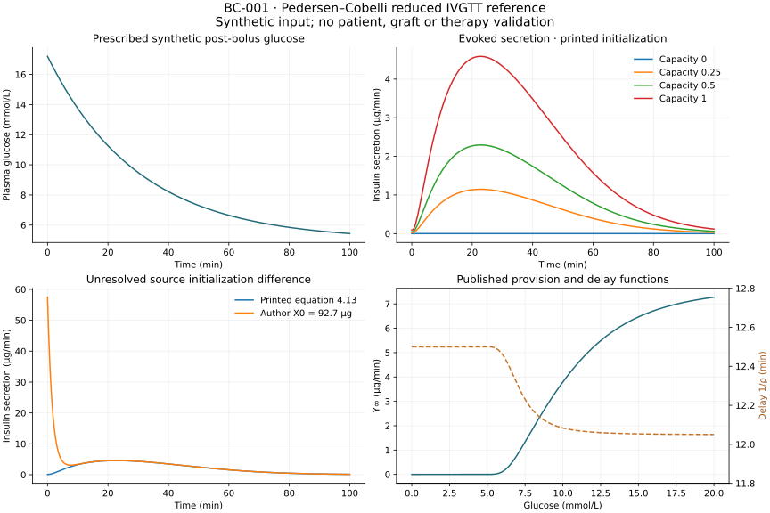

# BC-001 execution and evidence record

Subsequent execution: [BC-002](m4-kinetic-results.md) implements and verifies the kinetic-only stage below. This page preserves the BC-001 proposal/evidence record; full metabolic feedback and biological review remain open.

Executed on 20 September 2026. **A standalone glucose-to-evoked-secretion reference is implemented and numerically checked.** The synthetic experiment uses Pedersen and Cobelli's reduced IVGTT equations and fixed illustrated parameters. It reconstructs the published theoretical provision/delay relationships. It does not reproduce a patient or the original 204-person mean dynamic curve, and it does not implement metabolic coupling, C-peptide estimation or a therapy.

The [tutorial](../m4-beta-cell-tutorial.md) is the canonical execution guide; the [protocol](m4-protocol.md), [model card](models/pedersen-cobelli2013.md), [source dossier](m4-evidence-dossier.md) and [machine execution record](../../experiments/m4/beta_cell/execution.json) separate specification, provenance and observed evidence. [Decision 0017](../decisions/0017-standalone-beta-cell-reference.md) explains the narrow model choice.

## Isolated basis and implementation

Work used branch `codex/beta-cell-reference` in `/private/tmp/opent1d-beta-cell-reference`. It began at `5cc110710e8c521a08c0cc9a5e025c93523d2ab5`, then preserved 72 reviewed nonignored project files from the dirty main worktree in local baseline commit `4e32a60`. The [base snapshot](../../experiments/m4/beta_cell/base-snapshot.json) records each copied file's SHA-256. This includes current roadmap/decision 0009, LIT-001 and the AZT1D preparation required by current documentation. No private records, ignored results, credentials or environment directories were copied. All 72 original files matched at the post-execution checkpoint. A later delivery check observed new M3 external-transfer additions in seven original-worktree files; these concurrent changes were left intact and were not imported into the frozen basis. The execution record lists the differing paths and observed hashes. This task performed no original-worktree edits, resets, stash, push or publication.

The code is separated into [numerical model](../../experiments/m4/beta_cell/runtime/model.py), [independent verification](../../experiments/m4/beta_cell/runtime/verify.py), [execution](../../experiments/m4/beta_cell/runtime/run.py), [standard-library report reconstruction](../../experiments/m4/beta_cell/runtime/report.py) and [artifact-only plotting](../../experiments/m4/beta_cell/runtime/plot.py). The locked runtime is independent of repository tooling. Provenance/failure patterns follow existing experiments, while units and the artifact schema are specific to this reference. Neither metabolic engine was changed.

## Observed numerical results

The declared glucose stimulus is G(t) = 5 + 12.2 exp(−t/30) mmol/L. It is evaluated from 0 to 100 minutes at 401 output times. All values below are **synthetic calculations**, except the reconstruction of published theoretical functions; none is an empirical estimate.

| Check or quantity | Observed result | Criterion or interpretation |
| --- | --- | --- |
| Tight RK45 versus DOP853, maximum secretion error | 3.15e-10 micrograms/min | At most 1e-6; passed |
| Coarse RK45 versus DOP853 | 7.27e-6 micrograms/min | Descriptive refinement comparison; tighter settings reduce error |
| Constant forcing, distinct/equal/nearly equal rates | Maximum state error 3.91e-14 in the respective native state units | At most 1e-6; independently integrated closed form |
| Exact repetition | Zero state difference | Passed |
| Capacity 0, 0.25, 0.5, 1 scaling | Maximum state discrepancy 2.22e-15 | At most 1e-8; zero capacity exactly zero |
| Basal glucose at activation threshold | Exactly zero evoked states/release | Excludes physiological basal insulin |
| Minimum numerical state | Zero | At least −1e-9 |
| Glucose conversion | 90 mg/dL = 5 mmol/L; zero trajectory difference | Author's factor 18 convention |
| Published response functions | Maximum independent-expression error 3.55e-15 | At most 1e-12 |
| Delay across 0–20 mmol/L | 12.0503–12.5 min | Within prespecified 12.0–12.6 min; reproduces the paper's approximately 12-minute relationship |
| Printed initial pool X0 | 0.154652 micrograms; Y0 = 0 | Declared basal-equilibrium interpretation of equation 4.13 |
| Sampled peak secretion | 4.58896 micrograms/min at 22.75 min | Descriptive synthetic output |
| Trapezoidal evoked release, 0–100 min | 215.54950 micrograms | Descriptive synthetic AUC; not a delivered insulin dose |

The algebraic reference reproduces equations underlying Figure 2c/d and the published delay observation, without digitizing source graphics. The source's empirical glucose file is absent from the inspected package and its public companion path returned HTTP 404. No exact Figure 2a/b or original participant/cohort reconstruction is claimed. The independent closed form and two solvers verify implementation, not biological accuracy.

## Sensitivity and unresolved interpretation

The alternative author-code initialization X0 = 92.7 micrograms produces a sampled AUC of 308.28005 micrograms. Its difference from the printed-initialization trajectory follows the independent decay `(92.7 − X0) exp(−m t)` to a maximum pool error of 9.95e-14 micrograms. The exact additional release over the horizon is 92.54535 micrograms; the 0.25-minute trapezoidal difference is slightly larger because it samples the rapid initial decay. This sampling distinction is explicit and must not be mistaken for source disagreement or solver error.

The initialization discrepancy is scientifically consequential, whereas numerical solver differences are tiny at the selected tolerances. It remains unresolved; the alternative is not an asserted correction. The source reduction additionally omits a term from its glucose-dependent change of variables. These facts limit the interpretation of the dynamic trajectory even with precise integration.

Local ±1% parameter perturbations were prespecified and are saved in the report. AUC elasticities are approximately −1.317 for KM, −0.999 for Kphi, +0.972 for priming pplus, −0.955 for reinternalization r, +0.880 for c and +0.120 for M0. Small AUC sensitivity to m in this horizon does not mean m is unidentifiable from early time-resolved observations; an integrated outcome and a complete trajectory carry different information. These are local synthetic derivatives, not population variation or fitted confidence intervals.

Capacity 1 with nominal c/M0 and capacity 0.5 with doubled c/M0 (which also doubles nominal X0 before capacity scaling) produce exactly identical calculated states. This demonstrates a structural common-amplitude ambiguity. No human parameter fitting or recovery was attempted. The [dossier](m4-evidence-dossier.md) records further parameter-combination and measurement limitations; domain review is still required.

## Verification and reconstruction

Executed `uv sync --locked` and `uv run --locked python scripts/check.py` with a writable local `UV_CACHE_DIR`, plus the separate runtime sync and native tests. The repository check covers lint, Markdown/YAML/citation validation, navigation, all 201 repository unit tests and strict Sphinx build. The standalone environment passed 23 native tests and 13 numerical verification groups. The repository includes 30 new artifact tests covering independently hand-calculable metrics, altered/missing files, rehashed incomplete grids, invalid functions, failed numerical verdicts and incomplete lifecycle states.

Selected injected failures included malformed configuration, unsuccessful/truncated/nonfinite solver output, wrong solver timestamps and interruption. Runner checks preserved failed manifests, archived input/configuration and error type; existing output directories were refused unchanged. Public readers reject a calculated-but-not-finalized run. Completion is recorded only after report and figure exist.

JSON reconstruction ran with `python -S`, loading no scientific packages or archived source code. Report and SVG reconstruction were byte-identical to the saved final artifacts. Cross-version Python 3.9/3.12 report testing exposed an earlier `zip(strict=True)` compatibility issue and a tiny ordinary-summation difference; the reader now uses validated equal-length grids and `math.fsum`. Those analysis-only fixes do not change model equations or protocol. Earlier local reference attempts remain under ignored results; `reference-04` is the final archive. The plotted PNG was visually checked for labeling, layout and explicit evidence limits.

The CI workflow now includes this locked standalone execution and reconstruction within the existing repository-check job, with failure artifacts retained. This configuration was checked locally; no remote CI run is claimed. No additional native metabolic-engine campaign was run because their code and physiology are unchanged. Internal AI-assisted source/numerical reviews are not independent human reproduction or biological review.

## Work-package acceptance and next step

| Package | Evidence status | Remaining work |
| --- | --- | --- |
| OT-024 | Bounded question/model/measurement dossier, access gaps and unsent domain-review brief delivered | Actual access, source clarification and expert review have not occurred; they are recorded needs, not claimed partnerships |
| OT-015 | Relevant standalone secretion specification and future coupling boundary delivered | Basal secretion, whole-body scale and constants must be chosen with evidence in a concrete OT-026 execution protocol |
| OT-025 | Attributed code, fixed parameter provenance, numerical verification, published theoretical relationships and synthetic demonstration executed | **Partial** for exact published dynamic reproduction: original input and initial-state reconciliation remain missing; no empirical assessment |
| OT-026 / M4 | Concrete staged proposal only; M4 remains incomplete | Verify a kinetic liver inlet, zero-extension/native equivalence, conservation, communication convergence and baselines; review interpretation and suitable observations |
| OT-027 / M5 | Candidate longitudinal graft-function question and measurement needs prepared as context | Freeze a specific intervention/population/endpoint protocol and independent assessment with authorized data; no therapy module or outcome claim |

The next concrete engineering step is a separately specified **kinetic-only liver-inlet test in pinned simglucose**, following the [OT-015 proposal](m4-coupling.md). First resolve secretion scale/basal conventions; then check a finite trace against an independent two-compartment solution and conserved insulin accounting. The present engine lacks direct portal-insulin action on glucose production, and the selected secretion reduction lacks rising-glucose/meal behavior. Those limitations must be resolved or explicitly retain the kinetic-only scope before any glucose-control or transplant comparison.

For later cell-therapy work, seek the defined review and observation clarification in the [unsent brief](m4-collaboration-brief.md). Functional release, cell number, graft persistence and therapeutic benefit remain separate hypotheses. No one was contacted and no restricted patient data or access applications were submitted.
