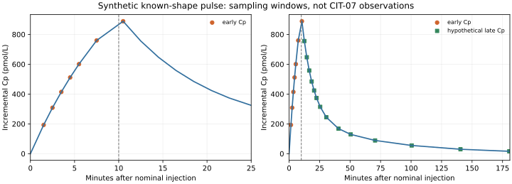

# BC-015-P4 — Synthetic C-peptide window stress test

The [prespecified question](m4-sampling-window-protocol.md) was executed
with the unchanged [BC-003 C-peptide equations](models/polonsky1986-cpeptide.md).
It compares **seven early** C-peptide observations with the same seven plus
**14 hypothetical late** observations. The early clock comes from the
[CIT-07 protocol v8](https://repository.niddk.nih.gov/public/study_document/Documentation/CIT-07_Protocol_Version_8.0_20Aug12.pdf);
the added late C-peptide samples are *not* documented for its core FSIGT.
All concentrations, secretory input and noise in this experiment are invented.
No patient records or external review were used.

## What ran

An incremental 9 pmol/(kg min) C-peptide appearance pulse lasts from 0 to
10 minutes after a nominal injection. The Polonsky two-compartment model
with its printed T1D group-mean rates produces the concentration response.
The true pulse gain and K3 multiplier both equal 1. The analysis estimates
those two multipliers while fixing K1, K2, central volume, pulse timing/shape
and zero incremental baseline. The source test clock is converted explicitly:
CIT-07's -0.5-minute injection makes its 1-minute sample 1.5 minutes after
injection. Neither the pulse nor the zero-baseline assumption is a statement
about CIT-07 recipients.

The [runner](../../experiments/m4/sampling_window/run.py) uses the locked
BC-003 model runtime. A segmented ODE independently generates the noiseless
series; the published-equation analytical convolution supplies predictions
for fitting. Sixty-four prespecified Gaussian draws at 30 pmol/L engineering
SD are shared between the nested schedules. Two off-truth starts are retained
per fit. The [execution record](../../experiments/m4/sampling_window/execution.json)
points to the ignored local archive with source snapshots, exact protocol,
runtime lock, observations, fitted predictions, objectives, failures, report
and figure.

| Quantity | Early: 7 Cp times | Early + hypothetical late: 21 Cp times |
| --- | ---: | ---: |
| Smallest SD-scaled local singular value | 3.160 | 17.163 |
| Local condition number, gain/K3 | 16.21 | 4.33 |
| Completed noisy fits | 64/64 | 64/64 |
| Median absolute relative gain error | 3.97% | 1.70% |
| Median absolute relative K3 error | 21.74% | 3.74% |
| 90th-percentile absolute relative K3 error | 43.69% | 8.67% |
| Best-fit K3 bound hits | 4/64 | 0/64 |

The extended window had smaller absolute K3 error in **56 of 64 paired
draws**. Both designs have local rank two for these two parameters; early
local rank alone did not imply stable noisy recovery. The late tail improves
this specific separation because the pulse shape and other kinetic terms
were made known. These finite-draw numbers are not confidence coverage or
assay-based performance estimates. No threshold was tuned to obtain them.



## Verification and reproduction

The maximum ODE-versus-analytical difference over truth and two opposite
parameter corners was **1.37e-12 pmol/L**, below the frozen 0.0001 limit.
Final mass-balance error was at most **8.53e-14 pmol/kg**. Log-Jacobian
step-refinement differences were at most **1.24e-7 relative**, below 0.001.
Both noiseless starts recovered each true multiplier within 1%. An
independent standard-library report calculation checked archived sample
times, paired subsets, every objective, bounds, case count and two-column
singular-value arithmetic without importing the numerical model. Three
native tests covered clock conversion, independent analytical agreement,
invalid inputs and altered/incomplete result rejection.

Two fresh executions produced **17/17 byte-identical archived files** apart
from the time-stamped manifests. The report and SVG rebuilt byte-for-byte
from the final archive. To rerun from the worktree root with fresh paths:

```sh
uv sync --locked --project experiments/m4/beta_cell/runtime
uv run --locked --project experiments/m4/beta_cell/runtime \
  python -m experiments.m4.sampling_window.run \
  --output results/m4-sampling-window/new-run
uv run --locked python -S -m experiments.m4.sampling_window.report \
  results/m4-sampling-window/new-run \
  --output results/m4-sampling-window/new-report.json
cmp results/m4-sampling-window/new-run/report.json \
  results/m4-sampling-window/new-report.json
```

The run refuses to overwrite an archive. An incomplete run retains a failed
manifest; individual failed optimizations stay in the planned denominator.
The checked-in [machine protocol](../../experiments/m4/sampling_window/protocol.json)
is SHA-pinned by the runner. The root repository checks also pass.

## Interpretation and next gate

This is a **favorable synthetic design stress** under a stipulated source
shape and exact incremental baseline, not evidence that late CIT-07
C-peptide was collected or that a particular blood-draw schedule is needed
clinically. An unknown secretory waveform, uncertain basal release, renal
clearance, K1/K2/volume, assay limits, graft site and insulin administration
can all change identifiability. The coupled glucose model's meal input is
not an IVGTT stimulus and was intentionally not used here.

OT-026 remains partial. The next empirical gate is still a versioned,
authorized same-challenge release with actual time-linked glucose, insulin
and early/late C-peptide (or a newly specified early-only question), assay
and treatment information, plus an independent domain review and
participant-disjoint allocation. The [public source screen](m4-alternative-observation-screen.md)
and [unsent review brief](m4-collaboration-brief.md) specify the request;
this simulation supplies no access rights, human validity or therapy effect.
