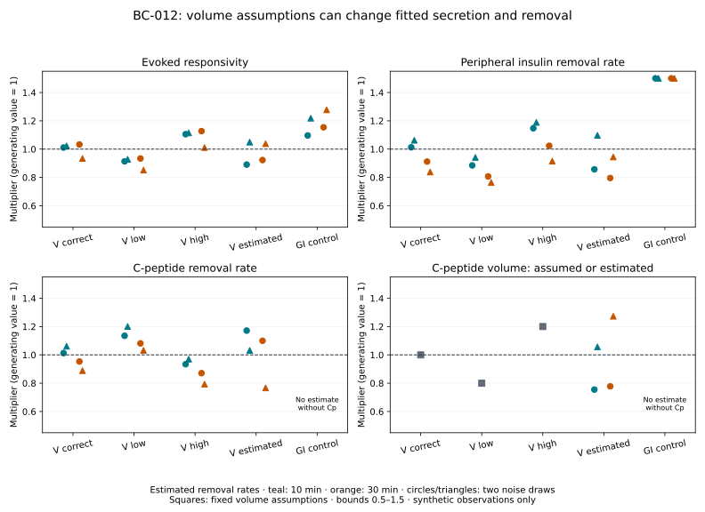

# BC-012 — C-peptide volume assumptions and inferred function

BC-012 tests whether the conditional joint recovery in BC-011 survives a wrong or estimated central C-peptide volume. It changes only the observation mapping of the unchanged glucose–secretion–insulin/C-peptide model. All volume arms see the same synthetic measurements. This isolates one nuisance assumption; it does not estimate a population distribution of volumes or validate inference in humans.

The [protocol](m4-volume-sensitivity-protocol.md), [machine specification](../../experiments/m4/volume_sensitivity/protocol.json) and [decision 0027](../decisions/0027-cpeptide-volume-sensitivity.md) were frozen before fitting. Work starts from `959d1d1` in `/private/tmp/opent1d-beta-cell-reference`, branch `codex/beta-cell-reference`. Original worktree changes, historical model code and both environment locks are preserved.

## What is implemented

The [model wrapper](../../experiments/m4/volume_sensitivity/model.py) observes the central C-peptide amount through `Cp=Q1/(0.0655*volume_scale)`. Its four candidate multipliers describe evoked secretory responsivity, peripheral insulin removal m4, C-peptide removal k3 and central volume. Amount states, their initial inventories, source ownership and mass ledgers remain those of BC-011. Volume changes neither glucose nor insulin. All candidate m4 values retain BC-011's explicit equilibrium conditioning on exact basal G/I and known SC input.

The [inference code](../../experiments/m4/volume_sensitivity/inference.py) compares volume multipliers 1, 0.8, 1.2 and a free volume in [0.5,1.5], with known or estimated removal rates. A matched GI control has no volume estimate; unknown k3 also remains unobservable without Cp. Each arm has 10/30-minute schedules, noiseless observations and two shared noise draws, yielding 60 analyses with two starts each. The ±20% stress and fitting bounds are engineering choices. Fixing a first-order rate does not fix dimensional clearance `k3*V` when volume changes.

[Numerical verification](../../experiments/m4/volume_sensitivity/verify.py), fitting and the [standard-library report reader](../../experiments/m4/volume_sensitivity/report.py) remain separate. The reader verifies the full matrix, common observations, residual and channel-objective arithmetic, fixed/free/unobservable coordinates, bounds, sensitivity anchors and SVD factors. Missing or failed starts cannot become a completed campaign. Wrong-volume bias is retained as a finding; the 1% noiseless recovery gate applies to correct/estimated-volume and observable GI parameters.

The model ancestry remains [Dalla Man et al. 2007](https://doi.org/10.1109/TBME.2007.893506) and [Polonsky et al. 1986](https://doi.org/10.1172/JCI112308), with exact equation, unit and source-discrepancy records in the [secretion](models/dallaman2007-secretion.md) and [C-peptide](models/polonsky1986-cpeptide.md) cards. [Raue et al. 2009](https://doi.org/10.1093/bioinformatics/btp358) motivates distinguishing local sensitivity from global/data-limited identifiability. No new paper asset, author code or participant record is imported.

## Reproduce

From the isolated worktree, choose a new output directory:

```bash
uv sync --locked
uv sync --locked --project experiments/m0/simglucose
uv run --locked python -m experiments.m4.volume_sensitivity.run \
  --output results/m4-volume-sensitivity/my-reference
```

The runner executes the complete numerical matrix twice in fresh processes and refuses to overwrite an existing archive. It stores input observations and noise, protocol and source snapshots, runtime/native identity, parameters, settings, all starts, predictions/residuals, sensitivities, numerical errors, logs, report and figure. The root environment remains tooling only; simulation and fitting use the existing locked native environment.

Reconstruct without numerical packages, recreate the figure and run checks:

```bash
uv run --locked python -S -m experiments.m4.volume_sensitivity.report \
  results/m4-volume-sensitivity/my-reference \
  --output results/m4-volume-sensitivity/reconstructed.json
cmp results/m4-volume-sensitivity/my-reference/report.json \
  results/m4-volume-sensitivity/reconstructed.json
uv run --locked --project experiments/m0/simglucose \
  python -m experiments.m4.volume_sensitivity.plot \
  results/m4-volume-sensitivity/my-reference \
  --output results/m4-volume-sensitivity/reconstructed.svg
cmp results/m4-volume-sensitivity/my-reference/figure.svg \
  results/m4-volume-sensitivity/reconstructed.svg
uv run --locked --project experiments/m0/simglucose \
  python -m unittest experiments.m4.volume_sensitivity.test_numerical -v
uv run --locked python scripts/check.py
```

## Execution and software checks

The first campaign and its full fresh-process repeat complete all **60 analyses and 120 starts each**, with no optimizer or model failures and no post-fit changes to the protocol or tolerances. All **64 numerical files are byte-identical** across processes. The fresh shared observations are also byte-identical to the historical BC-011 reference archive. Standard-library report reconstruction and native figure reconstruction are byte-identical; the rendered figure was visually inspected. The [execution record](../../experiments/m4/volume_sensitivity/execution.json) retains source/runtime hashes, compact results and verification outcomes. Raw arrays and logs remain under ignored `results/m4-volume-sensitivity/reference-01/`.

Seven native numerical tests pass, exercising volume units, analytic identities, full forward gates, invalid/incomplete inputs and exact detached caching. Twenty-six standard-library artifact tests pass without site packages, using hand-derived residuals and orthogonal sensitivity fixtures to expose changed observations, wrong anchors, missing starts, false statuses, corrupted bounds and altered archives. The required `uv sync --locked` and `uv run --locked python scripts/check.py` pass: **396 repository tests**, linting and the strict documentation build. The separate native lock sync passes; neither lock changed. The new CI job is configured but has not been executed remotely. These are software and conditional numerical checks, not human validation.

## What the synthetic comparison shows

An incorrect fixed volume biases the inferred responsivity even with noiseless observations. At 10-minute sampling, fixing volume 20% low while keeping removal rates correct gives gain **0.6761** instead of one; fixing volume 20% high gives **1.1807**. The mismatch is visible in the weighted residual sums, 332.90 and 264.54 respectively.

Allowing removal rates to change can conceal much of that mismatch. With low volume, the same noiseless observations give gain **0.9069**, m4 **0.8853** and k3 **1.1325**, with total weighted sum of squares **3.56** across 75 observations. With high volume the estimates are **1.0890**, **1.1197** and **0.9133**, with sum **2.45**. These are small residuals relative to the declared engineering noise scale despite biased parameters. There is no prespecified statistical fit-quality threshold here; a small residual does not establish correct biology.

When volume is free, all eligible noiseless parameters recover within the frozen 1% criterion from both starts; the largest relative error is **8.62e-8**. Noisy estimates are less precise. The following table gives maximum absolute relative errors of the best completed start over **four specified schedule/noise combinations** per arm, with removal rates estimated. These maxima are descriptive examples, not estimated population error rates or confidence limits.

| Volume assumption / observations | Gain error | m4 error | k3 error | Volume error | Cases with a bound hit |
| --- | ---: | ---: | ---: | ---: | ---: |
| Correct, GIC | 6.61% | 16.18% | 11.13% | Fixed | 0 / 4 |
| 20% low, GIC | 14.80% | 23.57% | 20.07% | Fixed wrong | 0 / 4 |
| 20% high, GIC | 12.70% | 18.87% | 20.66% | Fixed wrong | 0 / 4 |
| Estimated, GIC | 10.94% | 20.41% | 23.35% | 27.28% | 0 / 4 |
| GI control | 27.75% | 50.00% | Unobservable | Unobservable | 4 / 4 |

With removal rates assumed known, the corresponding maximum gain errors are 4.46% (correct volume), 35.98% (low), 21.44% (high), 6.28% (estimated) and 8.55% (GI). The estimated-volume error is at most 2.87% with rates fixed, versus 27.28% with rates also estimated. Thus independent kinetic knowledge materially changes the difficulty of this synthetic question. Exact basal G/I and fixed other physiology also supply information and must remain explicit.

Across the four estimated-rate examples, free-volume GIC has smaller maximum gain/m4 errors than GI, but larger errors than correctly fixed-volume GIC. This is not pointwise dominance: with rates known, 30-minute sampling and noise seed 117, free-volume GIC gives 6.28% gain error versus 3.78% for GI. All four noisy estimated-rate GI cases reach the upper m4 bound 1.5. None of the GIC cases hits the imposed bounds; absence of a bound hit does not imply a reliable uncertainty interval. The largest disagreement between the two fitted starts is **5.38e-5** multiplier units, which checks those starts rather than distant alternatives.

## Local information and numerical verification

At true volume, estimated-rate GIC has local rank 3 with fixed volume and rank 4 with free volume. At 10 minutes, the smallest weighted singular value changes from **11.8405** to **6.2960**, while the condition number changes from **11.41** to **28.37**. At 30 minutes these are **7.2467** to **4.1797**, and **10.99** to **25.13**. Coordinates, observations and engineering noise weights define these values; they are not universal identifiability scores. All nonzero directions in the 20 designs exceed their own checked refinement discrepancies. The free-volume GI control retains two exact absent directions, k3 and volume.

The fasting identity `Cp=Sb(m4)/(k3*V)` explains why one basal C-peptide observation alone cannot distinguish k3 from V. The checked dynamic trajectories distinguish their effects locally: k3 changes time constants, while V scales concentration. This is conditional local evidence, not proof of global uniqueness or practical identifiability from human observations.

All 46 inherited forward gates and seven new volume gates pass. Across 45 volume/corner/solver trials, parent equivalence at volume one, state invariance and G/I invariance are exactly zero-error. Inverse concentration scaling and the basal-product identity differ by at most **2.23e-16** relatively. The analytic log-volume derivative discrepancy is **6.67e-6** in SD-scaled units against a 1e-4 limit. The largest scaled solver discrepancy is **1.93e-6** against 0.001. Weighted Jacobian relative discrepancies are at most **5.65e-7** for difference-step refinement and **6.64e-6** for solver refinement, against 0.01 limits.



## Next bounded work and roadmap position

The separately frozen [BC-013 nuisance-profile experiment](m4-profile-likelihood-results.md) now executes this follow-up for gain, m4, k3 and volume, with matched fixed-volume and GI controls. It retains all starts, refines every detected crossing, checks reference-solver agreement and exposes interest/nuisance-bound limitations. This quantifies conditional objective geometry; it does not establish confidence coverage. The next internal assessment needs new prespecified synthetic noise realizations, failure accounting and Monte Carlo precision. Independently assessed human observations and external domain review remain separate requirements.

For human assessment, independently constrained C-peptide kinetics/volume, paired glucose/insulin/C-peptide series, repeated basal observations, stimulus and SC-delivery records, assay characteristics and relevant kinetic covariates remain needed. The [measurement and access assessment](m4-cpeptide-measurements.md) still requires verified rights, an independent evaluation allocation and domain review. The equimolar appearance ratio, k1/k2, hepatic structure, insulin action and meal kinetics remain fixed. This experiment supplies no empirical ±20% volume distribution, population covariance model, clinical sampling recommendation or data-access authorization.

OT-024 and the relevant OT-015 specification remain delivered. OT-025 remains partial for exact published dynamic cohort reproduction. **OT-026 and M4 remain partial**: the synthetic volume question is assessed, while broader nuisance physiology, population calibration, global/human identifiability, external biological review and independent observations remain open. Later OT-027 must select an actual therapy, population, graft site, mechanism and endpoint. Functional responsivity is not a cell count, and changing it is not evidence of treatment efficacy.
