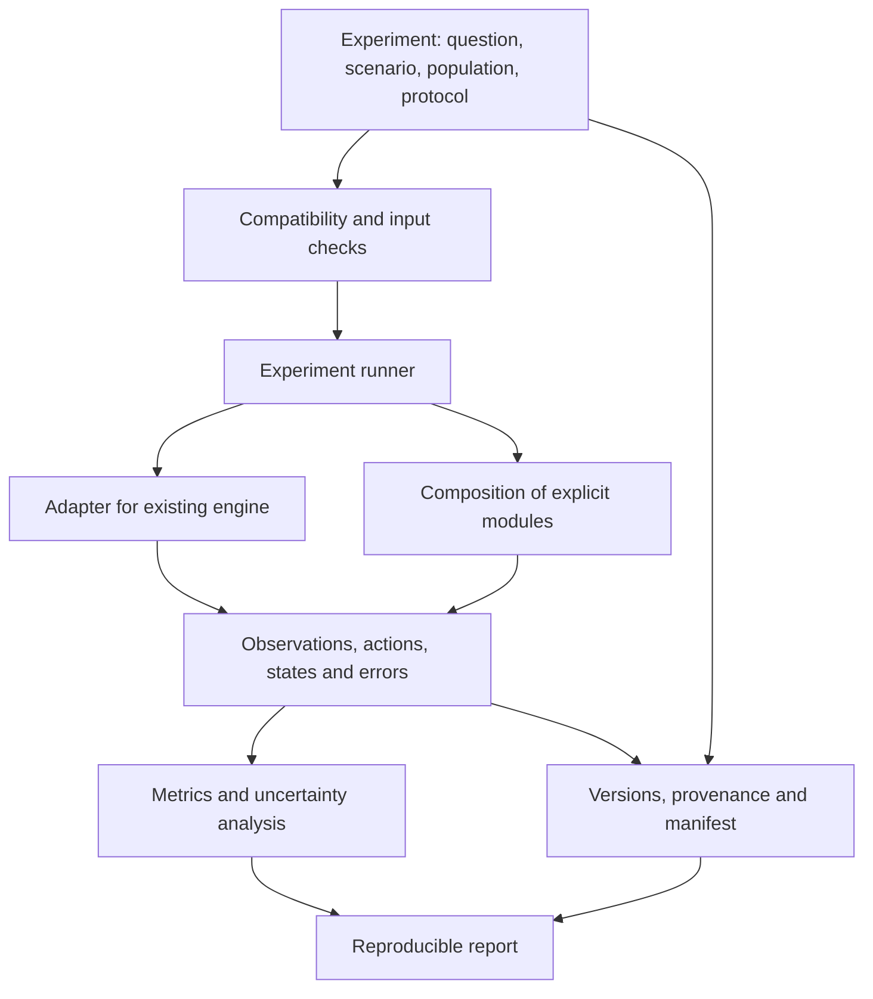

<a id="opent1d-onderzoeksbasis-en-projectopzet"></a>

# OpenT1D: research basis and project design

Translated from Dutch on 29 October 2026. Historical findings and source
references below retain their original scope; this is not a new research review.
Editorial wording was clarified on 29 October 2026 to describe contributions
and comparison scopes without ranking projects.

<a id="1-advies"></a>

## 1. Recommendation

**Develop OpenT1D as an open, modular virtual laboratory for T1D research: shared infrastructure and useful building blocks, reusing others' models. Start with a fully reproducible glucose/insulin experiment and demonstrate early that different model families can be connected. Build from there toward personalization, beta-cell function and bounded therapy questions.**

The first scientific contribution should be a verifiable statement: under which conditions does a conclusion about a treatment or control algorithm hold when the physiological model, virtual population or measurement uncertainty changes? This fits the long-term ambition and produces useful infrastructure before a multiscale digital twin is available.

Open simulators, modular frameworks, data-processing pipelines and benchmarks already exist. OpenT1D should connect to them. The proposed contribution is a maintained collection of experimental protocols, adapters, model descriptions and evidence with which others can collaborate. Its usefulness should be assessed with researchers and informed by existing workflows and opportunities for reuse.

The priorities are:

1. **Reproducibility:** rerunning the same experiment, including versions, settings, inputs, randomness and analysis.
2. **Comparability:** explicit conventions for observations, interventions, populations, units and outcome measures.
3. **Scientific validity:** stating what has been tested for each research question and where extrapolation begins.
4. **Reuse:** connecting existing models and analysis tools with as few changes as possible.
5. **Extensibility:** admitting new biological processes once a measurable question, useful model and suitable validation data are available.

The initial build order is **upstream reproduction → complete experiment → meaningful interchangeability between model families**. Research into suitable real data starts immediately. External assessment, personalization, devices and biological extensions can then proceed according to their own dependencies. Residual endogenous secretion is the first proposed biological extension; it need not wait for all personalization or device functions to be complete. AI can accelerate development from the start and later support experimental search methods. The order depends on evidence and interfaces, not an assumed development speed or team size.

<a id="2-reikwijdte-en-bewijskracht"></a>

## 2. Scope and strength of evidence

This analysis concerns scientific positioning, reusable software, data, architecture and an executable roadmap. The source reference date is 12 September 2026. The report uses original research publications, official project documentation, repositories, standards and data-holder terms. New preprints are distinguished from published studies.

The recommendations are design choices based on those sources. No simulators were installed, numerical results reproduced or patient datasets downloaded for this report. Availability in a repository therefore does not establish installability, maintenance quality, model fidelity or redistribution rights for every included file. Those checks are explicit first milestones.

For OpenT1D, three kinds of statement should be distinguished: what a publication demonstrated, what a software project says it supports and what OpenT1D can itself confirm after reproduction. A README explanation is enough to select a candidate, but insufficient to adopt a scientific performance claim.

The current implementation roadmap is in [ROADMAP.md](../../ROADMAP.md); the public [vision](../vision.md) and [architecture direction](../architecture.md) develop the modular laboratory design. The scientific milestones describe functionality still to be built and tested. The repository foundation now has documentation and checking tools; this does not change the strength of evidence described here for the candidate models.

<a id="3-het-bestaande-landschap"></a>

## 3. The existing landscape

<a id="31-simulatoren-en-raamwerken"></a>

### 3.1 Simulators and frameworks

| Project | Demonstrable basis | Possible role in OpenT1D | Point to address |
|---|---|---|---|
| UVA/Padova T1D Simulator | Published glucose/insulin models and assessment against clinical data.[^1] | Scientific reference; possibly an optional external engine | Establish version, population, access terms and scope separately |
| simglucose | Python implementation based on UVA/Padova 2008; 30 virtual profiles; MIT code.[^2] | First adapter and simple reference experiments | Do not assume independent validation or FDA status for this implementation |
| GluCoEnv | PyTorch environment for parallel glucose control and RL; builds on simglucose/UVA 2008; MIT according to the repository.[^3] | Later acceleration and RL experiments | Another engine within largely the same model family |
| LoopInsighT1 / LT1 | Modular TypeScript simulator with patient, controller, sensor and actuator; MIT.[^4][^5] | First candidate for a second model family and module reuse | Test compatibility and numerical references of the selected version |
| APS TestBed | Research testbed combining two simulators, controllers and fault injection.[^6] | Study existing protocols and architecture; consider extension | Check components and licenses before adoption |
| McGill Artificial Pancreas Simulator | MATLAB framework including a Hovorka patient model; MIT.[^7] | Independent reference for model behavior | MATLAB and any additional runtime requirements |
| py-mgipsim | Python simulator for meals, activity and insulin delivery; GPL-3.0.[^8] | Candidate for activity and additional physiology | Record ancestry per model variant and GPL distribution obligations |
| ReplayBG / py_replay_bg | Identification of personal models and simulation with changed insulin/carbohydrate inputs.[^9][^10] | Personalization and retrospective experiments | Python code is GPL-3.0; do not automatically equate the original article's validation with every port |

**Model diversity must be assessed by ancestry.** simglucose and GluCoEnv, for example, provide a useful comparison of implementations and speed. Because both refer to the same basis, together they do not strongly test uncertainty in physiological model structure.[^2][^3] A Hovorka/Cambridge variant alongside a UVA/Dalla Man variant is a more suitable candidate for that purpose. Shared assumptions remain even then.

LT1 is a particularly relevant comparison: the publication describes both headless execution and modular simulation.[^5] The Cambridge implementation can also be found concretely in the repository.[^39] This makes a thin adapter more promising than a new implementation of all differential equations. An executable trial must still demonstrate that the combination with OpenT1D works in practice.

<a id="32-data-analyse-en-benchmarks"></a>

### 3.2 Data, analysis and benchmarks

Glucose forecasting projects include GlucoBench, GluPredKit and the recent MetaboNet-Bench.[^11][^12][^14] BabelBetes provides clinical data normalization; AGATA provides glucose analysis, including a Python port.[^15][^16] A generic prediction tool or new collection of dataset parsers would therefore overlap substantial existing work.

These projects are not all the same. Predicting the next glucose value under observed conditions is a different evaluation task from investigating what a changed intervention would cause. OpenT1D can connect existing prediction tasks while its own core focuses on explicit interventions, model coupling and robustness of experimental conclusions.

<a id="33-welke-ontwikkelroute-heeft-de-voorkeur"></a>

### 3.3 Which development route is preferred?

| Route | Strength | Weakness | Recommendation |
|---|---|---|---|
| New universal simulator | Full implementation control | Large verification burden and duplication of biology | Reject as a starting point |
| Extend one existing framework | Much immediate reuse | May be constrained by one runtime or model structure | Investigate seriously in the first milestone |
| Shared laboratory infrastructure with adapters and focused custom modules | Preserves source models; supports comparison and extension | Adapter semantics and versioning require discipline | Preferred route, starting with a complete experiment |
| Build a multiscale QSP platform immediately | Fits the ultimate vision | Difficult to calibrate and validate without specific data | Later, per research question |

The first development decision should therefore be concrete: run the same small protocol directly in simglucose and LT1 and record the missing functionality. At the same time, investigate whether APS TestBed already covers most of that gap. The first integration may mainly add configuration, documentation and adapters; missing modules and couplings can follow later. This preserves the shared virtual laboratory ambition and avoids unnecessary duplication per component. A custom solver is not a prerequisite for value.

<a id="4-eerste-doelgroep-en-eerste-onderzoeksvraag"></a>

## 4. First audience and first research question

The recommended first user is a researcher or developer who wants to compare a glucose controller, physiological model or device model with existing references. This user can immediately benefit from a reproducible protocol without adopting a complete digital twin.

The first research question is:

> How does the relative performance of reference controllers change with differences in meal information, sensor measurements and physiological model choice?

A second, infrastructure-oriented question accompanies it: can someone outside the project connect one controller or model and independently reconstruct the same results? That usage test is necessary to determine whether OpenT1D actually provides shared infrastructure.

A first demonstration may use one simulator. A convincing first research release additionally requires comparison with at least one other physiological model family, or a very explicit restriction of the claim to the selected engine. All controllers need not rank the same in all models. An explained reversal may be the most important result.

The first scope includes adult virtual profiles, subcutaneous insulin delivery, meals and synthetic CGM measurements. Children, pregnancy, exercise, multiple hormones and new insulin formulations follow separately once the model basis and validation are available. This is a choice to formulate research claims precisely, not a judgment of those subjects' importance.

<a id="5-het-eerste-complete-experiment"></a>

## 5. The first complete experiment

<a id="51-een-kleine-maar-volledige-keten"></a>

### 5.1 A small but complete chain

The first product consists of a Python library, a command-line interface and an automatic report. A researcher selects a protocol version, model, virtual profiles and controller. OpenT1D validates the combination, runs every case and saves results with the information needed to recalculate them.

Proposed user action:

```text
opent1d run experiments/reference-meals.yaml
opent1d report runs/<run-id>
opent1d reproduce runs/<run-id>/manifest.json
```

This is a design sketch, not an existing CLI. The practical promise is that the report follows entirely from saved data, without manual notebook steps or graph postprocessing.

<a id="52-referenties-en-scenarios"></a>

### 5.2 References and scenarios

First use a documented basal-bolus strategy and a simple PID controller. They serve as functional references; before making a substantive claim about advanced controllers, add a suitable stronger reference, such as a published MPC implementation. Investigate reuse before writing a new controller. All controllers receive the same types of information within each benchmark track.

Start with a published or upstream reference scenario whose inputs and outcomes are sufficiently specified. Then add separate variants: correct meal announcement, missing announcement, inaccurate carbohydrate information, sensor noise and sensor dropout. A missing announcement changes what the controller knows; a different actual meal changes the patient input. These two events must not coincide unnoticed.

A multiday scenario is a subsequent step only after initialization, warm-up period and time variation have been investigated. Original UVA/Padova versions had a more specific validated scope than all possible multiday simulations; the S2013 publication explicitly discusses that limitation.[^40] An engine's ability to simulate a week does not establish a supported week-long prediction.

This limitation is version-specific: the later S2017 publication describes an extension to daily simulations, including varying insulin sensitivity and adapted insulin delivery models.[^41] OpenT1D must make such differences between model generations visible.

Run faults individually first, then in combinations. Choose severity, duration and frequency either from data or as an explicit stress test. An artificially severe fault says something about robustness under that assumption; it does not estimate real-world incidence.

<a id="53-uitkomsten-en-eerlijke-vergelijking"></a>

### 5.3 Outcomes and fair comparison

Reporting must include TIR at 70–180 mg/dL, TBR below 70 and below 54 mg/dL, and TAR above 180 and above 250 mg/dL. These categories align with the international consensus on CGM reporting.[^23] Preserve thresholds and boundary conventions in the benchmark version and support display in mmol/L. Clinical target percentages are not automatically simulator pass criteria.

Add glucose variability, insulin delivery, duration of low-glucose episodes, runtime, solver errors, missing observations and aborted runs. Calculate outcomes separately on simulated blood glucose and synthetic CGM measurements when both are available. A good sensor value may hide a model deviation in the underlying state.

Present outcomes per virtual patient and scenario, with paired differences between controllers. Repeated random seeds are not new patients. Use uncertainty intervals with appropriate grouping of repeated measurements and state whether they describe simulation variation alone or also variation between profiles. Millions of simulated minutes from a few profiles do not support broad clinical representativeness.

A ranking with one total score is insufficient. Show at least the relationship between glucose control, low-glucose exposure and failure behavior. Prespecified primary outcomes and analyses prevent retrospective reporting of only the most favorable results. Also report inconclusive comparisons and differences smaller than the relevant uncertainty.

Limit endpoints to what is actually modeled. Do not report simulated ketoacidosis, clinically severe hypoglycemia or sustained HbA1c improvement when the model contains only short glucose/insulin series. A glucose threshold crossing remains a glucose outcome in that case.

Use a deliberately poor or trivial reference to check that the benchmark detects clear shortcomings. Also ensure that simulated failures and emergency interventions remain visible. An early-stopped run must not receive a favorable score because the rest of the simulation disappears from the denominator.

<a id="6-architectuur"></a>

## 6. Architecture

<a id="61-een-kleine-kern-met-twee-niveaus-van-modulariteit"></a>

### 6.1 A small core with two levels of modularity

There are two different integration problems. In the short term, OpenT1D must drive complete existing simulators. Later, it must couple biological subsystems. Do not immediately try to split every existing simulator into the same internal components: doing so can change assumptions and numerical properties.

Start with an engine adapter around an existing simulator. Also define a limited component contract for new modules that can actually satisfy it. An engine may internally manage a complete glucose/insulin cycle while OpenT1D standardizes the scenario, controller information and output.



This diagram proposes responsibilities. It implies neither microservices, a cloud platform nor an independent solver for each block.

<a id="62-contracten-die-vanaf-het-begin-nodig-zijn"></a>

### 6.2 Contracts needed from the start

| Contract | Minimum information to record |
|---|---|
| Model description | Identity, version, source, model family, species, disease stage, assumptions and scope |
| Port or variable | Quantity, unit, compartment, concentration or amount, observable or latent |
| Time | Relative time, input interval, observation interval, event order and internal integration step |
| Patient profile | Parameters, correlations, initialization and ancestry; distinguish synthetic and person-specific |
| Scenario | Actual events and separate information known to the controller |
| Controller | Permitted observations, actions, limits, internal memory and reset behavior |
| Device | Measurement or delivery behavior, delay, uncertainty, faults and calibration basis |
| Result | Time series, units, quality flags, failures, manifest and metric version |
| Validation | Research question, assessment data, prespecified criteria, results and limitations |

One example of a necessary semantic check: a bolus in units and a delivery rate in units per hour are different inputs. Another is plasma insulin versus subcutaneously delivered insulin. A shared variable name or convertible unit alone does not make these quantities interchangeable.

Record whether an amount applies at a time point or is integrated over an interval. Define whether the controller at time t first receives the new measurement and then chooses an action, and when that action affects physiology. These conventions prevent event-order differences being mistaken for treatment differences.

Support capabilities: an adapter reports, for example, whether it can restore states, allow controller intervention, receive endogenous secretion or change parameters during a run. Reject unsupported experiments beforehand. Silently ignoring an input makes the result unusable.

<a id="63-numerieke-verantwoordelijkheden"></a>

### 6.3 Numerical responsibilities

Initially let the original engine execute its own equations and solver. Check that the adapter produces the same reference time series as direct execution. Preserve solver choice, error tolerances and relevant runtime information alongside random seeds.

Future couplings require explicit communication intervals, delays, feedback and shared states. Tightly coupled processes may need a joint solver or iterative solution. Updating a slow immune module once daily is a hypothesis about timescales, not an inherently correct integration method. Test such a choice with step refinement and a finer reference.

Each modeled process must have one owner. If a new module takes over insulin absorption, it must be clear that the same absorption is not also applied in the existing engine. The same holds for mass balances: internal storage of an amount and transfer between compartments must be jointly consistent.

<a id="64-technische-keuzes"></a>

### 6.4 Technical choices

Recommendation: use Python for experiment definitions, adapters, analysis and the command-line interface. Keep model engines in their original language when this simplifies verification. Store configuration in versioned text files, time series in a table or array format with explicit metadata, and results in a locally inspectable directory structure.

A suitable initial stack is Python with NumPy/SciPy, schema validation, Parquet for tabular output and a simple report generator. These are architectural preferences, not an already tested dependency set. Concrete supported versions follow from adapter trials. Keep heavy ML libraries, GPU support and external runtimes optional.

Use one repository while components change together. Separate code logically into contracts, adapters, experiments, validation, metrics and reporting; create separate packages only when independent versioning is actually needed. Start with local parallel execution. Measure memory, compute time and I/O before adding a distributed runner.

A web interface can later expose configuration and reports. The first scientific functionality must also be fully available through files and code. This simplifies CI, batch runs and use by other researchers.

<a id="7-standaarden-aansluiten-waar-ze-iets-oplossen"></a>

## 7. Standards: connect where they solve a problem

| Standard or infrastructure | Suitable for | Recommended point of adoption |
|---|---|---|
| SBML | Exchange of supported biological model structures.[^25] | A concrete biochemical or QSP module |
| CellML | Description of mathematical physiological models.[^26] | Reuse of a suitable existing model |
| SED-ML | Description of simulation experiments, models, analyses and output.[^27] | First an explicit mapping of supported experiments |
| COMBINE/OMEX | Bundling model and experiment files.[^28] | Export of one demonstrably reproducible example |
| FMI | Model exchange and co-simulation between runtimes.[^29] | When multiple concrete adapters share the need |
| BioSimulators/BioSimulations | Existing conventions, validation tools and execution/publication of model studies.[^30] | Reuse where the chosen model form is supported |
| PEtab | Reproducible specification of parameter estimation problems.[^31] | Calibration of suitable mechanistic models |

None of these standards proves that two models are biologically compatible. FMI, for example, specifies interfaces; co-simulation coordination and scientific coupling remain the integrator's responsibilities.[^29] Nor does every implementation support every part of a standard.

Define a small OpenT1D profile with a version, supported capabilities and mapping to existing concepts. Export only what can be represented faithfully. A closed control loop with custom code must not be presented as fully SED-ML reproducible when the chosen toolchain cannot execute those semantics.

The right order is a working experiment, an explicit description of its meaning and then exchange testing. This provides a concrete basis for standardization without designing a universal description language in advance.

<a id="8-validatie-als-kernfunctionaliteit"></a>

## 8. Validation as core functionality

<a id="81-vier-afzonderlijke-vragen"></a>

### 8.1 Four separate questions

The FDA describes risk-based credibility assessment for mechanistic models in medical device submissions.[^22] OpenT1D can use the underlying idea: first define the question and intended use, then gather suitable evidence. This is a design basis, not a claim that the project thereby meets all submission requirements.

| Question | Example evidence | What this does not yet prove |
|---|---|---|
| Does the code execute the intended model? | Reference comparison, unit checks, solver convergence | That the model describes reality sufficiently |
| Can someone reproduce the experiment? | Clean installation, recorded inputs and manifest | That the assumptions are correct |
| Does the model describe the intended data? | Assessment on unused data, uncertainty coverage | That the effect of a different treatment is correct |
| Is the intervention conclusion credible? | Suitable experimental or clinical intervention data | Validity for other populations or therapies |

Historical acceptance of a UVA/Padova simulator for a particular preclinical use is not a transferable certification for derived Python code, new populations or additional biological modules.[^1][^40] Documentation should therefore use concrete wording about ancestry and local verification. Avoid the label “FDA-approved OpenT1D simulator”.

<a id="82-een-bewijspakket-per-model-en-toepassing"></a>

### 8.2 An evidence package per model and application

Each model receives a description of supported research questions, source equations, parameter ancestry, limitations and checks. Each composed application additionally receives its own dossier. A model version may suit a meal response while being insufficiently supported for exercise or long-term disease progression.

A practical evidence package contains the protocol, exact model and data versions, test cases, prespecified criteria, all outcomes, error analysis and a conclusion about that application. Record for each claim whether it comes from a source, was reproduced locally or was independently checked.

Do not use a universal “validated” certificate. Use explicit labels such as “upstream reference reproduced”, “assessed on an external cohort for this outcome” or “exploratory outside the calibration range”. This lets OpenT1D admit new modules without overstating their scientific maturity.

<a id="83-identificeerbaarheid-en-onzekerheid"></a>

### 8.3 Identifiability and uncertainty

A good fit can arise because different parameter combinations produce the same measurement pattern. The protocol by Villaverde and colleagues therefore treats identifiability, parameter estimation and uncertainty analysis as related parts of model calibration.[^24]

For OpenT1D, this means starting with few parameters to estimate, documenting priors or bounds and investigating whether the available data can distinguish those parameters. Then check uncertainty in the prediction relevant to the research question. A parameter need not be perfectly determined for a particular prediction to be useful, but that usefulness must be assessed separately.

Distinguish measurement uncertainty, parameter uncertainty, differences between model structures and numerical errors. Many random seeds only reduce Monte Carlo uncertainty within the chosen assumptions. They do not repair a missing biological mechanism.

<a id="84-benchmarklekkage-en-controle-van-informatie"></a>

### 8.4 Benchmark leakage and information control

Keep training, tuning and assessment material separate. For person-specific models, both a later period from the same person and another person or study are useful but different tests. Include normalization, imputation and feature selection in that separation.

In a realistic track, a controller may receive only information available in that scenario. Hide actual future meals, latent physiological parameters and error-free blood glucose if the controller would receive only CGM. simglucose documents access to patient states through extra controller information; the adapter must therefore deliberately restrict permitted observations.[^2]

Fully public benchmarks inevitably risk test-set tuning. Start with transparent frozen protocols and explicit tuning records. Later add externally managed or prospectively chosen evaluations. A hidden seed alone is not a strong generalization test when the same patients and scenario distributions are already known.

<a id="9-datastrategie"></a>

## 9. Data strategy

<a id="91-geselecteerde-bronnen"></a>

### 9.1 Selected sources

| Source | Relevance | Access and limitation | Use in the roadmap |
|---|---|---|---|
| Synthetic upstream references | Adapter and software checks | Record rights to files and parameter profiles | First release |
| JAEB Diabetes datasets | Clinical AID and other diabetes studies; catalogue with protocols.[^17] | Check terms and actual variables per study.[^18] | External comparison and selected reconstructions |
| MetaboNet | Harmonized CGM and insulin data from multiple sources.[^13] | Distinguish public and DUA-restricted portions; check source and bundle terms | First candidate for broad data integration |
| OhioT1DM | Small, richly described prediction dataset.[^19] | DUA; original paper describes institutional signature | Optional; no dependency for the basic installation |
| TrialNet TN10 through NIDDK | Teplizumab prevention study with data available on request.[^20] | Application and authorized research use | Later disease progression and intervention assessment |
| HPAP / PANC-DB | Molecular, cellular and functional islet data.[^21] | Registration; consulted agreement prohibits redistribution | Later assessment of cellular modules |

MetaboNet reports 3,135 participants in the total collection, including 1,895 in the public portion. The reported 1,228 patient-years with overlapping CGM and insulin data concern the total collection; the public portion contains approximately 867 such patient-years.[^13] These numbers are source claims, not our own audit. They show that OhioT1DM is not the only logical initial source.

The June 2026 MetaboNet-Bench preprint describes a restriction to noncommercial research and education for the consolidated dataset, alongside original source terms.[^14] The actual terms of a downloaded version remain decisive. A public download is not general permission to redistribute data or enable every industrial use.

<a id="92-concreet-selectiebeleid"></a>

### 9.2 Concrete selection policy

Start with a data inventory establishing which variables are necessary per research question. A particular CGM series may suffice for glucose forecasting, whereas identifying meal dynamics also requires useful meal records. Check interval meaning, missing values, actual insulin delivery, device changes and any time shifts before model calibration.

For the first external experiment, use one selected dataset or clearly defined subset, with a recorded source version and separate assessment period. Then extend to a second study. A large collection of poorly matched data is less useful than a smaller set that actually supports the chosen question.

OpenT1D must preserve raw events alongside standardized time series. Otherwise, for example, it may no longer be possible to determine whether a value was total insulin per interval or a delivery rate effective at that moment. Record the original value, conversion and quality flag where needed for reconstruction.

<a id="93-datakwaliteit-is-onderdeel-van-het-model"></a>

### 9.3 Data quality is part of the model

Distinguish zero, missing, unknown and imputed. A missing meal record is not evidence that no meal occurred. A zero in an insulin series may also have different meanings depending on the source format.

Look for overlap between studies before dividing datasets into training and test sets. A participant may appear under different identifiers. The MetaboNet publication explicitly discusses this problem; adopting a harmonization format does not remove the risk for new combinations.[^13]

Use a versioned data card: population, inclusion criteria, temporal resolution, missing modalities, consent, variables and known limitations. Show selection and exclusions for every experiment. Report how many participants and which portions of their data were actually used.

<a id="94-open-infrastructuur-met-gecontroleerde-data"></a>

### 9.4 Open infrastructure with controlled data

Supply public demos and CI checks with synthetic or demonstrably redistributable data. For restricted studies, OpenT1D supplies a converter and locally executable protocol; the user obtains suitable access independently. Store research data outside the source repository and record which derived results may be published.

Institutional DUAs may be an external dependency for independent research. Therefore do not make a dataset with such an agreement necessary for the first useful release. This concerns access terms, not how much development work someone can perform.

<a id="10-de-route-naar-multiscale-t1d"></a>

## 10. The route toward multiscale T1D

<a id="101-apparaten-activiteit-en-nieuwe-insulines"></a>

### 10.1 Devices, activity and new insulins

After M2, the glucose/insulin product line can expand independently, without first modeling the immune system. Prioritize a question with an existing model basis: a sensor fault model, delivery delay, activity scenario or different insulin kinetics. py-mgipsim and later UVA/Padova literature are concrete starting points for activity and adapted delivery models respectively.[^8][^41]

For new insulins, distinguish pharmacokinetics, the concentration over time, from pharmacodynamics, its effect. Introducing another formulation merely as “faster-acting insulin” is defensible only if the chosen parameterization supports that use. Start with a published reference profile, test the standalone module and then its coupling to glucose outcomes.

A similar sequence applies to devices: first the relevant measurement or delivery behavior, then its consequences for a controller. A parameter set carrying a commercial brand name does not prove accurate simulation of the current product. Device version, model source and scope must be visible.

These extensions form an optional branch based on the next research question. They are not a mandatory detour toward beta-cell or immune research. For combination therapies too, each claimed effect requires a suitable mechanism and assessment basis.

<a id="102-personalisatie-van-glucose-insulinedynamiek"></a>

### 10.2 Personalizing glucose/insulin dynamics

ReplayBG provides a concrete route: first identify parameters from CGM, insulin and carbohydrates, then simulate changed inputs.[^9] The original study assessed the methodology on 100 virtual people and presented two cases with real data. This is useful initial evidence, but not general confirmation of individual treatment predictions in every clinical situation.

Start with reconstruction and prediction on held-out data. Then run intervention tests whose expected response is independently known. Record which conditions are assumed unchanged during replay: behavior, exercise, nutrition, illness and model parameters may themselves change with treatment in reality.

For OpenT1D, a personalized model is a model version with person-specific data, a calibration procedure and uncertainty. Reserve a stronger digital-twin claim for an application with testable linkage to a person, an update procedure and evidence for the intended use. The boundary must be explicit in project documentation.

<a id="103-bètacelfunctie-als-eerste-biologische-uitbreiding"></a>

### 10.3 Beta-cell function as the first biological extension

The logical bridge toward disease modification is endogenous insulin secretion and functional beta-cell capacity. C-peptide-based minimal-model methods show how secretion and sensitivity can be estimated from dynamic measurements.[^32] That original methodology does not automatically validate T1D, transplantation or every assay protocol; a new application requires suitable data.

A first module should therefore describe a limited number of properties, such as glucose-stimulated secretion, functional capacity and C-peptide kinetics. Measurable secretory function and anatomical cell mass must remain separate concepts. If their separate values cannot be inferred from data, report effective functional capacity rather than apparently exact cell mass.

The first research question could be: which glucose and insulin outcomes does a model predict at different supported levels of residual secretion? Assess secretion against dynamic measurements and metabolism against data not used for tuning. Also investigate whether coupling the two improves prediction over a simpler model.

The technical coupling requires attention to where insulin appears. Endogenous secretion and subcutaneous delivery are not identical. A graft also has an implantation site. Describe delivery route, compartment and extraction in the contract and have a domain expert assess the coupling.

<a id="104-celtherapie-als-afgebakend-volgend-experiment"></a>

### 10.4 Cell therapy as a bounded next experiment

The 2025 phase 1–2 zimislecel publication reported insulin independence after one year in 10 of the 12 participants who had received the full dose and reached that follow-up. All participants received immunosuppression; this was a small study with interim analyses.[^36] These results offer starting points for outcomes and mechanistic questions, not a complete data basis for a universal transplantation simulator.

A first cell-therapy study could focus on the sensitivity of glucose outcomes to functional graft capacity and loss of function. Add oxygen transport, vascularization, encapsulation or local immune responses only when needed to answer a specific question and measurement data are available. Every additional module must deliver a testable improvement.

Define functional cure operationally for an experiment: what degree of insulin independence, what glucose regulation, sustained for how long and under what additional treatment? A platform may support different definitions, but must not silently equate short-term insulin independence with permanent cure without immunosuppression.

<a id="105-immuunsysteem-en-ziekteprogressie"></a>

### 10.5 Immune system and disease progression

The T1D PhysioLab model shows that extensive coupling of immune cells, islets and disease course is possible. Its published scope, however, concerns the NOD mouse.[^33] It is therefore a source of architecture and hypotheses, not a directly validated human module. Availability of reusable source code and rights has not been established here.

For human disease progression, start with a limited question and the necessary observables. One possible first assessment is reproducing a published intervention outcome at the right disease stage. TN10 investigated delaying diagnosis in high-risk participants; PROTECT investigated preserving beta-cell function shortly after diagnosis.[^34][^35] These populations and endpoints must not be merged into one generic “T1D treatment”.

First use a transparent, simple progression model as a reference. Then compare a mechanistic extension for additional predictive power, identifiability and intervention behavior. A model that fits historical treatment arms must withstand another study or an intervention held out in advance before a broader predictive claim is justified.

Graft rejection, autoimmunity and immunosuppression effects are separate processes. They need not all appear in the first module. The model must explicitly state which are included and which are treated as external boundary conditions.

<a id="106-multiscale-integratie-als-resultaat"></a>

### 10.6 Multiscale integration as an outcome

The ultimate goal is a family of compatible models for different questions. A well-supported glucose model may suffice for an AID experiment. Local transport dynamics may be necessary for an islet implant. Long-term immune and beta-cell progression may be central to prevention.

A multiscale composition succeeds only when it demonstrably improves prediction or explanation at acceptable uncertainty and computational cost. The research question therefore determines which scales are coupled. The largest possible model is not a success criterion in itself.

<a id="11-rol-van-ai"></a>

## 11. The role of AI

<a id="111-ai-bij-ontwikkeling"></a>

### 11.1 AI in development

Use AI extensively for adapters, documentation, references, test cases, experiment configurations and analysis code. The key discipline is keeping generated equations, conversions and parameter values traceable to a checked source. A plausible explanation does not replace a numerical reference.

Organize work into small, verifiable changes. An adapter, for example, receives a known input and expected upstream time series. A metric receives manually calculable boundary cases. A biological extension receives explicit assumptions and an independent assessment. These checks can be automated without assuming a slow development pace.

<a id="112-ai-als-onderzoeksonderwerp"></a>

### 11.2 AI as a research subject

Add AI methods in increasing dependency order: parameter search and sensitivity analysis; selection of informative experiments; surrogate models for expensive calculations; then new controllers or treatment strategies. This sequence is a recommendation for assessing every method against understandable references.

An RL controller needs its own tuning protocol and separate test cases. Test transfer to another physiological model family and report sensitivity to observation and device faults. A surrogate must also be assessed outside its training points, including a criterion for when the original engine is needed again.

Initially use a language model for proposals and explanations around experiments. Let formal configuration validation and the simulator determine what actually runs. An automatically discovered strategy remains a research hypothesis until appropriate intervention evidence is available.

<a id="12-open-source-wetenschappelijke-samenwerking-en-adoptie"></a>

## 12. Open source, scientific collaboration and adoption

<a id="121-licenties-en-distributie"></a>

### 12.1 Licensing and distribution

Recommendation for independently written core code: Apache-2.0, for broad reuse and an explicit contributor patent license.[^38] This is a proposal for new code; it changes no rights to others' code, models, datasets or parameter files.

Make each dependency's license visible. simglucose, GluCoEnv and LT1 publish MIT code, while py_replay_bg, py-mgipsim and py_agata, among others, indicate GPL-3.0.[^2][^3][^4][^8][^10][^16] Determine obligations for each combination actually distributed. An optional plugin or separate process does not automatically resolve license compatibility; both the manner and meaning of coupling matter.[^37]

Start with a clearly distributable foundation and document additional engines separately. If a GPL engine becomes essential, distributing the relevant combination under GPL may be a deliberate choice. A publication, dataset and its implementation can all have different terms.

<a id="122-een-bijdrage-moet-klein-genoeg-zijn-om-te-beoordelen"></a>

### 12.2 A contribution must be small enough to review

The ideal first external contribution is one controller, model adapter or benchmark scenario with a reproducible example. Request ancestry, supported use, license, parameter basis, reference output and limitations for a model contribution. Make software contributions and scientific claims separately assessable.

Use simple decision records for changes to units, interfaces, metrics and benchmark protocols. Version scientific protocols separately from software: a different TIR calculation or population selection can change results without changing the API.

Preserve citable releases, a changelog, contributions by original model authors and a correction procedure for errors in earlier results. Initially, the project needs no extensive governance structure. It does need an identifiable release owner and a way to turn substantive criticism into a repeatable experiment.

<a id="123-externe-samenwerking-gericht-op-bewijs"></a>

### 12.3 External collaboration focused on evidence

Relevant contacts are maintainers of selected simulators, glucose-control research groups, the data holders involved and later researchers in islet function or immunotherapy. A concrete collaboration proposal is stronger than a broad platform pitch: for example, reproducing an upstream scenario and having the adapter assessed for preservation of intended behavior.

The first questions for potential users are which comparison is currently difficult to repeat, which outcomes are decisive for them and what they need to connect their own model. The success criterion is that they can perform a research task, not that they find the vision interesting.

Measure adoption through independently reproduced experiments, external adapters and use in concrete analyses. Stars, downloads and numbers of simulated years are supplementary signals. They do not replace evidence that others can use the infrastructure reliably.

<a id="13-roadmap-op-basis-van-beslismomenten"></a>

## 13. Roadmap based on decision points

| Milestone | Deliverable | Condition for proceeding |
|---|---|---|
| M0 — Selection and references | Supported choice between extension and integration layer; executable upstream references | Model ancestry, rights and reproducibility sufficiently clear |
| M1 — Complete basic experiment | One engine, reference controllers, versioned scenario, metrics and repeatable report | Adapter preserves upstream behavior; input and metric checks pass |
| M2 — Comparison between models | At least two physiological model families with compatible tracks | Differences in conclusions are visible and assumptions comparable |
| M3 — External data and personalization | One documented data pipeline, limited calibration and independent assessment | No leakage into assessment material; uncertainty and failed cases reported |
| M4 — Beta-cell function | Secretion/C-peptide module with suitable data and metabolic coupling | Added value and identifiability investigated; coupling assessed scientifically |
| M5 — Targeted therapy | One cell-therapy or immunotherapy question with its own evidence package | Results hold on suitable separately held-out material |
| M6 — Multiscale research | Selected coupled modules, efficient execution and experimental search methods | Extra complexity produces measurable benefit over simpler models |

This table summarizes research areas; current dependencies and acceptance criteria live exclusively in [the roadmap](../../ROADMAP.md). M0–M2 deliver the broader laboratory's first working research task. Data assessment starts in M0. M3, M4 and the device branch can proceed alongside each other once their own model couplings and data are available. M4 therefore does not require all of M3 to be complete. M5–M6 build on the mechanisms and evidence needed by their selected question. There is no promised date for a complete digital twin.

Technical preparation can precede a scientific milestone. While data access is being obtained, for example, a synthetic test set, interface and analysis procedure can be prepared. That preparation does not receive “validated module” status while the required evidence is absent.

<a id="14-risicos-en-beslissingen"></a>

## 14. Risks and decisions

| Risk | Early signal | Focused response |
|---|---|---|
| Duplicating existing infrastructure | The prototype mainly repeats LT1, APS TestBed or data tooling | Reuse existing components; focus custom work on missing functions, couplings and evidence packages |
| Confusing engines with model families | Two implementations of the same basis count as independent validation | Record ancestry and assess at least one other model structure |
| Incorrect coupling | Output looks plausible, but absorption, extraction or event order is modeled twice | Make process ownership, compartments and reference balances explicit |
| Overfitting small virtual populations | Good averages, weak performance on new scenarios | Separate tuning, new model structure and external data |
| Unusable clinical data | Meals, actual delivery or time information missing | Adapt the question or select more suitable data |
| Too many non-identifiable parameters | Many different fits produce divergent intervention predictions | Reduce the model or seek more informative measurements |
| Insufficient rights | Open code contains data or components with other terms | Ancestry per asset; public core with suitable separate data paths |
| Growth without external usability | Many modules, nobody independently reproduces a result | Complete one external user task first |
| Overstated scientific claim | Reconstruction presented as proven treatment prediction | Limit the claim to the use actually assessed |

The most important immediate decisions are the initial track, two candidate engines, first upstream reference, meaning of time and units, and report format. Exact cloud architecture, a general model marketplace and a complete immune ontology can wait until a concrete experiment requires them.

A convincing first public demonstration shows the same controller comparison across two model families, with identical information conditions, all errors and reproducible output. The scientific outcome need not be a spectacular improvement. A well-explained difference between models that someone else can independently confirm demonstrates precisely the value OpenT1D aims to provide.

<a id="bronnen"></a>

## Sources

The numbered footnotes form the complete source register. Repository links concern the consulted state; an executable experiment must still pin a commit or release and its license files. Paper years are publication years, not necessarily the age of the original data.

[^1]: Visentin et al. *The University of Virginia/Padova Type 1 Diabetes Simulator Matches the Glucose Traces of a Clinical Trial*. Diabetes Technology & Therapeutics, 2014. [Publication](https://pmc.ncbi.nlm.nih.gov/articles/PMC4074748/). Used for clinical model assessment and the specific historical preclinical scope.
[^2]: Jinyu Xie and contributors. *simglucose*. [Repository and documentation](https://github.com/jxx123/simglucose), [MIT license](https://github.com/jxx123/simglucose/blob/master/LICENSE). Accessed 12 September 2026. Used for model ancestry, profiles, interfaces and access to latent states.
[^3]: GluCoEnv developers. *GluCoEnv*. [Repository](https://github.com/RL4H/GluCoEnv). Accessed 12 September 2026. Used for PyTorch execution, physiological ancestry and repository license.
[^4]: Heiko Peuscher and contributors. *LoopInsighT1*. [Repository](https://github.com/hpeuscher/loopinsight1), [MIT license](https://github.com/hpeuscher/loopinsight1/blob/master/LICENSE.md). Accessed 12 September 2026.
[^5]: Peuscher, Schrills, Eichenlaub and Jørgensen. *A Modular Open-Source Framework for In-Browser Diabetes Simulation*. IFAC-PapersOnLine 58(24), 309–314, 2024. [Article](https://doi.org/10.1016/j.ifacol.2024.11.055), [institutional full text, especially §2.2](https://backend.orbit.dtu.dk/ws/files/383717203/1-s2.0-S2405896324021827-main.pdf). Used for architecture and headless execution.
[^6]: Zhou, Kouzel, Ren and Alemzadeh. *Design and Validation of an Open-Source Closed-Loop Testbed for Artificial Pancreas Systems*. CHASE, 2022. [Author version](https://arxiv.org/abs/2208.06479), [APS TestBed repository](https://github.com/UVA-DSA/APS_TestBed). Used to establish overlap with existing multi-engine benchmarking and fault injection.
[^7]: McGill Diabetes Lab. *Artificial Pancreas Simulator*. [Repository](https://github.com/McGillDiabetesLab/artificial-pancreas-simulator). Accessed 12 September 2026. Used for the MATLAB framework, Hovorka model and MIT statement.
[^8]: Illinois Tech developers. *py-mgipsim*. [Repository](https://github.com/illinoistech-itm/py-mgipsim), [GPL-3.0 license](https://github.com/illinoistech-itm/py-mgipsim/blob/main/LICENSE). Accessed 12 September 2026. The original mGIPsim methodology is described in [*Simulation Software for Assessment of Nonlinear and Adaptive Multivariable Control Algorithms: Glucose–Insulin Dynamics in Type 1 Diabetes*](https://pmc.ncbi.nlm.nih.gov/articles/PMC7449052/), 2019. The relationship to each current Python model variant must be checked during integration.
[^9]: Cappon, Vettoretti, Sparacino, Del Favero and Facchinetti. *ReplayBG: A Digital Twin-Based Methodology to Identify a Personalized Model From Type 1 Diabetes Data and Simulate Glucose Concentrations to Assess Alternative Therapies*. IEEE Transactions on Biomedical Engineering 70(11), 3227–3238, 2023. [Publication and abstract](https://pubmed.ncbi.nlm.nih.gov/37368794/), DOI 10.1109/TBME.2023.3286856. Used for the method and extent of the original evaluation.
[^10]: Giacomo Cappon and contributors. *py_replay_bg*. [Repository](https://github.com/gcappon/py_replay_bg), [documentation](https://gcappon.github.io/py_replay_bg/). Accessed 12 September 2026. Used for Python port availability and the GPL-3.0 statement.
[^11]: Sergazinov and colleagues. *GlucoBench*. [Official repository](https://github.com/IrinaStatsLab/GlucoBench). Accessed 12 September 2026. Used for existing prediction tasks; no code reuse or license clearance assumed.
[^12]: GluPredKit developers / Replica Health. *GluPredKit*. [Repository](https://github.com/replicahealth/GluPredKit). Accessed 12 September 2026. Used for existing glucose prediction preparation, training and evaluation.
[^13]: Wolff, Calhoun, Aiello, Qin and Royston. *MetaboNet: The Largest Publicly Available Consolidated Dataset for Type 1 Diabetes Management*. 2026. [Full author version, table 1 and §2](https://arxiv.org/html/2601.11505v1), [journal publication](https://doi.org/10.1177/19322968261441637). Used for counts, public versus restricted data and participant overlap. The figures follow the consulted author version; a downloaded version may differ.
[^14]: Jeffries et al. *MetaboNet-Bench: A Multi-modal Benchmark for Glucose Forecasting in Type 1 Diabetes*. Preprint, 17 June 2026. [Publication, including appendix on data rights](https://arxiv.org/html/2606.18640v1), [repository](https://github.com/njeffrie/MetaboNet-Bench). Used for existing multimodal evaluation and reported collection terms. Publication as a preprint does not imply completed peer review; code and data licenses are separate questions.
[^15]: BabelBetes developers. *BabelBetes*. [Repository](https://github.com/nudgebg/babelbetes), [PyPI release 0.3.1 of 2 June 2026](https://pypi.org/project/babelbetes/0.3.1/). Used for existing clinical diabetes data normalization.
[^16]: Cappon, Sparacino and Facchinetti. *AGATA: A toolbox for automated glucose data analysis*. 2023, DOI 10.1177/19322968221147570. [Python repository](https://github.com/gcappon/py_agata). Accessed 12 September 2026. Used for analysis tooling and the GPL-3.0 statement.
[^17]: Jaeb Center for Health Research. *Diabetes: Datasets & Documents*. [Study catalogue](https://public.jaeb.org/datasets/diabetes). Accessed 12 September 2026. Used for existing studies and protocols, not as a guarantee of every data file's contents.
[^18]: Jaeb Center for Health Research. *DCLP3 Public Dataset: terms of use*. [Application and terms page](https://public.jaeb.org/dataset/573). Accessed 12 September 2026. Used for registration, attribution and study-specific terms.
[^19]: Marling and Bunescu. *The OhioT1DM Dataset for Blood Glucose Level Prediction: Update 2020*. CEUR Workshop Proceedings, 2020. [Full text, especially §5](https://ceur-ws.org/Vol-2675/paper11.pdf). Used for dataset size and the described DUA route; current individual access has not been confirmed.
[^20]: Krischer / NIDDK Central Repository. *Anti-CD3 Mab (Teplizumab) for Prevention of Diabetes in Relatives At-Risk for Type 1 Diabetes Mellitus (TN10)*. Dataset, version 3, updated 21 May 2024. [Study page](https://repository.niddk.nih.gov/study/113), DOI 10.58020/vwa2-e568. Accessed 12 September 2026. Data available on request.
[^21]: Human Pancreas Analysis Program. PANC-DB [description](https://hpap.pmacs.upenn.edu/about-pancdb), [available assays and access](https://hpap.pmacs.upenn.edu/faq), [user agreement](https://hpap.pmacs.upenn.edu/user-agreement). Accessed 12 September 2026. Used for data types, registration and redistribution restrictions; record terms again at actual access.
[^22]: U.S. Food and Drug Administration. *Assessing the Credibility of Computational Modeling and Simulation in Medical Device Submissions*. Final guidance, November 2023. [Official publication](https://www.fda.gov/regulatory-information/search-fda-guidance-documents/assessing-credibility-computational-modeling-and-simulation-medical-device-submissions). Used as a framework for application-specific credibility.
[^23]: Battelino et al. *Clinical Targets for Continuous Glucose Monitoring Data Interpretation: Recommendations From the International Consensus on Time in Range*. Diabetes Care 42(8), 1593–1603, 2019. [Publication](https://pubmed.ncbi.nlm.nih.gov/31177185/), [full text](https://pmc.ncbi.nlm.nih.gov/articles/PMC6973648/). Used for TIR, TBR and TAR glucose bands.
[^24]: Villaverde, Pathirana, Fröhlich, Hasenauer and Banga. *A protocol for dynamic model calibration*. Briefings in Bioinformatics 23(1), bbab387, 2022; online 2021. [Full text](https://pmc.ncbi.nlm.nih.gov/articles/PMC8769694/). Used for the relationship between identifiability, calibration and uncertainty.
[^25]: SBML Editors. *SBML Level 3 Version 2 Core, Release 2*. 2019. [Official specification page](https://sbml.org/documents/specifications/level-3/version-2/core/).
[^26]: CellML Project. *CellML language specifications*. [Official specifications](https://www.cellml.org/specifications). Accessed 12 September 2026.
[^27]: SED-ML Community. *Simulation Experiment Description Markup Language*. [Official description](https://sed-ml.org/). Accessed 12 September 2026. The version to support must be explicitly recorded during implementation.
[^28]: COMBINE Community. *COMBINE Archive Specification / OMEX, version 1*. [Official specification](https://raw.githubusercontent.com/combine-org/combine-specifications/main/specifications/files/omex.version-1.pdf). Accessed 12 September 2026.
[^29]: Modelica Association, FMI Project. *Functional Mock-up Interface Specification 3.0.2*. [Official specification](https://fmi-standard.org/docs/3.0.2/). Accessed 12 September 2026. Used for model exchange, co-simulation and importer responsibilities.
[^30]: BioSimulations/BioSimulators. [Platform documentation](https://docs.biosimulations.org/), [test suite](https://docs.biosimulators.org/Biosimulators_test_suite/). Accessed 12 September 2026. Used for reusable execution conventions and standard validation.
[^31]: PEtab developers. [PEtab documentation](https://petab.readthedocs.io/en/latest/), [format specification 2.0](https://petab.readthedocs.io/en/latest/v2/documentation_data_format.html). Accessed 12 September 2026. Used for exchangeable parameter estimation problems; actual engine support must be tested separately.
[^32]: Breda, Cavaghan, Toffolo, Polonsky and Cobelli. *Oral glucose tolerance test minimal model indexes of beta-cell function and insulin sensitivity*. Diabetes 50(1), 150–158, 2001. [Original methods study](https://pubmed.ncbi.nlm.nih.gov/11147781/). No direct validation for all T1D populations or graft situations.
[^33]: Shoda et al. *The Type 1 Diabetes PhysioLab Platform: a validated physiologically based mathematical model of pathogenesis in the non-obese diabetic mouse*. Clinical & Experimental Immunology 161(2), 250–267, 2010. [Publication](https://pmc.ncbi.nlm.nih.gov/articles/PMC2909407/). Used as an example of immune/beta-cell coupling in the NOD mouse.
[^34]: Herold et al. *An Anti-CD3 Antibody, Teplizumab, in Relatives at Risk for Type 1 Diabetes*. New England Journal of Medicine, 2019. [Original trial publication](https://www.nejm.org/doi/full/10.1056/NEJMoa1902226). Used for the prevention research question and population.
[^35]: Ramos et al. *Teplizumab and β-Cell Function in Newly Diagnosed Type 1 Diabetes*. New England Journal of Medicine, 2023. [PROTECT publication](https://www.nejm.org/doi/full/10.1056/NEJMoa2308743). Used for preservation of beta-cell function after diagnosis as a separate application.
[^36]: Reichman et al. *Stem Cell–Derived, Fully Differentiated Islets for Type 1 Diabetes*. New England Journal of Medicine 393, 858–868, 2025; online 20 June 2025. [Original phase 1–2 publication](https://www.nejm.org/doi/10.1056/NEJMoa2506549). Used for outcomes, size and limitations of the reported cell-therapy study.
[^37]: Free Software Foundation. *Frequently Asked Questions about the GNU Licenses*. [Explanation of combinations and aggregation](https://www.gnu.org/licenses/gpl-faq.en.html#MereAggregation). Accessed 12 September 2026. Interpretation by the license steward; assessment of a concrete distribution depends on the facts.
[^38]: Apache Software Foundation. *Apache License, Version 2.0*. January 2004. [Official license text](https://www.apache.org/licenses/LICENSE-2.0.html), especially §3 on the patent license.
[^39]: LoopInsighT1 developers. *Cambridge.ts*. [Model implementation with references](https://github.com/hpeuscher/loopinsight1/blob/master/src/core/models/Cambridge.ts). Accessed 12 September 2026. Used to identify a concrete candidate from the Hovorka/Cambridge family.
[^40]: Dalla Man et al. *The UVA/PADOVA Type 1 Diabetes Simulator: New Features*. Journal of Diabetes Science and Technology, 2014. [Publication](https://pmc.ncbi.nlm.nih.gov/articles/PMC4454102/). Used for version-specific model extensions and the single-meal validation limitation described then. This does not describe all later simulator versions.
[^41]: Visentin et al. *The UVA/Padova Type 1 Diabetes Simulator Goes From Single Meal to Single Day*. Journal of Diabetes Science and Technology 12(2), 273–281, 2018. [Publication and abstract](https://pubmed.ncbi.nlm.nih.gov/29451021/), DOI 10.1177/1932296818757747. Used to distinguish simulator generations, time variation and expanded insulin kinetics.
